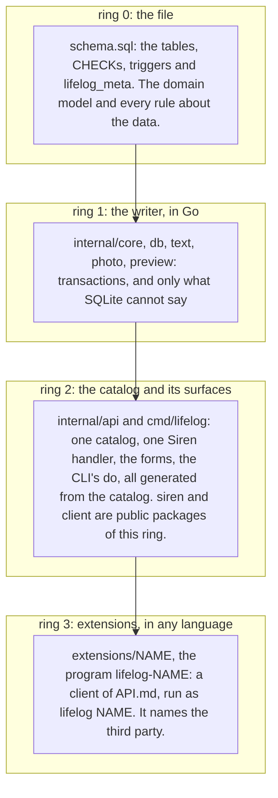
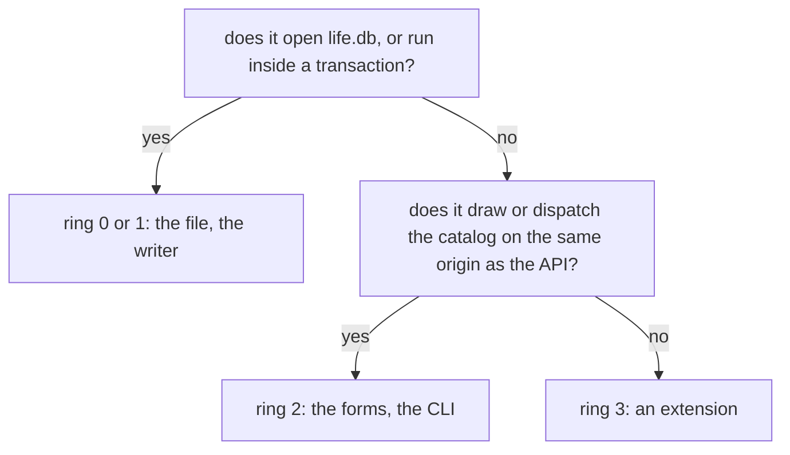

# AGENTS.md — rules for anyone (human or agent) working in this repo

## What this repo is

**The product is `lifelog`, the Go application** ([README](README.md)): one binary at the repo root that writes
`life.db`, a lifetime-scale, single-user SQLite database, and serves it as a hypermedia API, a CLI and a browser.
Everything that names a third party (an MCP server, a coding agent's setup, Google Photos) is an extension: a
separate program, a client of the API, found by name ([the four rings](#the-four-rings)).
**The database it writes is specified on its own** in [`docs/`](docs/README.md) — goals, the canonical DDL
([`docs/schema/schema.sql`](docs/schema/schema.sql)), the storage contract, the decision log (D1–D30), the query
cookbook, non-goals, research — so that `life.db` can be read, or written by another application, in any language.
The docs state the current truth only.

**What `life.db` is for: a life log and its backup.** It keeps
what happened and what was measured: a journal of day pages, notes, the people and places in them,
where the owner was, health readings, and the files the owner keeps — as their text and a small picture, the
original left outside ([D9](docs/decisions/D09-binary-files.md)). A plan is a line of a page ([D23](docs/decisions/D23-no-tasks.md), [D29](docs/decisions/D29-plan-lines.md)): there is no tasks table.
A span of life or a session is a plain page or a reading, not a table of its own ([D22](docs/decisions/D22-events.md)); money and a location track remain deferred
([D18](docs/decisions/D18-money.md), [D21](docs/decisions/D21-location-history.md)). A proposal that adds project
workflows, notification delivery or a finance ledger needs a real incident and the owner's word first.
Any developer, in any language, may
build an application around it; the contract they implement is `docs/` and nothing else.

A writer is built against the docs ([building a writer](docs/guides/building-a-writer.md)): it implements the schema and
never defines it. One writer per `life.db` file, many applications around the schema. `lifelog` is that writer for the
owner's file; it answers to `docs/` like any other writer would, and `docs/` never names it — the contract stays
language-neutral, so a rule lives in the docs and the Go code cites it.

| path | what it is | it answers to |
|---|---|---|
| `docs/schema/schema.sql` | the one canonical DDL | real use (below) |
| `docs/architecture/`, `docs/contract/`, `docs/decisions/`, `docs/cookbook/`, `docs/research/` | the contract around it: why, what the DDL cannot hold, the SQL in use, the evidence | real use |
| `docs/guides/` | for people building on the schema: [building a writer](docs/guides/building-a-writer.md) | the contract |
| `docs/issues/`, `docs/rfcs/`, `docs/plans/` | the process records: incidents, proposals, execution plans ([how a change happens](docs/process.md)) | — |
| `tests/` | the validation suites (Go tests): every *executed* claim of the docs, run against the DDL in `docs/` and through the writer's own extraction and save | the docs |
| `cmd/`, `internal/`, `tools/`, `go.mod` | the product: `lifelog` (Go) — hypermedia API, CLI, browser ([README](README.md)) | the docs |
| `extensions/` | the extensions: one module each, a client of [API.md](API.md), run as `lifelog NAME` ([the contract of an extension](extensions/README.md)) | `API.md` and the contract of an extension; never `lifelog/internal` |
| `site/` | the public page of the project (GitHub Pages) | the README: it names only what the README names, and changes in the same commit as a command or a feature it shows |

## Engineering priorities and working agreement

Build for a maintainer fifty years from now: understandable code, replaceable dependencies and explicit contracts,
not a promise that today's binary or toolchain lasts forever. Favor **consistent client behavior, ease of change and
fast feedback**. Safeguards should catch failures, not create ceremony.

- Read the relevant code, tests and contract before editing. Inspect the working tree; preserve unrelated and
  uncommitted changes. Keep the diff focused on the requested task, with necessary local refactoring only.
- Within that scope, proceed with implementation fixes and tests. Unless already authorized, explain the tradeoff
  and ask before adding a dependency, making a broad architectural or externally visible behavior change, or
  expanding scope. Contract changes follow the existing process below; routine implementation fixes need no new RFC.
- Prefer the smallest understandable solution. Do not add layers, frameworks, generic repositories, configuration
  knobs or speculative extension points for hypothetical needs. Do not reorganize working code just for uniformity.
- An extension is checked in its own folder: `go vet ./... && go test ./...` there. The root's `./...` does not
  build it. Its end-to-end test builds the real `lifelog` and runs the real line.
- Keep application engineering guidance here, and its rules for synthetic workloads and performance evidence in
  [tests/README.md](tests/README.md). Keep application decisions and the
  [engineering references](README.md#engineering-references) in [README.md](README.md). The database contract remains
  language-neutral in `docs/`, and each of its conventions has its home there; the
  [checklist of the conventions](#conventions-every-writer-and-every-ddl-change-preserves) here only links those
  homes. Explain non-obvious reasons and constraints, not what the syntax does.
- **Write in Simplified Technical English** (ASD-STE100), in every page, comment, commit message and conversation:
  short sentences with one idea each, the active voice, one approved word for one meaning, no synonyms for variety,
  no idioms. The reader fifty years from now may not have English as a first language.
- **Show a concept as a mermaid diagram, not as prose, whenever a diagram can carry it**: a flow of steps, the
  states of a record, the relationships between tables, the shape of a process. Prose then says only what the
  diagram cannot. Diagrams in `docs/` follow the conventions under [editing the docs](#editing-the-docs) and are
  checked by the `diagrams` suite; a diagram in a conversation or a plan needs no id line.
- Before finishing, inspect the diff and generated changes. Report what changed, exact checks run and their results,
  and anything blocked or untested. Include checks in a commit message when committing; never imply unrun checks passed.

## Setup and checks

Use the Go version required by [go.mod](go.mod). The ordinary build and baseline tests need no cgo, Python or
`sqlite3` CLI: the pinned `modernc.org/sqlite` supplies SQLite. See [tests/README.md](tests/README.md) for its engine
requirements and schema-evolution probes. Modules need network access once; baseline tests use synthetic local data,
not external services or private files.

| tier | when / budget | run |
|---|---|---|
| focused feedback | while editing; aim for seconds | `go test ./internal/<package> -run '<TestName>'`; `go test -short ./...` for a broader quick check |
| baseline | after **every** change, before completion; aim for about two minutes | `go vet ./... && go test ./...` |
| additional analysis | Go or dependency changes; also before releases | `staticcheck ./...` and `govulncheck ./...` |
| order dependence | changes to shared state, test helpers or concurrency | `go test -count=1 -shuffle=on ./...`; replay the reported seed with `-shuffle=<seed>` |
| races | extended checks on Linux; particularly concurrency changes | `CGO_ENABLED=1 go test -race -count=1 -timeout 40m ./...` (the suites of `tests/` pass the default 10 minutes under the detector) |
| diagrams | diagram changes | `LIFELOG_MERMAID=1 go test ./tests -run TestMermaidRender` |

- Run `gofmt` on changed Go files. `schema.go` at the root embeds `docs/schema/schema.sql`: there is no copy, and a change to the DDL is live in the binary at the next build.
  The baseline includes mutants: `-short` is feedback, not a substitute for completion checks. These budgets are
  design targets, not timeouts or permission to drop tests. Investigate slow suites instead of hiding coverage gaps.
- Staticcheck and govulncheck are separate development tools, not application dependencies. Use reviewed, pinned
  versions compatible with the toolchain; report versions. Do not silently install tools or introduce CI/tooling
  configuration. If unavailable, report the check as not run. Use govulncheck's default text mode for exit-status
  gating; successful JSON output is not a clean vulnerability result. Findings need resolution or explicit disposition,
  not blanket suppressions.
- The race check is a separate development environment: supported Linux target, cgo and a C compiler. It does not
  change the pure-Go release build. Diagrams need `mmdc` and Chromium, as [the suite guide](tests/README.md) describes.
- Support Windows and Linux while both are in use. Validate OS-sensitive paths, file operations and subprocesses on
  both before release; identify the OS actually tested. Do not claim cross-platform coverage from cross-compilation.
- Extended lifetime/stress, fuzz and benchmark runs may take 10–30 minutes and are explicit, not part of every edit.
  Run the relevant extended checks for changes to the behavior they exercise; reserve the whole set for scheduled or
  pre-release validation when available. Keep representative correctness cases in the baseline. Document a runner's
  invocation when implementing it; specifying a workload in
  [the suite guide](tests/README.md#synthetic-personas-and-scale) does not mean that runner exists or has passed.

## The owner's live database in this folder

- `life.db` and its `-wal`/`-shm` live in this folder, beside the built binary, and are gitignored. `./lifelog` with
  no `--db` and no `LIFELOG_DB` uses that file: the folder of the program, [README](README.md). It is the owner's
  real data. Never open it from a test, a query, a fixture, `sqlite3` or Datasette. Tests use `t.TempDir()` and
  synthetic data.
- **Never run `git clean -x` here.** It deletes gitignored files, and `life.db` is one of them. A nightly
  `lifelog snapshot` keeps checked copies outside the folder ([D25](docs/decisions/D25-snapshots.md)), so the worst
  loss is one night.
- A system service runs the installed `lifelog` against this file, and a local proxy exposes it on the owner's
  private network. The CLI in this folder and that service are the same writer on one file, which
  [connections](docs/contract/connections.md) allows; so is the temporary server that `lifelog NAME` opens for an
  extension. Do not start a second writer stack on it, and do not point a reader at it while the service writes.
- The service runs the installed binary, not `./lifelog`. A change is live only after `go build -o <install path>
  ./cmd/lifelog` and a service restart. Report the install path, the restart and the service's own log line when
  you ship a change.

## The one hard rule: no migrations until the schema freeze

**Do not create `db/migrations/`, `0001_init.sql`, or any migration runner** — not in `docs/`, `tests/` or the Go code. Until the
schema is frozen ([D13](docs/decisions/D13-migrations-and-freeze.md)):

- **`docs/schema/schema.sql` is the single canonical init DDL and is edited in place.** Schema changes = edit it
  (and the decisions, cookbook recipes and contract pages it touches) directly.
- Test databases are throwaway: apply `schema.sql` to a fresh file (e.g. `/tmp/…/life.db`), test, discard.
  Never migrate a test DB — recreate it.
- Numbered forward-only migrations (`0002_*.sql`, …) begin **only after** the freeze ([D13](docs/decisions/D13-migrations-and-freeze.md) says what that is),
  and from then on changes are additive-only ([D13](docs/decisions/D13-migrations-and-freeze.md) defines it; principle 4 of the
  [goals](docs/architecture/goals-and-principles.md)). Each migration also edits `schema.sql`, which stays the full
  current DDL; there is never a `0001_init.sql` ([D13](docs/decisions/D13-migrations-and-freeze.md) says how the two are kept equal).
  Anything still in the schema at the freeze stays for good, so cutting happens before it.

## What earns a change (principles 1, 6 and 7 of the [goals](docs/architecture/goals-and-principles.md))

- **Real use drives change.** A new table, column, constraint, trigger or convention needs a real
  incident behind it — a failed import, a bug in the writing application, a question the data could
  not answer — or it must replace something it makes redundant. A hypothetical writer is not an
  incident, and neither is a wish of an application. The next step is the capture path and one real import
  ([imports](docs/contract/imports.md)), not another review.
- **The path of a change** is [docs/process.md](docs/process.md): an [issue](docs/issues/README.md) records the incident,
  a [proposal](docs/rfcs/README.md) argues the change, a [decision](docs/decisions/README.md) records it, then `schema.sql`,
  the pages and the suites change together.
- **One home per concept.** A fact that can be derived from another column is not stored beside it
  (a day page's day is its title; a place's name is its page title).

## Go implementation

### The four rings

A thing lives in the innermost ring that can hold it ([plan 135](docs/plans/135-extensions-outside-the-core.md)).

Two tests of `cmd/lifelog` (`boundary_test.go`) keep the rings, and a change preserves them: **the core names no
third party** (no Go source of `internal/` or `cmd/` holds a product's or a company's name: the list is in the test,
and a new one is added in the change that moves the thing out), and **the core dials only its own server** (outside
`client`, no Go source of `internal/`, `cmd/` or `siren/` makes an HTTP client or dials a socket). Go enforces the
third: an extension never imports `lifelog/internal`. The browser stays in ring 2 by the owner's word (2026-10-19):
it draws the entity on the origin of the API, with the forms that post to it.

- **Ordinary Go first.** Follow [Go Code Review Comments](https://go.dev/wiki/CodeReviewComments): clear names,
  early error returns, cohesive packages, explicit dependencies and small public surfaces. Keep supporting packages
  under `internal/`, except `siren` and `client`, the two packages the Go extensions import. Prefer the standard library; justify a dependency by the complexity or risk it removes.
- **A rule about the data is a CHECK or a trigger, never Go.** When a write must be refused because of what the row
  says (a range, a shape, a state, a relation to another row), the refusal is written in `schema.sql`, with its
  decision, its mutant and its suite witness; the Go cites the constraint name and lets the file refuse. Go holds
  only what SQLite cannot see or say: a status other than 422 (a missing row is 404, a tombstone or a stale
  version 409), a read's bounds, the title predicate and the algorithms the contract assigns to the writer
  (wikilinks, calendars, zones), the owner-only rule, and a comparison of a resent payload. A Go check that
  repeats a CHECK or a trigger is a defect (issue 0068): delete it, and let `core.refused` carry the sentence
  SQLite gives. The same holds when a rule changes: edit the trigger, not the code around it. The shape of a request (the names it uses, a value outside the options the catalog lists) is the API's rule, not the data's: `fieldsOf` holds it once, for every surface.
- **Read what the schema stores.** A value the DDL holds or generates (`is_journal`, a day, a count) is read from the
  row, never derived again in Go or in a second SQL expression; a Go predicate or a join that recomputes a stored
  column is a defect ([plan 133](docs/plans/133-what-the-code-holds-twice.md)). One home per concept holds in the
  code as in the docs: a value computed and not read, a helper with one caller that only passes through, and an
  exported name used only inside its package are deleted or folded in the change that finds them.
- **The catalog is the one list of an action's fields.** A handler reads its input through the action's row
  (`fieldsOf(r, act)`) and reads no field the row does not list; `Required` of the row is the handler's rule. A field
  read outside the catalog is unreachable from the CLI and the MCP tools, which refuse what the catalog does not
  name, so it is a parity defect, not a convenience.
- **Refused, never ignored.** What a surface does not take is refused with its reason: a flag or an argument a command does not
  read, a field an action does not list, which the API refuses (422) for every surface, a body type an action does not take (a multipart body to an action with
  no file field is 415), two flags that name one thing twice. Nothing is dropped in silence.
- **Concrete types by default.** Put a small interface at the consumer that actually needs substitution; do not mirror
  every struct with an interface or add a service/repository layer solely for mocks. Use generics only when they make
  actual repeated logic simpler. Share domain behavior, not incidental similarities between unrelated operations.
- **Preserve the existing application boundaries** ([README decisions](README.md#decisions)). Keep the CLI, the
  browser and the MCP extension thin, using the shared API/action catalog rather than duplicating validation or
  business rules. Reuse the existing core operations; a new surface must not become a second implementation of a
  write.
- **Every capability on every surface.** The owner's rule (2026-10-08): whatever `lifelog` can do is reachable through
  the API, the CLI, the MCP server (the extension `lifelog-mcp`) and the browser alike. The way to get there is the one
  catalog: a capability is a resource or an action of `GET /actions`, and so the CLI's `do`, the MCP tools and the
  browser's forms carry it without further work; a shortcut on one surface (`lifelog capture`, a dedicated HTML view) wraps an action, never
  replaces or extends it. A feature that exists on one surface only is a defect, not a convenience. The only
  differences allowed are the ones the README names and tests assert: owner-only actions (the ones the
  catalog marks `owner`, shown by `lifelog actions`) are refused to an `agent:*` or `import:*` writer
  and are never MCP tools. The README's table [every action on every surface](README.md#every-action-on-every-surface)
  names each action's route, CLI line, MCP tool and form; a new action adds its row in the same change, and
  `TestTheTableOfTheSurfacesIsTheCatalog` fails until it does.
- **One way to do a thing.** The owner's rule (2026-10-18, [plan 131](docs/plans/131-the-pareto-pass.md)): each thing
  has one action, one route, one MCP tool and one form, drawn where its resource is (a page's actions on the page, a
  day's on the day, a list's on the list). A link may lead to that form; nothing draws it a second time. Do not add an
  action, a field, a flag, a route, a tool or an alias that does what another already does: extend the one that
  exists, or replace it and delete the old one in the same change. A browser view that only repeats another view's
  data (a second calendar, a second list of the same rows) needs the owner's word first.
- **Contexts and ownership.** Pass the operation's `context.Context` explicitly, first, through blocking calls and SQL.
  Do not replace a request context with `Background` to evade cancellation, or use context values as dependency bags.
  Prefer synchronous APIs. Every goroutine needs an owner, bounded work, a shutdown path and a way to await completion;
  detached recovery work needs an explicitly justified lifetime.
- **Errors are part of the behavior.** Check errors, including setup, scans, `rows.Err()`, commits and output flush/close
  failures where data could be lost. Add useful operation context; use `%w` when exposing the cause is intentional and
  `errors.Is`/`errors.As` for semantics. Do not classify errors by incidental strings. Return expected failures, not
  panics; keep process exits at the executable boundary. Avoid duplicate logging and private bodies, readings or file
  contents in diagnostics; do not expose internal errors indiscriminately to clients. A check or a repair reports a
  finding only about what it examined: a run that did not finish (a deadline, a cancelled context, a busy file) is
  an error, never a finding or a result. An error status has its code in `siren`, its line in [API.md](API.md) and
  its first words in the view (`alertOf`); a new status adds the three together, and `codeOf` never answers
  `internal` for a status it knows. `siren.Codes()` is the one list of the codes, and
  `TestEveryErrorCodeIsInTheContractAndTheStatusTable` holds that list, API.md and `codeOf` equal, and `TestAnErrorCodePicksItsWords` holds `alertOf`.
- **Resources and transactions.** Close rows, files and response bodies and call cancellation functions with clear
  ownership. Use existing transaction helpers; do not mix pool calls with an active transaction's operations or perform
  avoidable network/file processing while holding a write transaction. Do not bypass connection setup for convenience
  ([connection contract](docs/contract/connections.md)).
- **Treat boundaries as untrusted.** Parameterize SQL values; allowlist dynamic identifiers. Bound request metadata,
  decoding and concurrency; stream large payloads. Preserve the existing request, path and authority protections
  ([application decisions](README.md#decisions)); lexical path cleaning alone is not filesystem containment. Test
  malformed input and boundary refusals, not only well-formed examples.
- **Portable and reproducible.** Use `filepath` for filesystem paths, not URL paths; avoid shell-dependent application
  behavior. Respect platform differences in case, separators, symlinks and file replacement. Keep dependency and
  toolchain updates deliberate, reviewed and tested; do not freeze vulnerable versions for the sake of longevity.

## Engineering rule books

The repo keeps five rule books as skills in `.agents/skills/`; Claude Code reads them through the links in
`.claude/skills/`. They are general advice. **This file and `docs/` win over a skill.** When a skill and this file
disagree, follow this file and name the conflict in the report.

Before you edit, load the skills of the task type. When you review a diff, load the skills of its type. Read the
`mini` file of each skill; read the full file only when the mini file does not settle the question.

| task | primary | companion |
|---|---|---|
| new code: a package, an API, an action | `a-philosophy-of-software-design` | `code-complete` |
| a change to existing code, a refactor, a bug fix | `refactoring` | `a-philosophy-of-software-design` |
| failure handling, the service, timeouts, snapshots, imports | `release-it` | `designing-data-intensive-applications` |
| a change to `schema.sql` or the contract, on the path of [the process](docs/process.md) | `designing-data-intensive-applications` | — |

Any other change to `docs/`, or a plan, loads no skill. Each row pairs books that the upstream
[compatibility matrix](https://ciembor.github.io/agent-rules-books/compatibility/index.html) rates as complementary.
The skills are frozen: do not update them from the upstream repo, and do not add or remove a skill without the
owner's word. `skills-lock.json` records the source and the hash of each.

End the report with one line: `Skills: <names>. Conflict: <none, or the skill rule and the rule of this file that
won>.`

## Tests that earn confidence

- **Test-first where it matters.** For a bug, write a reproducer and observe the intended failure before the fix.
  For risky writes, define invariants and failure cases before implementation. Elsewhere, test order is flexible, but
  changed behavior needs tests before completion. If a pre-fix reproduction is impractical, explain why and what the
  regression test proves. A setup failure is not a valid reproduction.
- **Put tests with their subject.** Application tests live beside their packages as `*_test.go`; `tests/` validates
  the database contract ([suite guide](tests/README.md)). Use existing helpers and the contract's own vectors. Name tests
  by behavior; use table-driven subtests when cases share a structure, not as a requirement for every test.
- **Test behavior, not scaffolding.** Assert results, persisted state and meaningful errors, including forbidden side
  effects on failure. Prefer semantic assertions to whole-output snapshots, private call sequences or exact error
  prose unless that representation is the contract. Check setup errors; use `t.Helper`, `t.Cleanup` and useful
  got/want diagnostics. Fail the test from its test goroutine, not a background worker.
- **Real SQLite for storage.** Use fresh files under `t.TempDir()`, the canonical/embedded DDL as appropriate and
  production connection settings. Build application scenarios through the production writer. Direct SQL is appropriate
  for isolated DDL probes, deliberate damage and clearly labeled bulk setup whose equivalence is checked; it must not
  silently bypass the behavior under test. SQL mocks or `:memory:` alone cannot establish file-backed storage behavior.
  Use narrow fakes for external boundaries or deliberate fault injection, not as a replacement for integration tests.
- **Independent answers.** Use hand-checked expected values or a simpler reference model. Do not compute the expected
  result using the production query, normalizer or algorithm being tested. Supplement row counts with relevant field,
  relationship and ordering assertions. Integrity checks supplement these assertions; they do not replace them.
- **Deterministic by construction.** Use fixed dates, local seeded RNGs and isolated temporary state; report seeds and
  failing operations. Synchronize concurrent tests with signals, not sleeps. Use `testing/synctest` for self-contained
  timing/concurrency logic, not as fake time for real database or filesystem I/O. Timeouts guard deadlocks, not speed.
  Parallelize only isolated tests; avoid shared databases, mutable globals, environment or working-directory changes.
- **Exercise failure paths according to risk.** For affected operations test validation boundaries, rollback after partial
  work, cancellation, stale versions, repeated imports/retries, correction chains and reopen/recovery. Use subprocess
  tests for process exits or interruption claims. Do not describe process-interruption tests as power-loss proof.
- **Client parity is a first-class contract.** Run shared behavioral scenarios through applicable CLI, HTTP/HTML and
  MCP entry points, including in-process and remote dispatch where relevant (the MCP surface is held by the
  end-to-end test of `extensions/mcp`, which runs the real `lifelog mcp`). Verify the same domain outcomes, validation
  and persisted state, allowing only intentional presentation, provenance and permission differences. Assert those
  differences too: owner-only actions must remain unavailable to agents. Include a small set of real transport/process
  smoke tests; direct handler calls alone do not prove adapter wiring. Keep most exhaustive cases at their owning layer
  rather than multiplying every test across every surface.
- **Fuzz and property-test meaningful invariants.** Target text/Unicode parsing, metadata decoders, path handling,
  import normalization and operation sequences. Keep seeds synthetic, cases independent and runs bounded; preserve
  minimized failing inputs as regressions. Ordinary `go test` runs seed cases, not a fuzz campaign. Example of an
  existing target: `go test ./internal/photo -run '^$' -fuzz '^FuzzRead$' -fuzztime=60s`.
- **Coverage is a map, not a score.** Use coverage to find untested behavior, particularly failure paths; no global
  percentage, test-count or one-test-per-function quota. Never weaken assertions, skip a failure, bless changed snapshots
  or add retries just to get green. An incorrect test can change with evidence of the intended contract. Treat flakes
  as defects. Contract-rule mutants remain governed by the documentation rules below.
- **Synthetic workloads and performance evidence.** A generator, a scale run, a benchmark or an optimization follows
  the [synthetic personas and scale](tests/README.md#synthetic-personas-and-scale) and the
  [performance evidence](tests/README.md#performance-evidence-not-speculative-optimization) of the suite guide.

## Editing the docs

- **One home per rule.** A table's rule is its constraint/trigger and a comment inside its `CREATE`
  statement in `schema.sql` (comments outside are not stored in the file); a rule that spans tables is a
  `lifelog_meta` row (keep them few); `docs/contract/` holds only what the DDL cannot (the wikilink grammar and
  vectors, connection settings, integrity checks, imports); `docs/decisions/` says *why* and cites constraint names
  instead of restating the rule; `docs/cookbook/` shows it in use. Do not restate a rule in a second place — that
  includes this file, an application's docs and code comments: link the page instead.
- **One page per concept, linked.** Pages link each other with relative markdown links
  (`[imports](../contract/imports.md)`); there are no section numbers. Every link must resolve and every page must be
  reachable from `docs/README.md` (the `document` suite checks both). A new decision is a new file in
  `docs/decisions/` from its template, listed in the decision index.
- **Language-neutral.** The contract must be implementable without reading any application's code. Anything a writer
  must compute identically in every language (the title predicate, `title_key`, wikilink and `#tag`
  extraction) is specified in [titles and wikilinks](docs/contract/titles-and-wikilinks.md) with its vectors
  (the suites read them from that page: it is their only copy). [Plan lines](docs/contract/plan-lines.md) is the second page of computed rules with vectors (the grammar of a line, the next date of a repeat); an implementation may be an example, never the only statement of a rule.
- **Self-consistency.** Every change to `schema.sql` keeps the contract pages, the entity model, the decisions,
  the cookbook and the totals line in `docs/schema/README.md` in step. The mermaid diagrams are checked by
  the `diagrams` suite: the ER diagrams draw tables, key columns and foreign keys only, and the link map must
  equal `link_kinds`. Each diagram starts with a `%% diagram: <id>` line; keep to `erDiagram`, `flowchart`
  and `stateDiagram-v2` with quoted labels. A new concept gets a diagram before it gets a paragraph (the working
  agreement above says why); a new diagram in `docs/` is counted in `tests/README.md`.
- **Suites change with the docs, never to make them pass.** The suites are grouped by subject
  (`tests/README.md`). If a suite must change because the docs legitimately changed, change it in
  the same edit and say so in the commit message — a suite loosened to pass proves nothing, and
  `tests/` is validation, not a migration runner. A new cross-table rule needs a `lifelog_meta` key and
  a row in the 2075 table of the [threat model](docs/contract/threat-model.md); a new rule of any kind gets a mutant in
  `tests/mutants_test.go`. Keep the counts in `tests/README.md` (diagrams, mutants) true.
- **Current truth and nothing else** in every folder of `docs/` except `issues/`, `rfcs/` and `plans/`, which are
  dated records: no review rounds, validation records, addenda, "superseded" notes, finding ids, version narrative
  or changelog. When a decision changes, rewrite it in place —
  git is the log. Keep D-numbers stable (they are cited across the docs and inside `schema.sql`); new decisions get
  new numbers. Tests are named by subject, never by review round.
- **Out of scope for now ([non-goals](docs/architecture/non-goals.md)):** the markdown export, CSV dumps, off-box
  copies and continuous replication. The docs are about the schema and its reliability; do not reintroduce
  any of them into `docs/` or `tests/` unless the owner reopens it. Snapshots are in: a dated `VACUUM INTO` copy
  and its restore check ([D25](docs/decisions/D25-snapshots.md)).
- **Plans** live in `docs/plans/`.

## Conventions every writer and every DDL change preserves

Their homes are in `docs/`; this list is the checklist, not the rule. Each item names only the homes of its rules: a
table and a `lifelog_meta` key are in [schema.sql](docs/schema/schema.sql).

- **Time**: `lifelog_meta.instants` and `.days`, [D10](docs/decisions/D10-time-model.md).
- **Identity and provenance**: the tables `entities` and `entity_names`, the typed extensions and
  `lifelog_meta.source`; [a person or a place](docs/cookbook/person-or-place.md); [imports](docs/contract/imports.md).
  Review owned names, direct typed foreign keys, stable identity and provenance together.
- **No deletes**: `lifelog_meta.deletes`, [D11](docs/decisions/D11-tombstones.md).
- **Append-only facts**: [D7](docs/decisions/D07-measurements.md),
  [correct a measurement](docs/cookbook/correct-a-measurement.md).
- **Imports**: [imports](docs/contract/imports.md), `lifelog_meta.writers`.
- **CHECKs**: [the schema page](docs/schema/README.md), [D13](docs/decisions/D13-migrations-and-freeze.md),
  `lifelog_meta.sqlite`.
- **Links**: the table `link_kinds`, `lifelog_meta.typed_links`, [D8](docs/decisions/D08-entities-and-links.md).
- **Names and journal identity**: [titles and wikilinks](docs/contract/titles-and-wikilinks.md),
  [D5](docs/decisions/D05-pages-and-day-pages.md). Check preferred-name changes, retained aliases and journal
  reservations against those rules. Spans and sessions follow [D22](docs/decisions/D22-events.md);
  habits follow [D24](docs/decisions/D24-habits.md).
- **Connections**: [connection setup](docs/contract/connections.md), `lifelog_meta.writers` and `.sqlite`.
- **The wikilink save contract**: [titles and wikilinks](docs/contract/titles-and-wikilinks.md),
  [save a body](docs/cookbook/save-a-body.md), [D19](docs/decisions/D19-wikilink-save-contract.md).
- **Integrity**: [integrity checks](docs/contract/integrity-checks.md).
- **Privacy**: `life.db` with its `-wal`/`-shm`, and every snapshot of it, never in git (health data, private notes and pictures cannot be scrubbed from history; `.gitignore` covers `*.db`, `*.db-journal`
  and `/import/`). Never commit a real vault, real notes or real data as a fixture:
  tests use synthetic data only.

## Empiricism over intuition

SQLite has sharp edges that only running the SQL reveals (CHECK NULL semantics, missing `strftime`
formats, `'weekday N'` modifier direction). Any claim in the docs about what SQLite *does* must be
executed by a suite in `tests/`, not assumed. If you add such a claim, write the probe first, then state
the claim and mark it *executed* (the word means that a suite runs it). A suite must not depend on
accidents of one SQLite build (page layout, compile options): it finds what it needs, or says plainly
what it requires.
