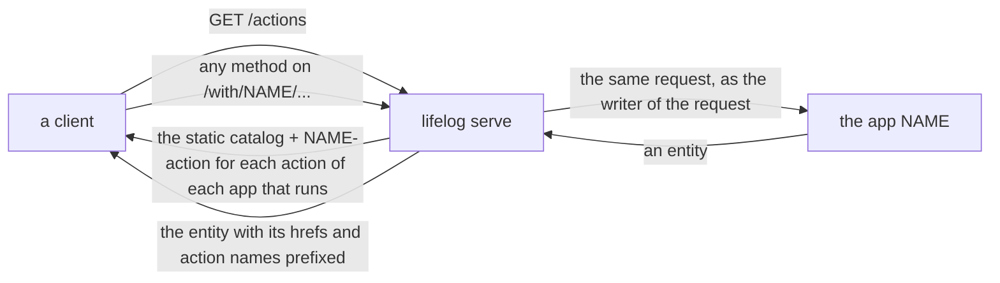

# The lifelog API, for client authors

This page is what a client (a phone app, a browser app, a script) needs to speak to `lifelog serve`: the entity every
answer is, every class of entity and the properties it carries, the errors, the pages, and how to reach a server. The
database behind it is specified on its own in [docs/](docs/README.md); this page is only the application's wire shape.
The test `TestAPIReferenceMatchesTheCode` in `internal/api` reads the property tables below and fails when the code
and this page disagree, so a property here is a property on the wire.

## Reaching a server

- **Local:** `lifelog serve` listens on `http://127.0.0.1:7777` for this machine only ([README](README.md#decisions)).
- **Other devices:** `lifelog serve --public --token-file PATH` listens on every interface; every request carries
  `Authorization: Bearer <token>`, or a browser logs in once at `/login`. `--allow-origin` names the browser origins
  allowed to call it; `--tls-cert`/`--tls-key` serve HTTPS. Without one of them the answer is 401 `token_required`.
- **Provenance:** `Lifelog-Source: <name>` names the writer on every row the request writes (`[a-z0-9_:.-]{1,64}`,
  e.g. `app:phone`). Without it a browser form writes as `ui` and anything else as `api`. A writer named `agent:…`
  or `import:…` is refused the owner-only actions (`owner: true` in the catalog)
  and the owner-only reads `GET /settings` and `GET /snapshots/{name}` (403 `forbidden`).
- **Representation:** `Accept: application/vnd.siren+json` (or anything but `text/html`) gets the JSON below;
  `Accept: text/html` gets the same entity drawn as a page. A JSON client sends an action as
  `application/x-www-form-urlencoded`, `application/json` (one object; a non-string value is sent as its JSON text) or,
  for `add-file` and `set-cover`, `multipart/form-data`.
- **Writes answer with the resource they changed** (200, with `Location`), and `result` says what the write did. A
  browser form is answered 303 to that resource instead, or to the page its field `back` names when that is a path
  on this server. The path may end in an id (`#row-4-2`) that names where the page opens.
- **Preview:** `POST /render` with the field `body` (or `text`) answers a page that shows the body as its page shows
  it once saved; it writes nothing, answers `text/html` only and is not a catalog action: it is the browser's Preview,
  a second button of a form that writes a body, which opens it in a new tab.

## The entity

Every answer is one [Siren](https://github.com/kevinswiber/siren) entity:

| field | what |
|---|---|
| `class` | the kind of resource: one of the classes below, sometimes with a second word (`day-page`, `deleted`, `dry-run`) |
| `title` | a human title |
| `properties` | the resource's own data, per class below |
| `entities` | embedded links: `{rel, href, title, class}` each, the things this resource lists or links to. An embedded link of a connected app may also carry `properties` and `actions` (an extension of Siren): a short form of an embedded representation that keeps its `href`. The browser draws it as a [row](extensions/README.md#how-the-browser-draws-a-page-of-an-app). |
| `links` | `{rel, href, title}`: `self`, `index` (home), `prev`/`next` (a neighbour or the next page), and the rels named per class |
| `actions` | what may be done here: `{name, class, title, description, method, href, type, fields, owner, danger}`, each field `{name, type, title, value, required, options, in, rows, pages, accept, placeholder}` with its current value filled in; `class` is at most one word that says what the action does ([action classes](#action-classes)); `owner: true` marks the owner's alone and `danger: true` marks one that hides or retracts what is there, so a client can warn before it sends; `in: "path"` marks a field of a templated href (`GET /actions` only) and `rows` is how many lines a `textarea` is drawn; `pages: true` says the value is a page's title, so a client can offer the names of the pages; `accept` is what a `file` field takes (`audio/*`); `placeholder` is an example of a value (`Weight, Mood, Walk`), which a client may show in an empty field and may ignore |
| `result` | after a write: what it did (the result shapes below) |

`GET /actions` is the catalog: every action with a templated `href` (`/pages/{id}/body`). A client fills the path
fields and sends the rest as the form. An action is offered on a resource only where it is legal there, so a client
that follows `actions` needs no rules of its own. A `required` field that is missing or empty is refused (422
`invalid`, the message `missing field <name>`), and nothing is written. `search` is the one exception: with no `q`,
or a `q` of blanks only, it answers with no hits ([search](#search)). A field of the type `date` takes a local day,
`YYYY-MM-DD`, or the word `today`: the server's local day, the day that `GET /days/today` redirects to. Any other
value that is not empty is refused (422 `invalid`). A field of the type `password` is a text that the catalog never
fills in: `GET /actions` leaves its value empty, and only the owner's own resource (`GET /settings`) fills it. A browser
draws it as a password input.

One read answers `303` to a thing picked at random ([plan 130](docs/plans/130-the-explore-pass.md)): `random-page`
(`GET /pages/random?kind=`), to a live thing of a Browse kind (`page` by default, or `all`), never a day page and never
a ghost page; with `kind=day`, to the day of a live day page up to today. It is a 404 when there is nothing to pick;
another kind is 422.

**Types** in the tables: `string`, `integer`, `number`, `boolean`, `day` (a local day, `YYYY-MM-DD`), `instant`
(UTC, `2026-06-09T21:14:03.482Z`), `list`, `object`. A property marked *absent when empty* is left out of the JSON
when it has no value. A `number` field is written in decimal digits; `mood`, `value` and `line` also take a sign, a point and an exponent (`-0.5`, `1e3`). `NaN`, `Inf`, a hexadecimal number and an underscore are refused.
A request names only the fields of the action, and a browser's own `back`, `feedback` and `new`; any other name is 422 `invalid`. A browser form may also carry the fields of a form it shares with another action (the pick bar of a list sends the form of `file-pages` to `tombstone-pages` too); another client is refused them. A value outside a field's `options`, as `GET /actions` lists them, is 422 `invalid`. A multipart part with an unknown name is refused before its bytes are read.

## Action classes

The `class` of an action is the standard Siren member. It says **what the action does** to the resource it is on. It
never says how to draw the action. The list is `siren.ActionClasses()`, and a test holds it equal to this table. An
action has at most one class. An action with no class is any other action.

| class | what the action does |
|---|---|
| `create` | It makes a new thing. The answer is that thing or its list. |
| `edit` | It changes the own properties of the resource it is on. |
| `toggle` | It flips one state of the resource it is on. It has no field, or one field with two options. |

A client may ignore a class: an action with a class works as an action with none. The placement of an action is the
choice of each client. The browser draws it by its class ([the browser and a page of an app](extensions/README.md#how-the-browser-draws-a-page-of-an-app)).
A class that is not in the list is dropped from the action of a [connected app](#connected-apps).

## Errors

An error is an entity of class `error` with `properties`:

| property | type | meaning |
|---|---|---|
| `status` | integer | the HTTP status |
| `code` | string | what went wrong, to branch on: `stale_version` (a save with an old `version`), `exists` (a title in use; the link `existing` names the page. When `create-person` meets a live plain page, the link `promote` is the address of that page with the promote form open and the fields filled), `cross_origin` (a browser write from another origin), `token_required` (a public listener without a credential), `snapshot_refused` (the snapshot folder refused it), `restore_check_failed` (the snapshot is written but fails its restore check), `busy` (503 with `Retry-After`: another writer holds the file; nothing was written, so a retry is safe), `unavailable` (503 with `Retry-After`: an app connected by `serve --with` is not running), `upstream` (502: the app answered something that is not an entity), or the status's general name: `bad_request`, `unauthorized`, `forbidden`, `not_found` (for a metric that does not exist, the link `register` is the address of the Metrics board with the form of `register-metric` open and the name filled), `conflict`, `too_large`, `unsupported_media` (415: a multipart body to an action that takes no file), `invalid` (422), `timeout`, `internal` |
| `message` | string | the text, for a person; a fault of the server (500 `internal`) says only `internal error`, and the server's log has the cause |

## Connected apps

`lifelog serve --with NAME` may run an app that serves a catalog of its own ([the contract of an
extension](extensions/README.md#a-catalog-of-its-own)). The server merges that catalog into its own. A client needs no
code for an app: it follows `GET /actions`.

- **The merged `GET /actions`.** The static catalog is the table in the [README](README.md#every-action-on-every-surface).
  An action of an app is dynamic: it is there while the app runs. Its `name` is `NAME-action`, and its `href` starts
  with `/with/NAME`. It has the `owner`, `danger` and `fields` that the app gave. An app that does not run has no
  action in the list.
- **The routes** are `/with/NAME` and `/with/NAME/...`, for every method. A request that matches an action of the app
  is checked as every action is: a field that the action does not name, a missing required field or a value outside
  `options` is 422 `invalid`, and an `owner` action is 403 `forbidden` for an `agent:*` or `import:*` writer. In both
  cases the app is not called. A `GET` that matches no action goes to the app as it is, without `back`, `feedback` and
  `new`. Any other method that matches no action is 404.
- **The writer** of the app's request is the writer of yours (`Lifelog-Source`). The app gets no cookie and no token.
- **The answer** is the entity of the app, with `/with/NAME` before each `href` and `NAME-` before each action name.
  The actions of an embedded link get the same prefixes.
  A link or an action whose `href` has a scheme or a host is dropped. A `POST` from a browser is answered 303 to the
  `self` link of the answer.

| status | `code` | when |
|---|---|---|
| 404 | `not_found` | no app has this name |
| 503 | `unavailable` | the app does not run; `Retry-After` says when to ask again |
| 502 | `upstream` | the app answered something that is not an entity |
| 504 | `timeout` | the app did not answer in 30 seconds |
| the app's own | the app's own | the app answered with an error entity: it passes with its status and code |

The server sends a request to the app once. There is no retry on any method.

**Limits.** A running `serve` has the apps. The in-process CLI and the temporary server of `lifelog NAME` have none, so
`lifelog do NAME-action` needs `--url`, and an agent reaches the apps with `lifelog mcp --url`. The MCP tool of
`NAME-action` is `NAME_action`, and an `owner` action is no tool. An action with a field of the type `file` is refused
when the catalog of the app is read; a multipart body is not forwarded.

## Tasks

While a **task service** runs ([the contract of an extension](extensions/README.md#a-task-service)), `lifelog` draws
its tasks under `/tasks` and offers six actions. The service is not an app: it has no `/with/NAME` and no action with a
prefix. The file keeps no task ([D23](docs/decisions/D23-no-tasks.md)); the pages are made at each request.

| route | the page |
|---|---|
| `GET /tasks` | Today: the open tasks due today or before, across the lists, sorted by due day. Today is the day of the clock of the server, in the zone of the owner. |
| `GET /tasks/week` | Next 7 days: the open tasks due from today to today + 6. |
| `GET /tasks/lists/{id}` | The open tasks of one list. An unknown list is 404 `not_found`. |
| `GET /tasks/done`, `GET /tasks/lists/{id}/done` | The tasks done in the last 30 days, newest first. |
| `GET /tasks/items/{id}` | One task, with the forms `edit-task` and `delete-task`. An unknown task is 404 `not_found`. |

A task with no due day is last, and tasks with the same day keep the order of the service. A row is an embedded link
with the chips `due`, `list` (on a page that mixes lists) and `done`, and the round button `complete-task` (`reopen-task`
on a done row). The pages follow the [rules of the generic view](extensions/README.md#how-the-browser-draws-a-page-of-an-app).

| action | route | fields | |
|---|---|---|---|
| `add-task` | `POST /tasks` | `title` (required), `list` (a name; `options` are the names of the lists), `due` (a day), `notes` | |
| `edit-task` | `POST /tasks/items/{id}` | `id`, `title`, `notes`, `due` | A field that is not sent stays as it is. An empty `due` or `notes` clears it. |
| `complete-task` | `POST /tasks/items/{id}/complete` | `id` | |
| `reopen-task` | `POST /tasks/items/{id}/reopen` | `id` | |
| `delete-task` | `POST /tasks/items/{id}/delete` | `id` | `owner`, `danger` |
| `sync-tasks` | `POST /tasks/sync` | none | |

The actions are in `GET /actions` while a task service runs, so the table of the [README](README.md#every-action-on-every-surface)
(the core alone) does not list them. They are checked as every action is: a field that the action does not name, a
missing `title`, a `list` that is not a name, a `due` that is not a day (`YYYY-MM-DD`) or a blank `title` is 422
`invalid`, and `delete-task` is 403 `forbidden` for an `agent:*` or `import:*` writer. In these cases the service is not
called. The service is called as the writer of the request, once, with a limit of 30 seconds. An error of the service
passes with its status and code.

| status | `code` | when |
|---|---|---|
| 503 | `unavailable` | no task service runs ("no task service runs"), or it is not reachable; `Retry-After` says when to ask again |
| 502 | `upstream` | the service answered something that is not an entity of the protocol |
| 504 | `timeout` | the service did not answer in 30 seconds |
| the service's own | the service's own | the service answered with an error entity: it passes with its status and code |

## Pages of a list

`/days`, `/browse` and `/search` take `limit` (1–500; defaults 30 for days, 50 for search, 200 for browse) and
`offset` (0 or more), carry both in their properties, and link `next` when a further row exists and `prev` past the
first page. Orders: days newest first; search by rank, or newest first with `order=newest` ([search](#search)); browse by the kind of its rows ([browse](#browse)).

## Classes

### root

`GET /`: the entry point of the API. A browser's `GET /` (it asks for HTML, and not Siren) is answered with the
[day](#day) of today instead, the page of today. Links: `today`, `days`, `browse` (`/browse`), `people`
(`/browse?kind=person`), `media` (`/browse?kind=media`), `files`
(`/browse?kind=document`), `metrics`, `ghosts` (`/browse?ghosts=1&kind=page`), `actions`, `calendar` (this month),
`year` (this year). Actions: `capture` (for today), `search`,
`find`, `open-day`,
`create-page`, `create-person`, `add-file`,
`record`, `register-metric` (owner), `snapshot` (owner).

| property | type | meaning |
|---|---|---|
| `today` | day | this machine's local day |
| `recent[]` | list | the 5 newest live day pages up to today, the newest first |
| `recent[].day` | day | the day |
| `recent[].page_id` | integer | the day page's id |
| `recent[].first_line` | string | the first line of its body that has text, as plain text: a heading's or a list item's marker, the marks of emphasis, code and links, and the brackets of a wikilink cut (a link shows its label), an embed or an image left out (a picture is not words, so a line of pictures alone is passed over), 160 characters at most; absent when the body has no such line |
| `recent[].mood` | list | the values of the day's current Mood readings, in the order they were recorded; absent when none |
| `recent[].picture` | string | the address of the picture of the day page's cover (as `cover` of [a page](#page-person-file)); absent when it has none |

### actions

`GET /actions`: no properties; `actions` is the whole catalog with templated hrefs. With `new=<action>` and a value
for each path field of that action (`/actions?new=rename&id=12`), that one action has its `href` filled in, as a
resource offers it; a browser, which cannot fill a path from a form, opens an action so.

Two actions have a section of their own, as the resource where they are drawn: `say` ([conversation](#conversation))
and the owner's `settings` ([settings](#settings)).

### days

`GET /days`: the stream ([plan 130](docs/plans/130-the-explore-pass.md)), the way the Calendar opens: one page of the
days of the record as cards, the newest first, each an embedded `item` link to its day. A day is in the stream when it
holds something: a live entity with that day (its day page, a page, a file) or a current reading. A day after today is
never in it. The query takes `limit` and `offset`, as every list; 30 and 0 by default.

Links: `prev` (Newer days; absent on the top page), `next` (Older days; absent on the oldest page), the zoom: `days`
(`/days`), `week`, `month` and `year` (the period of the top card's day, or of today when the page has no card; a period that
has no page is absent), `index`. Actions: `open-day`, `random-page` with `kind` day.

| property | type | meaning |
|---|---|---|
| `today` | day | this machine's local day |
| `limit` | integer | the page size used |
| `offset` | integer | the days skipped |
| `cards[]` | list | the days of the page, the newest first |
| `cards[].day` | day | the day |
| `cards[].page_id` | integer | the live day page's id; absent on a slim card, a day with no day page |
| `cards[].words` | string | the first 4 lines of the day page's body that have words, as plain text (as `recent[].first_line` of the root), joined by a newline; absent when none |
| `cards[].mood` | list | the values of the day's current Mood readings, in the order they were recorded; absent when none |
| `cards[].picture` | string | the address of the picture of the day page's cover (as `cover` of [a page](#page-person-file)); absent when it has none |
| `cards[].people[]` | list | the live people the live day page links with a wikilink, by title, 6 at most; absent when none |
| `cards[].people[].title` | string | the title of the person |
| `cards[].people[].href` | string | the person's page |
| `cards[].more_chips` | integer | the people after the first 6; absent when none |
| `cards[].birthdays[]` | list | the live people born on the month and day of the card (29 February is on 28 February in a common year); a birthday is only on a day that has a card; absent when none |
| `cards[].birthdays[].title` | string | the title of the person |
| `cards[].birthdays[].href` | string | the person's page |
| `cards[].pages[]` | list | the live pages and files with the day that are not day pages, by title, 3 at most; absent when none |
| `cards[].pages[].kind` | string | `page` or `file` |
| `cards[].pages[].title` | string | the title of the page |
| `cards[].pages[].href` | string | the page |
| `cards[].more_pages` | integer | the pages and files after the first 3; absent when none |
| `cards[].readings` | integer | the current readings on the day, of every metric but the Mood (`mood` holds those); absent when none |

### browse

`GET /browse`, the catalog action `browse` (docs/plans/117-one-browse-view.md): one page of the things of one kind,
with the category tree beside them. The query, all optional:

- `kind`: `page`, `person`, `media`, `document`, `metric` or `all`; the default is `all` with `in`, else
  `page`.
- `in`: a title (any name of the page, in any case): only what is filed directly in that category.
- `unfiled`: `0` or `1`: only what is in no category. A deleted category is not one: what is filed only there is in
  no category.
- `ghosts`: `0` or `1`: only the rows of the `ghost_pages` view, a day page left out.
- `deleted`: `0` or `1`: only the tombstones, of any type, a day page among them: each row opens its page, which
  offers `revive`.
- `media`: `image`, `video` or `audio`: one media kind.
- `limit` and `offset`: as every list; 200 and 0 by default.

A combination with no meaning is refused (422): `all` without `in`; `in` with `unfiled`; `ghosts` with a kind other
than `page`, or with `in` or `unfiled`; `deleted` with a kind, `in`, `unfiled` or `ghosts`; `media` with a kind other than `media`. A title that names nothing is a 404. A title of a thing
that cannot be a category (a person, a file, a metric or a day) is a 422, and of a deleted page a 409.
A page is a plain page: a day page is in no list. Media and documents are the files, split by the first part of their
type. Orders: pages, people and metrics by title, in any case (as the tree orders the categories); media and documents newest day first; `all` the categories
first, then by title; ghosts oldest first; the deleted the newest deletion first.

A category is a page that something is `part-of` (D26). Each row is an embedded `item` link (class: the row's
`type`), and each category of the tree an embedded `category` link to Browse in that category (it keeps a `kind` the
query names, but `all`). Links: `self` (with the filters), `index`, `metrics`, `new-metric` (with `kind=metric` only: the address of the [New metric form](#metrics)), a `kind` link for each chip (class:
its kind; it keeps `in` and `unfiled`; `all` inside a category only, and there the first), `everything` and `unfiled` (the ends of the tree), `ghosts`, `deleted`, with `kind=media` also `pictures`,
`videos` and `recordings`, and `prev`/`next`. Actions: the New of the kind (`create-page`, `create-person`,
`add-file`, which keeps a file of any kind on the media list too; none for `metric`, `all` and the ghosts),
and inside a category `create-page` with `category` filled: it makes the page and files it there in one write, and a
refusal of either step writes nothing (the other kinds are filed by `file-pages`); `file-pages` on every list, with its field `move` filled with `1` inside a category (the pick bar moves by default) and empty elsewhere; `tombstone-pages` on `page` (the ghosts
too), `media` and `document`; `random-page` with `kind` filled with the kind of the list, on every list but the ghosts. The deleted
offer no action.

| property | type | meaning |
|---|---|---|
| `kind` | string | the kind of the rows |
| `in` | object | the category; absent when the list is not in one |
| `in.id` | integer | its page id |
| `in.title` | string | its title |
| `in.path` | string | its path in the tree, or its title when nothing is filed in it |
| `unfiled` | boolean | the list is of what is in no category |
| `ghosts` | boolean | the list is of the ghost pages |
| `deleted` | boolean | the list is of the tombstones |
| `media` | string | the media kind read, or `""` |
| `counts` | object | the live things of each kind in the scope of the list (everything, the category, or no category) |
| `counts.page` | integer | the plain pages |
| `counts.person` | integer | the people |
| `counts.media` | integer | the pictures, videos and recordings |
| `counts.document` | integer | the other files |
| `counts.metric` | integer | the metrics |
| `counts.all` | integer | inside a category only: the sum of the kinds |
| `counts.ghosts` | integer | the rows of `ghost_pages`, in any scope |
| `counts.deleted` | integer | the tombstones, in any scope |
| `media_counts` | object | `kind=media` only: the live files of each media kind in the scope of the list, whatever `media` this page reads |
| `media_counts.image` | integer | the pictures |
| `media_counts.video` | integer | the videos |
| `media_counts.audio` | integer | the recordings |
| `categories[]` | list | every category page, by path, as [metrics](#metrics) `categories[]` |
| `categories[].id` | integer | the category's page id |
| `categories[].title` | string | its title |
| `categories[].path` | string | the titles from the top, joined by `/` |
| `categories[].count` | integer | how many live things are filed directly in it, a day page not counted; absent when none |
| `rows[]` | list | one row for each `item` link, in the same order |
| `rows[].id` | integer | the page's id |
| `rows[].title` | string | its title |
| `rows[].type` | string | its `entity_type` |
| `rows[].kind` | string | its kind: `page`, `person`, `media`, `document` or `metric`; in the list of the deleted, its `entity_type` |
| `rows[].category` | boolean | a page that is a category; absent otherwise |
| `rows[].categories[]` | list | the live categories the row is filed in, by title key; absent when none, and in the lists of the ghost pages and the deleted |
| `rows[].categories[].id` | integer | the category's page id |
| `rows[].categories[].title` | string | its title |
| `rows[].mentions` | integer | a person, a file (not in `all`): the live pages that link to it, each counted once |
| `rows[].last_day` | string | a person: the day of the newest live day page among them; absent when none |
| `rows[].picture` | string | the address of its cover's picture, or of a file's own; absent when none |
| `rows[].mime` | string | a file (not in `all`): the type of the original |
| `rows[].file_kind` | string | a file: the first part of its type, `image`, `video`, `audio`, `application`, `text`, … |
| `rows[].day` | string | a file (not in `all`): its day (the day given, a photo's EXIF day, else the day it was kept), else the day of the newest live day page that shows it; absent when it has neither |
| `rows[].unit` | string | a metric: its unit; absent for a count or a habit |
| `rows[].deleted_at` | instant | the list of the deleted only: when it was deleted |
| `limit` | integer | the page size used |
| `offset` | integer | the rows skipped |

### search

`GET /search?q=&order=&kind=&limit=&offset=` (FTS5 syntax over titles and bodies; an empty `q` is the search page). Hits are also embedded as `item` links. Action: `search`.
`order` is optional: `best` (the default) lists the best match first; `newest` lists the newest day first. The day of a
page is its title when it is a day page, and else the local day of its `created_at` (in the zone of the writer). Pages of
one day keep the order of the best match. Any other `order` is a 422 (`invalid`) that names the two. Links: `self`,
`index`, `order` (the same words in the other order, titled `Newest first` or `Best match`), `prev` and `next`, and a
`kind` link for each chip ([plan 130](docs/plans/130-the-explore-pass.md)): `All`, then `Days`, `Pages`, `People`
and `Files`, each with `class` its kind (`all` for All) and the same words and order.
`kind` is optional: `day`, `page` (a metric is one), `person` or `file` lists only the hits of that kind; with
none, every kind. Any other `kind` is a 422 (`invalid`).
A page is in one list only: the `hits` leave out the pages that `titles` lists, and the paging counts the pages that are left.
With no `q`, or a `q` of blanks only (spaces, tabs, a no-break space or another Unicode space), the answer has the
action `search` and no properties: a browser draws it as the page to search from.

| property | type | meaning |
|---|---|---|
| `q` | string | the query |
| `order` | string | the order of `hits`: `best` or `newest` |
| `kind` | string | the kind of `hits`; empty for every kind |
| `titles[]` | list | the live pages whose name key starts with the title key of `q` (as [titles and wikilinks](docs/contract/titles-and-wikilinks.md) folds a title), at most 8, in key order |
| `titles[].name` | string | the name that starts with `q`: the page's title or one of its aliases |
| `titles[].title` | string | the page's preferred title |
| `titles[].page_id` | integer | the page |
| `titles[].entity_type` | string | its type: `page`, `person`, `file`, … |
| `hits[]` | list | the hits of this page, best first |
| `hits[].id` | integer | the page's id |
| `hits[].title` | string | its title |
| `hits[].snippet` | string | the matching text, matches in `⟦`…`⟧` (U+27E6, U+27E7: never brackets, which a body's text uses) |
| `hits[].kind` | string | `day` (a day page), `page` (a page or a metric), `person` or `file` |
| `hits[].picture` | string | the address of the picture of its cover, or of a file's own picture; absent when it has none |
| `limit` | integer | the page size used |
| `offset` | integer | the rows skipped |

### day

`GET /days/{day}` (`/days/today` redirects; `GET /days/go?day=`, the action `open-day`, redirects to the day it
names, or to today when `day` is absent or empty, and a value that is not a day is 422). Links:
`prev`, `next` (the neighbouring days; 0000-01-01 has no `prev` and 9999-12-31 no `next`), `month` (its calendar), `week` (its week),
`page` (the day page, once it exists), `metrics`, and `cover` and `choose-cover` as on [the day page](#page-person-file). Embedded: `reading` links to each measurement. Actions: `capture`,
`record` and, once the day page exists, `set-cover` and `save-body`
of it (its body and `version` filled in). The write `capture`
answers with this entity and a `result` of the sync shape; its field `mood` has the `options` 1 to 5. The entry it
appends begins with the brackets of a turn of [the conversation](#conversation): `(HH:MM) ` in the server's local
time, or `(HH:MM, via NAME) ` when an `agent:*` or `import:*` writer sent it; a mood alone appends no text. Its field
`import_key` makes a send again a no-op ([D28](docs/decisions/D28-capture-keys.md)): the sender makes one key for one capture and sends it
unchanged on a retry, and the answer is then the class [result](#result), not this entity.

| property | type | meaning |
|---|---|---|
| `day` | day | the day |
| `page_id` | integer | the id of the day page; absent when none exists yet |
| `view[]` | list | the day view of the cookbook, one row each, in reading order |
| `view[].what` | string | `day page` (its body), `page` or `page (edited)` (a page written that day), or a metric's title (a reading) |
| `view[].at` | instant | when, for a page or a reading; absent otherwise |
| `view[].detail` | string | the body, the page title, `Metric: done`/`not done`/`not recorded`/`invalid`, or `value unit` |
| `readings[]` | list | the day's readings, each a reading (below) with its id, to correct one |
| `mood` | list | the values of the day's current Mood readings, in the order they were recorded (the Mood metric found by its name key); empty when none |
| `today` | day | this machine's local day |
| `daily` | list | the names of the live daily metrics, in name order: the day asks for a reading of each; empty when none |
| `units` | object | the unit of each metric that the day reads or asks for, by metric name; a metric with no unit is absent, and so is the property when none is left |
| `recent[]` | list | on the day of today only: the 5 newest live day pages up to today, as `recent[]` of [the root](#root); absent on any other day, and when there is none |
| `recent[].day` | day | the day |
| `recent[].page_id` | integer | the day page's id |
| `recent[].first_line` | string | the first line of its body, as `recent[]` of the root; absent when the body has no such line |
| `recent[].mood` | list | the values of the day's current Mood readings; absent when none |
| `recent[].picture` | string | the address of the picture of the day page's cover, as `recent[].picture` of the root; absent when it has none |
| `earlier[]` | list | the day pages of this day in the years before it (year minus 1, then 2, and so on while a page exists; at most 5; a year in which the date does not exist, 29 February, is passed over and does not end the list), the nearest year first, shaped as `recent[]`; absent when there is none |
| `earlier[].day` | day | the day |
| `earlier[].page_id` | integer | the day page's id |
| `earlier[].first_line` | string | as `recent[].first_line` |
| `earlier[].mood` | list | as `recent[].mood`; absent when none |
| `earlier[].picture` | string | as `recent[].picture`; absent when it has none |
| `cover` | object | the day page's cover, as `cover` of [a page](#page-person-file); absent when it has none |
| `cover.id` | integer | |
| `cover.title` | string | |
| `cover.embed` | string | |

The **reading** shape (`readings[]` here and in a series; a measurement's own properties):

| property | type | meaning |
|---|---|---|
| `readings[].id` | integer | the measurement's id |
| `readings[].metric` | string | the metric's name |
| `readings[].day` | day | its local day |
| `readings[].taken_at` | instant | when it was taken; absent when only the day is known |
| `readings[].tz` | string | the IANA zone it was taken in; absent when unknown |
| `readings[].import_key` | string | the key an import gave it; absent otherwise |
| `readings[].value` | number | the value |
| `readings[].captured_with_id` | integer | the page of what captured it (a device, an app); absent otherwise |

### month

`GET /months/{YYYY-MM}` (a value that is not a month is 422): the calendar of a month. Links: `prev`, `next` (the
months before and after; 0000-01 has no `prev` and 9999-12 no `next`), the zoom (as `/days` has it): `days`
(`/days`), `week`, `month` and `year` (of today when today is in the month, else of its first day; a period that has no page
is absent), `page` (the page of the month, titled `YYYY-MM`, once it exists), `index`. Embedded: a `day` link to each day of the month. The day view holds the rest of a day. Actions: `save-body` once the page of the month exists, else `create-page` with `title` this month (`YYYY-MM`).

| property | type | meaning |
|---|---|---|
| `month` | string | the month, `YYYY-MM` |
| `today` | day | this machine's local day |
| `days[]` | list | each day of the month, in order |
| `days[].day` | day | the day |
| `days[].page` | boolean | a live day page exists for it |
| `days[].first_line` | string | the first line of that page's body that has text, as plain text (as `recent[]` of the root); absent when none |
| `days[].mood` | list | the values of the day's current Mood readings, in the order they were recorded; absent when none |
| `days[].readings` | integer | the current readings on the day, of every metric but the Mood (`mood` holds those); absent when none |
| `days[].picture` | string | the address of the picture of the day page's cover (as `cover` of [a page](#page-person-file)); absent when it has none |
| `page_id` | integer | the period's page, once it exists; absent otherwise |
| `body` | string | its body; absent with `page_id` |
| `version` | string | its version, for `save-body`; absent with `page_id` |
| `cover` | object | its cover, as `cover` of [a page](#page-person-file); absent when it has none |
| `cover.id` | integer | |
| `cover.title` | string | |
| `cover.embed` | string | |

### week

`GET /weeks/{YYYY-Www}` (`/weeks/today` redirects; a value that is not an ISO 8601 week, or a week its year does not
have, is 422): the seven days of a week, Monday first. Links: `prev`, `next` (the weeks before
and after), the zoom (as `/days` has it, with `week`), `page` (the page of the week, titled `2026-W43`, once it
exists), `index`. Embedded: a `day` link to each day. Actions: `save-body` once the page of the
week exists, else `create-page` with `title` this week (`2026-W43`).

| property | type | meaning |
|---|---|---|
| `week` | string | the week, `YYYY-Www`; also the title of its page |
| `from` | day | its Monday |
| `through` | day | its Sunday |
| `today` | day | this machine's local day |
| `days[]` | list | each day of the week, in order |
| `days[].day` | day | the day |
| `days[].page` | boolean | a live day page exists for it |
| `days[].first_line` | string | the first line of that page's body that has text, as plain text; absent when none |
| `days[].mood` | list | the values of the day's current Mood readings; absent when none |
| `days[].readings` | integer | the current readings on the day, of every metric but the Mood; absent when none |
| `days[].picture` | string | the address of the picture of the day page's cover; absent when it has none |
| `page_id` | integer | the period's page, once it exists; absent otherwise |
| `body` | string | its body; absent with `page_id` |
| `version` | string | its version, for `save-body`; absent with `page_id` |
| `cover` | object | its cover, as `cover` of [a page](#page-person-file); absent when it has none |
| `cover.id` | integer | |
| `cover.title` | string | |
| `cover.embed` | string | |

### year

`GET /years/{YYYY}` (a value that is not a year, 0001 to 9999, is 422): the twelve months of a year. Links: `prev`,
`next` (the years before and after; 0001 has no `prev` and 9999 no `next`), the zoom (as `/days` has it): `days`
(`/days`), `week`, `month` and `year` (of today when today is in the year, else of 1 January), `page` (the page of the year, once it exists), `index`. Embedded: a `month`
link to each month. Actions: `save-body` once the page of the year exists, else `create-page` with `title` this year.

| property | type | meaning |
|---|---|---|
| `year` | string | the year, `YYYY` |
| `today` | day | this machine's local day |
| `written` | integer | the live day pages of the year |
| `readings` | integer | the current readings of every metric, on the days of the year |
| `months[]` | list | the twelve months, in order |
| `months[].month` | string | the month, `YYYY-MM` |
| `months[].written` | integer | the live day pages of the month |
| `months[].days[]` | list | each day of the month, in order |
| `months[].days[].day` | day | the day |
| `months[].days[].page` | boolean | a live day page exists for it |
| `quarters[]` | list | the four quarters, in order |
| `quarters[].key` | string | the key of the quarter's page, `2026-Q4` |
| `quarters[].page_id` | integer | the quarter's page, once it exists; absent otherwise |
| `page_id` | integer | the period's page, once it exists; absent otherwise |
| `body` | string | its body; absent with `page_id` |
| `version` | string | its version, for `save-body`; absent with `page_id` |
| `cover` | object | its cover, as `cover` of [a page](#page-person-file); absent when it has none |
| `cover.id` | integer | |
| `cover.title` | string | |
| `cover.embed` | string | |

### page, person, file

`GET /pages/{id}`; `GET /pages?title=` redirects to it. A browser's `GET` of the page of a live metric is a 303 to its [series](#series), with the query kept: the series carries the page, so a metric has one view. JSON, and the page of a deleted metric, are answered as here. The class is the page's type; a day page adds `day-page`, a
tombstoned page adds `deleted`. Links: `day` (a day page's day view), `series` (a metric's readings), `preview` (a
file's picture), `cover` (the
picture of the page's cover, when it has one), `choose-cover` (the [pictures it may take](#cover-choice): a live page that
is not a file), `make-metric` (a live plain page that is not a day page: the address of the [New metric form](#metrics) with the name filled; registering the metric turns this page into it and keeps its text). Embedded: every outgoing link under its kind, every incoming one under `backlink` and its kind, with the class
`category` added to a `part-of` backlink from a category page. Actions by
what is legal: `save-body` (with the current `body` and `version` filled; an empty `body` is refused, so a save
cannot empty a page), `promote` (it makes a person) and `rename` (neither on a live [conversation page](#conversation): its day names it, so `rename` of it, and `rename` of any page to a title `Conversation YYYY-MM-DD`, is 409 `a conversation page keeps its title: its day names it`, and writes nothing), `edit-person` (a live person: `name`, `birth_day` and `death_day` filled with the current values; a field left out stays, an empty date removes it, and an edit with no field is 422), `edit-metric` (a live metric: `daily` filled with the current mark, 1 or 0; a field left out is 0; a page that is not a live metric is 409), [`file-pages`](#filed) (a page that may
be `part-of`, not a day page: `ids` is this page, and `category` offers the category titles; a new title is made),
`create-page` with `category` filled (a live category page: something is `part-of` it; the new page is made and
filed in it in one write), `set-cover` (a live page that is not a file), `tombstone-pages` with `ids` this page, or
`revive` alone on a deleted page. The writes answer with this entity; `create-page` and `save-body` carry a `result` of the sync shape, `add-file` the kept
shape. A page's cover is the first live file with a preview that its body embeds; a file page has none, its own
picture stands for it. A browser draws the cover as a square at the head of the margin, with one link to the
[picker](#cover-choice), and leaves that embed out of the body.
`set-cover` (`POST /pages/{id}/cover`) puts `![[title]]` first in the body, unless that file is the page's
cover already; a file the body embeds already trades places with the cover's embed, each with its label, so the body
keeps each picture once. It takes a new photo as `original` (and
`preview` when the photo is not a JPEG, PNG or GIF), kept as a file with no day and titled
`<page> <today>.jpg`, a day page's `<day>.jpg` (` 2`, ` 3`… when taken) unless `title` names it; its `result` is the kept shape. Or it takes
the `title` of a kept file with a preview, and its `result` is the sync shape. A photo with no picture, a title
that is not a kept picture, or a file page, is refused (422).

| property | type | meaning |
|---|---|---|
| `id` | integer | the page's id, permanent |
| `entity_type` | string | `page`, `person`, `metric` or `file` |
| `title` | string | its preferred title; a day page's is its day |
| `day` | day | the page's day: a day page's own, or the day a note or file belongs to; absent otherwise |
| `body` | string | the body, CommonMark with `[[wikilinks]]` and `#tags` |
| `created_at` | instant | when it was created |
| `version` | string | the version token a `save-body` must send back |
| `deleted_at` | instant | when it was tombstoned; absent while it lives |
| `is_day_page` | boolean | it is a journal day page |
| `period` | string | `year`, `month`, `quarter` or `week` for a period page, whose title is its key (`2026`, `2026-10`, `2026-Q4`, `2026-W43`); absent otherwise |
| `person` | object | a person's details; absent otherwise |
| `person.name` | string | the full name |
| `person.birth_day` | day | born; absent when unknown |
| `person.death_day` | day | died; absent when unknown |
| `metric` | object | a metric's details; absent otherwise |
| `metric.unit` | string | its unit, `''` for a count or a habit |
| `metric.daily` | boolean | whether the owner asks for a reading of it on every day (D31) |
| `file` | object | a file's identity; absent otherwise |
| `file.sha256` | string | the SHA-256 of the original, hex |
| `file.mime` | string | its media type |
| `file.preview` | boolean | a picture is kept (`GET /pages/{id}/preview`) |
| `cover` | object | the page's cover: the first live file with a preview that the body embeds; absent for a file page and a page with none |
| `cover.id` | integer | the file's page id (its picture is `GET /pages/{id}/preview`) |
| `cover.title` | string | the file's title |
| `cover.embed` | string | the title as the body's embed writes it, which may be an alias: a reader that draws the cover apart from the body leaves out the first embed of that title |
| `links[]` | list | the typed links this page starts |
| `links[].kind` | string | the link kind (`wikilink`, `part-of`) |
| `links[].id` | integer | the other page's id |
| `links[].title` | string | its title |
| `links[].entity_type` | string | its type |
| `links[].note` | string | the link's note; absent when none |
| `links[].context` | string | always absent: only a backlink has a context |
| `backlinks[]` | list | the links that end here, the same shape |
| `backlinks[].kind` | string | |
| `backlinks[].id` | integer | |
| `backlinks[].title` | string | |
| `backlinks[].entity_type` | string | |
| `backlinks[].note` | string | |
| `backlinks[].context` | string | for a `wikilink`: the words of the block of that page that names this one; absent when none |

### cover-choice

`GET /pages/{id}/cover`: the pictures a page may take as its cover, newest day first (as the media list orders
them), paged (48 rows). Links: `page` (the page). Actions: `set-cover` of the page. A file page is 404 (its own picture
is its cover), a deleted page 409.

| property | type | meaning |
|---|---|---|
| `page` | object | the page |
| `page.id` | integer | its id |
| `page.title` | string | its title |
| `page.is_day_page` | boolean | it is a day page |
| `cover` | object | its cover, as `cover` of [a page](#page-person-file); absent when it has none |
| `cover.id` | integer | |
| `cover.title` | string | |
| `cover.embed` | string | |
| `rows[]` | list | the live files that keep a picture, of any kind |
| `rows[].id` | integer | the file's page id |
| `rows[].title` | string | its title: the `title` that `set-cover` takes |
| `rows[].picture` | string | the address of its picture |
| `rows[].day` | day | its day, as the media list says it; absent when it has none |
| `rows[].current` | boolean | it is the page's cover; absent otherwise |
| `limit` | integer | the page size used |
| `offset` | integer | the rows skipped |

### measurement

`GET /measurements/{id}`: one reading, current or not. Links: `day`, `series`, `supersedes` (what it corrects),
`superseded-by` (what corrected it), `captured-with`, and `record` on a current reading that is not a retraction
(Home with the form of `record` open and the metric, the day and the value of this reading filled in: the way to add
it again). Actions on the current reading that is not a retraction: `correct`, with a new value (the field `value`
holds the current one), and `retract`: to remove a reading, retract it. A retraction offers neither. The properties are the reading's (above) and:

| property | type | meaning |
|---|---|---|
| `id` | integer | |
| `metric` | string | |
| `day` | day | |
| `taken_at` | instant | |
| `tz` | string | |
| `import_key` | string | |
| `value` | number | |
| `captured_with_id` | integer | |
| `current` | boolean | this is the reading that stands (not corrected, not retracted) |
| `supersedes_id` | integer | the reading it corrects; absent for a first reading |
| `superseded_by` | integer | the reading that corrects it; absent while it stands |
| `retraction` | boolean | it retracts the chain: its value is void |

### series

`GET /metrics/{name}?from=&to=`: the readings of a metric over `(from, to]`, or with no `from` every reading through
`to` (`to` is today by default). An alias names the metric too. Links: `self` (with the query that is not a
default; `/metrics/{name}` when there is none), `all-readings` (with a `from` only: the same with no `from`), `up`
(metrics). A live metric is a page (D27), and the answer carries that page: its properties (the rows below that follow `daily`), its
links but `self`, `series` and `index` (so `cover` and `choose-cover`), its embedded links (every
outgoing link under its kind, every incoming one under `backlink`) and its actions, all as in [a page](#page-person-file).
The `metric` object of the page is not repeated: `unit` and `daily` are here. Embedded: `reading` links, and the page's.
Actions: `record` (this metric), and the page's.

| property | type | meaning |
|---|---|---|
| `metric` | string | the name (an alias asked for gives the metric's name) |
| `from` | day | the exclusive lower bound; empty for all history |
| `to` | day | the inclusive upper bound |
| `readings[]` | list | the readings (the reading shape), oldest first |
| `readings[].id` | integer | |
| `readings[].metric` | string | |
| `readings[].day` | day | |
| `readings[].taken_at` | instant | |
| `readings[].tz` | string | |
| `readings[].import_key` | string | |
| `readings[].value` | number | |
| `readings[].captured_with_id` | integer | |
| `unit` | string | its unit, `''` for a count or a habit, a range (`1-5`) for a scale; absent when the name is no live metric |
| `daily` | boolean | only for a live metric: whether the owner asks for a reading of it on every day (D31) |
| `id` | integer | only for a live metric: its page's id, and then the rows of the page that follow |
| `entity_type` | string | `metric` |
| `title` | string | its preferred title |
| `body` | string | the body, as the page has it |
| `created_at` | instant | when the page was created |
| `version` | string | the version token a `save-body` must send back |
| `is_day_page` | boolean | always false |
| `cover` | object | the page's cover, as `cover` of [a page](#page-person-file); absent when it has none |
| `cover.id` | integer | |
| `cover.title` | string | |
| `cover.embed` | string | |
| `links[]` | list | the typed links the page starts, as `links[]` of [a page](#page-person-file) |
| `links[].kind` | string | |
| `links[].id` | integer | |
| `links[].title` | string | |
| `links[].entity_type` | string | |
| `links[].note` | string | |
| `links[].context` | string | |
| `backlinks[]` | list | the links that end at the page, the same shape |
| `backlinks[].kind` | string | |
| `backlinks[].id` | integer | |
| `backlinks[].title` | string | |
| `backlinks[].entity_type` | string | |
| `backlinks[].note` | string | |
| `backlinks[].context` | string | |

### metrics

`GET /metrics`: the registry. Embedded: `item` links to each series. Actions: `record` with every live metric as an option,
[`file-pages`](#filed) with the category titles as the options of `category`, and `register-metric` (owner; `daily` 1 asks for the metric on every day; a `daily` that differs from an existing metric's mark is 409). A
browser draws each metric as a card: its latest reading and the line of its recent readings
([plan 112](docs/plans/112-metrics-as-cards.md)). The answer of `register-metric` is the metric's [series](#series),
with a `result` sentence; `file-pages` files a metric in a category.

| property | type | meaning |
|---|---|---|
| `metrics[]` | list | every live metric, by name |
| `metrics[].id` | integer | its page's id |
| `metrics[].name` | string | its name (the page's title) |
| `metrics[].unit` | string | the unit, `''` for a count or a habit, a range (`1-5`) for a scale |
| `metrics[].daily` | boolean | whether the owner asks for a reading of it on every day (D31) |
| `metrics[].note` | string | the page's text; absent when empty |
| `metrics[].categories` | list | the category paths it is filed in; absent when none |
| `metrics[].recent[]` | list | its newest 30 current readings, oldest first: the last is its latest |
| `metrics[].recent[].id` | integer | the measurement's id |
| `metrics[].recent[].day` | day | its day |
| `metrics[].recent[].value` | number | its value |
| `groups[]` | list | the same metrics in sections: each category in tree order, Not filed |
| `groups[].title` | string | the section |
| `groups[].path` | string | the category's path; absent for Not filed |
| `groups[].page` | integer | the category's page id; absent likewise |
| `groups[].depth` | integer | the category's depth in the tree |
| `groups[].metrics[]` | list | the metrics in it (the metric shape) |
| `groups[].metrics[].id` | integer | |
| `groups[].metrics[].name` | string | |
| `groups[].metrics[].unit` | string | |
| `groups[].metrics[].daily` | boolean | |
| `groups[].metrics[].note` | string | |
| `groups[].metrics[].categories` | list | |
| `categories[]` | list | every category page, by path: what `file-pages` files in |
| `categories[].id` | integer | the category's page id |
| `categories[].title` | string | its title |
| `categories[].path` | string | the titles from the top, joined by `/` |
| `categories[].count` | integer | how many live things are filed directly in it, a day page not counted; absent when none |
| `today` | day | the server's local day |

### integrity

`GET /integrity`: the four integrity checks of the contract, and this writer's own. It is an owner-only action
(`integrity-check`). The full-text check holds the write lock while it runs, so other writes wait. The whole run has a deadline of 90 seconds, below the deadline of two minutes of every request; a run that passes it is answered 504 `timeout`. Actions: the owner's `rebuild-search` and `resync-links`.

| property | type | meaning |
|---|---|---|
| `ok` | boolean | everything passed |
| `integrity_check` | list | SQLite's `PRAGMA integrity_check` lines |
| `foreign_key_violations` | integer | |
| `entities_without_domain_row` | list | ids |
| `invalid_typed_links` | list | ids |
| `invalid_measurement_corrections` | list | ids |
| `invalid_measurement_chains` | list | ids |
| `invalid_journal_names` | list | ids |
| `invalid_link_day_rules` | list | ids of `links` |
| `invalid_scale_values` | list | ids of `measurements` |
| `name_key_mismatches` | list | ids of `entity_names` |
| `link_drift` | list | ids of the live pages whose `wikilink` rows are not the links of their bodies; the repair is `resync-links` |
| `schema_drift` | list | the objects of the schema that differ from the DDL this writer embeds, each as `missing`, `extra` or `changed`, a type and a name; not part of `ok` |
| `full_text_index_ok` | boolean | |
| `full_text_error` | string | absent when the index is fine |

### result

The class of an answer that is not a resource: the `record` of a reading whose `import_key` was seen before
(`message` alone), the `capture` whose `import_key` was seen before (title `Already added`, `message` alone, its
`result` `{"already": true}`, and `self` and `day` at the day of that capture), and `add-file` with `dry_run=1` (class `result dry-run`, with the kept shape in `result`):

| property | type | meaning |
|---|---|---|
| `title` | string | the title the file would take |
| `sha256` | string | the hash of the original |
| `mime` | string | its type |
| `picture` | boolean | a picture was sent |

### snapshot

`POST /snapshots` (the owner's action `snapshot`, refused to an `agent:*` writer): a dated copy of the database into
the server's snapshot folder, then its restore check. The same values are in `result`; `self` is `/`, so a
browser form is answered home with them as feedback. A refusal (no folder, a folder inside a git work tree, a name in
use) is 422 `snapshot_refused`. A copy that fails its restore check is kept as `life-YYYY-MM-DD.failed.db` and answered 500 `restore_check_failed`.
A timeout is 504 `timeout`, and any other failure is 500 `internal`. Links: `self`, `index`, `download` (the
address of the file, below).

| property | type | meaning |
|---|---|---|
| `snapshot` | string | the file written, on the server's machine |
| `download` | string | the address of its download, `/snapshots/life-YYYY-MM-DD.db` |
| `restore_check` | object | the integrity result of the copy (the integrity shape); `ok` says whether it is one to restore |
| `restore_check.ok` | boolean | |
| `restore_check.integrity_check` | list | |
| `restore_check.foreign_key_violations` | integer | |
| `restore_check.entities_without_domain_row` | list | |
| `restore_check.invalid_typed_links` | list | |
| `restore_check.invalid_measurement_corrections` | list | |
| `restore_check.invalid_measurement_chains` | list | |
| `restore_check.invalid_journal_names` | list | |
| `restore_check.invalid_link_day_rules` | list | |
| `restore_check.invalid_scale_values` | list | |
| `restore_check.name_key_mismatches` | list | |
| `restore_check.link_drift` | list | |
| `restore_check.schema_drift` | list | |
| `restore_check.full_text_index_ok` | boolean | |
| `restore_check.full_text_error` | string | |

`GET /snapshots/{name}` (owner-only: 403 `forbidden` to an `agent:*` or `import:*` writer) sends a snapshot that the
action wrote, as `application/vnd.sqlite3` with `Content-Disposition: attachment`, so a browser saves it on its own
device. It is the file as written, never the live `life.db`. `name` is a name that the action gives
(`life-YYYY-MM-DD.db` or `life-YYYY-MM-DDTHHMMSS.db`) of a file in the server's snapshot folder; any other name, a
`.failed.db` copy and a name with no file are 404 `not_found`. A `Range` request is answered in part.

### rebuilt

`POST /search/rebuild` (the owner's action `rebuild-search`, refused to an `agent:*` or `import:*` writer): the repair of a
full-text index that `integrity-check` found not ok. It rebuilds the index from the pages in one write, so a failure
keeps the old index. It reads every page and holds the write lock while it runs. The same value is in `result`;
`self` is `/`, so a browser form is answered home with it.

| property | type | meaning |
|---|---|---|
| `documents` | integer | how many documents the new index holds |

### resynced

`POST /links/resync` (the owner's action `resync-links`, refused to an `agent:*` or `import:*` writer): the repair of the
pages whose `link_drift` `integrity-check` lists. It rewrites the `wikilink` rows of each such live page from its body,
by the code of a body save, in one write. A page whose links are right is not written. The same value is in `result`;
`self` is `/`.

| property | type | meaning |
|---|---|---|
| `pages` | list | ids of the pages rewritten |
| `created` | list | titles of the pages that the bodies named and no page had, now made; absent when none |
| `revived` | list | titles of the deleted pages that the bodies named, now restored; absent when none |
| `skipped` | list | titles that were not valid and so not linked; absent when none |

### tombstoned

`POST /pages/tombstone` (`tombstone-pages`, the one delete of the catalog): the one field `ids` names
the pages, one or several, separated by spaces or commas, or sent once per id as a browser form does; 500 at most. Every
id is tombstoned in one write, or none is: an id no row has is 404, and a row tombstoned already is left as it is. The
answer embeds an `item` link to each; `result` is the [result of tombstone-pages](#result-of-tombstone-pages), which a browser form shows in words on the list it
returns to (`back`), or home, with an Undo (`revive`) for one page or a link to the deleted list for several. `self` is `/`.

| property | type | meaning |
|---|---|---|
| `ids` | list | the ids named, each once, in the order sent |
| `count` | integer | how many |

### filed

`POST /pages/file` (`file-pages`): the field `ids` names the pages as `tombstone-pages` does; `category` is the title
of the category page, made as an empty page when no page has it; `move` 1 removes every other `part-of` link of those
pages first. Each page gets a `part-of` link to the category, in one write ([D26](docs/decisions/D26-metric-categories.md)).
`from` is the title of a category to take the pages out of: the `part-of` link from each page to the page with that
title is removed, and nothing else changes. `move` is not read with `from`. A page that was not in `from` is not an
error. Exactly one of `category` and `from` is required: both, or neither, is 422. With `from`, a title that names no
page is 404 and a deleted page is 409.
An id no page has is 404 and a deleted page or category is 409: either writes nothing. A day page or a person as the
category is 422 (`links_endpoint_types`). The answer embeds an `item` link to each page and a `category` link;
`result` says what was done in words, which a browser form shows on the list it returns to.

| property | type | meaning |
|---|---|---|
| `category` | object | the category page |
| `category.id` | integer | its id |
| `category.title` | string | its title |
| `category.path` | string | empty here |
| `category.count` | integer | absent here |
| `created` | boolean | the category page was made by this action |
| `ids` | list | the ids named, each once, in the order sent |
| `count` | integer | how many |
| `added` | integer | the part-of links added (a page filed there already adds none) |
| `moved` | integer | the other part-of links removed by `move` |
| `removed` | integer | the part-of links removed by `from` |

### login

`GET /login` on a public listener: the one page served without a credential. `POST /login` with `token` sets the
cookie (valid for one year) and redirects home; `POST /logout` clears it.

| property | type | meaning |
|---|---|---|
| `failed` | boolean | the last attempt was refused |
| `logged_in` | boolean | this browser already carries the cookie |

### settings

`GET /settings` (owner-only: 403 `forbidden` to an `agent:*` or `import:*` writer) and `POST /settings` (the owner's
action `settings`, refused the same way; the answer is this entity, with `result` the sentence `Settings saved.`). The
settings are the application's, in a file beside the database (`life.db` gives `life.settings.json`, mode 0600), and
not rows of `life.db`. Links: `self`, `index`. Actions: `settings`, with the values filled in, the key included, so
the owner's form sends the key back as it is. `GET /actions` offers `settings` with no value filled in. A field of
`settings` that a request leaves out stays as it is; an empty one clears that setting. A server that was started with
no settings file path refuses both routes (500, the message says so).

| property | type | meaning |
|---|---|---|
| `model_url` | string | the base URL of a server that speaks the chat-completions protocol, ending in `/v1`; `""` when not set |
| `model` | string | the model id; `""` when not set |
| `model_key` | string | a bearer credential for the server; absent when not set |
| `owner_number` | string | the digits of the owner's phone number with the country code, the one number the agent on the phone answers; absent when not set. A value that is not digits is 422 `owner_number: digits with the country code, such as 40712345678` |
| `ground` | string | the floor under the pages of the browser: `boards`, `oak`, `firelight` or `embers`; `""` when not set, which is `boards`. Another value is 422 |

### conversation

`GET /days/{day}/conversation` (`day` is a local day or the word `today`; another value is 422): the talk of a day
with an agent, as the turns of one plain page. Class `conversation`, and `page` too when the page exists. The core calls
no model: an agent (an extension) reads the page and writes its own paragraphs in the format below. Links: `self`, `day`
(the day view), `index`, and `page` (the conversation page) when it exists. Actions: `say` first, with `day` filled in,
only when `day` is the server's local today (the conversation of another day offers none);
when the page exists, the actions of [the page](#page-person-file) after it (`save-body` with the `version`, and
the others). When the page exists, the answer carries the page as a series carries a metric's page: its properties
(the rows below that follow `turns`), its links but `self` and `index`, and its embedded links. A page that is
deleted is no conversation: the answer has no turns, and `say` makes it live again. A browser's `GET /pages/{id}` of a
live conversation page is a 303 to this resource, with the query kept; the JSON of the page is the page's own.

`POST /days/{day}/say` (the action `say`, the owner's: 403 `forbidden` to an `agent:*` or `import:*` writer): the field `text` is added to the page of the day as the
owner's turn, with the time of the server's clock in its zone. The page is made on the first turn of the day, in
the same write; a deleted page of the conversation, or a deleted category `Conversations`, is revived by it. The
answer is this entity, and `result` is the [save result](#result-of-capture-create-page-save-body).
`say` is for today: a `day` that is not the server's local today is 422 `say is for today: the agent answers today's
conversation`, and writes nothing. A `text` that is empty or only blanks is 422 and writes nothing. The optional field
`via` names the relay, the program that carries the owner's words (`[a-z0-9_:.-]{1,64}`); another value is 422.

**The format of the page.** An agent in any language reads and writes the conversation with `save-body`, or with `say`
for the owner's turn. The page:

- is titled `Conversation YYYY-MM-DD` (the day), is filed in the category `Conversations`, and starts with the line
  `[[YYYY-MM-DD]]`;
- is read by lines. Line ends are LF; CRLF is read as LF;
- has a turn from each marker line. A marker line starts with `**Owner** (HH:MM): ` or `**lifelog** (HH:MM): ` and is
  outside a fenced code block (a line that starts with three backticks opens or closes a fence). `HH:MM` is the
  server's local time; a marker written with the earlier separator, `(HH.MM)`, is read the same. The agent writes `**lifelog**`, and `say` writes `**Owner**`. The brackets may also name the
  writer that relayed the turn: `**Owner** (HH:MM, via whatsapp): `, where the name is `[a-z0-9_:.-]+`. `say` writes
  it when the request names `via`, and writes no such part without it;
- runs a turn from its marker line to the line before the next marker line, or to the end of the page. The words of
  the turn are the rest of the marker line and the lines after it, with their inner blank lines (a turn may have many
  paragraphs, and a note that the owner adds after a reply is part of that reply). The blank edge is dropped;
- has the tool lines of a `lifelog` turn right before its marker: one block of lines that each start with ``- ` ``, for
  example ``- `search`: no hits``, with at most one blank line between the block and the marker. They are not part of
  the turn before. Tool lines before an `Owner` marker are part of the text before it. A tool line names the address
  of what the agent touched as ``- `name` → [href](href)`` (or ``- `name` → href``); the browser draws it as a card.
  A failed call is ``- `name` failed: code`` and names no address;
- may hold text before the first marker, after the first line `[[YYYY-MM-DD]]`. It is one turn of `who` `text` when it
  is not blank, shown as it is. The first line is no turn.

| property | type | meaning |
|---|---|---|
| `day` | day | the day of the conversation |
| `turns[]` | list | the turns, in the order of the page; empty when the page does not exist |
| `turns[].who` | string | `owner`, `lifelog`, or `text` for a free paragraph |
| `turns[].at` | string | `HH:MM`, also for a marker written as `HH.MM`; absent for a free paragraph |
| `turns[].via` | string | the relay named by `via`; absent when the owner wrote on a surface of lifelog |
| `turns[].text` | string | the words of the turn, without the mark |
| `turns[].tools` | list | the tool lines of a `lifelog` turn, as written, with the leading ``- ` ``; absent when none |
| `turns[].refs` | list | the addresses of the turn's tool lines (paths that start with `/`), in order, unique; absent when none |
| `id` | integer | only when the page exists: its id, and then the rows of the page that follow |
| `entity_type` | string | `page` |
| `title` | string | `Conversation YYYY-MM-DD` |
| `body` | string | the body, as the page has it |
| `created_at` | instant | when the page was created |
| `version` | string | the version token a `save-body` must send back; it changes with every write, so a client that waits for an answer compares it |
| `is_day_page` | boolean | always false |
| `cover` | object | the page's cover, as `cover` of [a page](#page-person-file); absent when it has none |
| `cover.id` | integer | |
| `cover.title` | string | |
| `cover.embed` | string | |
| `links[]` | list | the typed links the page starts, as `links[]` of [a page](#page-person-file) |
| `links[].kind` | string | |
| `links[].id` | integer | |
| `links[].title` | string | |
| `links[].entity_type` | string | |
| `links[].note` | string | |
| `links[].context` | string | |
| `backlinks[]` | list | the links that end at the page, the same shape |
| `backlinks[].kind` | string | |
| `backlinks[].id` | integer | |
| `backlinks[].title` | string | |
| `backlinks[].entity_type` | string | |
| `backlinks[].note` | string | |
| `backlinks[].context` | string | |

## Result shapes

### result of capture, create-page, save-body

What the save contract did with the body's `[[wikilinks]]` and `#tags`:

| property | type | meaning |
|---|---|---|
| `linked` | list | the titles linked |
| `added` | list | the titles in `linked` that the page did not link before this save; absent when none |
| `created` | list | the titles whose page was created; absent when none |
| `revived` | list | the tombstoned pages revived by a link; absent when none |
| `skipped` | list | the `[[names]]` that are not valid titles; absent when none |

### result of add-file

| property | type | meaning |
|---|---|---|
| `stored_day` | day | the day the existing page already had; absent otherwise |
| `id` | integer | the file page's id |
| `existing` | boolean | the same original was kept before |
| `deleted` | boolean | its page is tombstoned |
| `preview_added` | boolean | a missing picture was written |
| `promoted` | boolean | a plain page of that title became the file |
| `sync` | object | the sync shape of its body |
| `sync.linked` | list | |
| `sync.added` | list | |
| `sync.created` | list | |
| `sync.revived` | list | |
| `sync.skipped` | list | |
| `day_sync` | object | the sync shape of its day page, when it was appended there |
| `day_sync.linked` | list | |
| `day_sync.added` | list | |
| `day_sync.created` | list | |
| `day_sync.revived` | list | |
| `day_sync.skipped` | list | |
| `day` | day | its own day: the `day` sent, else the EXIF date of a photo; absent when it has neither, or when its page is deleted |
| `embedded` | boolean | `![[title]]` was appended to its day page |

### result of tombstone-pages

| property | type | meaning |
|---|---|---|
| `tombstoned` | list | the ids deleted, as `ids` |
| `count` | integer | how many |
| `revive` | string | the address of the `revive` action of the page, when one page was deleted: where a client posts the undo; absent for several |

