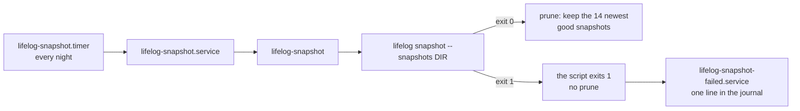

# deploy: reference files for the service and the nightly snapshot

These files are a **reference**, not the installed copies. The owner's machine has its own copies of the unit files
and of the script. Before you replace an installed file, compare it with the file here (for example with `diff`),
keep the settings that are only on the machine (the user, the paths), and then copy.

| file | installed as | what it does |
|---|---|---|
| `lifelog.service` | `/etc/systemd/system/lifelog.service` | runs `lifelog serve` (`--with whatsapp` adds the agent on WhatsApp beside it); `KillSignal=SIGTERM` and `TimeoutStopSec=30` let the server drain its requests |
| `lifelog-snapshot` | `/usr/local/bin/lifelog-snapshot` | runs `lifelog snapshot`, tests its exit status, prunes to the newest 14 good snapshots |
| `lifelog-snapshot.service` | `/etc/systemd/system/lifelog-snapshot.service` | runs the script once; `TimeoutStartSec=30min`; `OnFailure=lifelog-snapshot-failed.service` |
| `lifelog-snapshot.timer` | `/etc/systemd/system/lifelog-snapshot.timer` | starts the service every night |
| `lifelog-snapshot-failed.service` | `/etc/systemd/system/lifelog-snapshot-failed.service` | writes the failure to the journal |

`OWNER` and the paths in the units are placeholders.



## The snapshot names

[D25](../docs/decisions/D25-snapshots.md) gives the names. A snapshot that passes its restore check is
`life-YYYY-MM-DD.db`, or `life-YYYY-MM-DDTHHMMSS.db` when the day has one already. A snapshot that fails the check is
renamed to `life-YYYY-MM-DD.failed.db` (or `life-YYYY-MM-DDTHHMMSS.failed.db`). The script counts and prunes only the
good names. It never removes a `.failed.db` file: the owner reads it and removes it.

## The script

Settings come from the environment: `LIFELOG_SNAPSHOTS` (required), `LIFELOG_BIN`, `LIFELOG_DB` and `LIFELOG_KEEP`.
The script exits 1 when `lifelog snapshot` exits with any other status than 0. systemd then starts
`lifelog-snapshot-failed.service`. To read the failures:

```
journalctl -p err -t lifelog-snapshot-failed
journalctl -u lifelog-snapshot.service
```

## Ship a change

The service runs the installed program, not the one in the repo folder.

1. `go build -o <install path> ./cmd/lifelog`, and the extensions beside it: `go build -C extensions/mcp -o <install
   folder>/lifelog-mcp ./cmd/lifelog-mcp` and `go build -C extensions/agentic -o <install folder>/lifelog-agentic-init
   ./cmd/lifelog-agentic-init` ([extensions](../extensions/README.md)).
2. `systemctl daemon-reload` after a change to a unit file.
3. `systemctl restart lifelog.service`.
4. Read the service's log line (`journalctl -u lifelog.service -n 20`): it names the version and the `user_version`.
