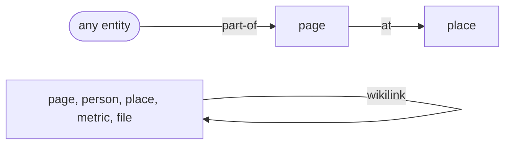

# Who may link what

An arrow is a `link_kinds` row. A node that names several types stands for each of them; `any entity` is an
endpoint with no restriction (`from_types` NULL). Three kinds exist: a `wikilink` is made by the body
([D19](../decisions/D19-wikilink-save-contract.md)), an `at` says where a day was ([D16](../decisions/D16-places.md)),
and `part-of` files a thing in a category ([D26](../decisions/D26-metric-categories.md)). A day page and a plain page are
both `page`, so the trigger `links_endpoint_types` holds what the arrows cannot draw: an `at` starts at a day page, and
a `part-of` neither starts nor ends at one.

