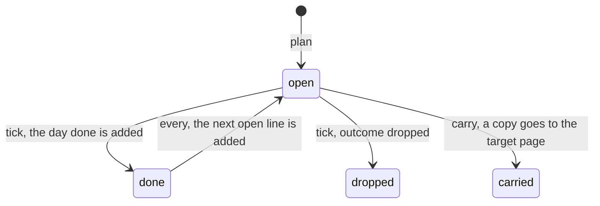

# Plan lines

A plan is a line of a page body ([D23](../decisions/D23-no-tasks.md), [D29](../decisions/D29-plan-lines.md)). The
file does not know it: `entities.body` is prose, and no table, column or constraint holds a plan. A writer reads the
lines from the body when it needs them, and it writes them back as text. This page is the one home of the grammar.
Every writer must read and write a line in the same way. The vectors at the end are the test.



The diagram shows a box and its moves. A move is an edit of one line of a body. Only an open line moves. A `done`,
`dropped` or `carried` line never moves again. The arrow from `done` to `open` is a new line: a ticked line with
`every:` adds the next open line to the end of the body. A `dropped` line and a `carried` line add no next line.
The copy of a carry is a new open line on the target page.

## What a plan line is

A plan line is a CommonMark list item of a page body. The item can use any bullet (`-`, `*`, `+`, or a number
followed by `.` or `)`), at any depth. The text of its first line starts with a box:

| box | meaning | `box` in the vectors |
|---|---|---|
| `[ ]` | open | `" "` |
| `[x]` or `[X]` | done | `"x"` |
| `[-]` | dropped | `"-"` |
| `[>]` | carried to another page | `">"` |

- The box must be followed by a space or by the end of the line. `[ ]x` is not a box.
- The parser reads the body as CommonMark ([R59](../research/references.md#r59)), the same way as for wikilinks
  ([titles and wikilinks](titles-and-wikilinks.md)). A fenced code block or an indented code block has no list
  items. A list item inside a block quote is quoted text, at any depth: it is not a plan line.
- The box is read from the source characters of the item's first line, not from the rendered inline text. A
  continuation line, a second paragraph and a box in the middle of a line are not plan lines.
- The box starts the first block of the item, on the line of the bullet. An item whose first block is not a
  paragraph (a heading, a code block, a quote, a list), or whose content starts on the line after the bullet, is not
  a plan line.
- A line number is 1-based, counted from the first line of the body. A line break is LF, CRLF or CR, and each counts
  once. Blank lines count.
- A line with only a box (`- [ ]`) is a plan line with an empty text. A tick or a carry of an empty text is refused.
- The wikilinks and `#tag`s in the words are read by the save contract as they always are. A plan line adds no link
  kind and no row.

## Words and tokens

After the box, the line has words and tokens. A **token** is `key:value`, where the key is one of `on`, `due`,
`done`, `every` or `from`, and the value is one or more characters that are not a space. The token starts after a
space (or after the box) and ends before a space (or at the end of the line). Keys are lower case. Any other
`key:value` is words: `http://x`, `note:x`, `ON:2026-10-22`, `(on:2026-10-22)` and `on:`
with no value. The rule is lexical: a token inside a code span is a token.

The **text** of a line is its source after the box, without its tokens, with each run of spaces (U+0020) made one
space and with the spaces at both ends removed. It is not normalised: `tick` and `carry` compare it byte by byte
with the text a client sends. A tab, a no-break space and any other character stay as written.

| token | value | meaning |
|---|---|---|
| `on:` | a day | the day the owner means to do it |
| `due:` | a day | the day it must be done by |
| `done:` | a day | the day it was done |
| `every:` | a repeat (below) | the line repeats when it is ticked |
| `from:` | the word `done` | the repeat counts from the day it was done, not from its date |

A day is a `lifelog_meta.days` value: `YYYY-MM-DD` with `date(x) IS x` ([exact time](exact-time.md)). `2026-2-3` and
`2026-02-30` are not days.

A line is **planned** on its `on:` day. If it has no `on:`, it is planned on its `due:` day. A line with neither
is planned on no day. A reader lists it only on its own page. An imported vault keeps its lines where they are
([imports](imports.md)).

## A malformed line

A line is malformed when it breaks one of these rules. The first token that breaks a rule, in the order of the line,
is the offender.

- A key appears twice. The second token is the offender.
- The value of a key is not valid: a day for `on:`, `due:` and `done:`; a repeat for `every:`; the word `done` for
  `from:`.
- `done:` is on a line whose box is not `[x]`.
- `from:done` is on a line with no valid `every:`.
- `every:` is on a line with no valid `on:` and no valid `due:`.

A malformed line is still a plan line. A reader draws it with its raw text. It is never planned on a day. A tick
or a carry of it is refused with status 422. The vectors give `bad` as the offending token, as written. A malformed
line has an empty `on`, `due`, `done` and `every`, and a false `from_done`. Its `text` is computed as for any line.

## The repeats

| `every:` | the next date |
|---|---|
| `day`, `N-days` (N ≥ 2) | the base plus 1 day, or N days |
| `week`, `N-weeks` (N ≥ 2) | the base plus 7 days, or 7N days |
| `month`, `N-months` (N ≥ 2) | the same day of the month, 1 or N months on; a day that does not exist moves to the last day of that month |
| `year`, `N-years` (N ≥ 2) | the same month and day, 1 or N years on; 29 February moves to 28 February in a year that has none |
| `weekday` | the next day from Monday to Friday, strictly after the base |
| `monday` … `sunday` | the next such day of the week, strictly after the base |
| `month-end` | the last day of the next month |
| `month-N` (N from 1 to 31) | day N of the next month, moved to its last day if it has fewer days |

N is written in decimal with no leading zero and no sign. `every:1-days` and `every:02-days` are malformed. So
are `every:month-32`, `every:month-0` and `every:tuesdays`. A hand-written `month-N` is valid. The writer writes it
after a clamp, as below.

## The tick of an open line

A tick has an outcome, `done` or `dropped`, and a day (the done day).

1. The line must be open and not malformed, with a non-empty text, and its text must equal the text the client
   sends. If not, nothing changes.
2. The box becomes `[x]` for `done` or `[-]` for `dropped`. For `done`, the token `done:D` is added after the
   last token of the line (after the words, if the line has no token). Every other character of the line stays.
3. If the outcome is `done` and the line has `every:`, the writer adds the next line to the end of the body.
   A `dropped` line adds nothing.
   The writer reads the new body back and finds the appended line as a plan line. If it cannot (the body ended
   inside an open fence or an HTML block), it refuses the write and changes nothing.

**The next line.** The *primary date* is `due:` if the line has it, else `on:`. The *base* is the primary date.
With `from:done` the base is the done day. The new primary date is the rule of the repeat applied to the base.
The other date, if the line has both, keeps its distance in days from the primary date. A result that is not a
day from `0000-01-01` to `9999-12-31` refuses the tick: nothing changes.

The new line is written as `- [ ] <text> on:… due:… every:… from:done`, in that key order, with the tokens the line
has. It is appended to the end of the body as its own paragraph (a blank line, then the line). The ticked line
keeps its `every:` and `from:` tokens.

A clamp changes the repeat in one case only. The line has `every:month`, no `from:done`, and the day of the
base is not in the next month. The new line then carries `every:month-D`, where D is the day of the month of
the base. So 31 January becomes 28 February with `every:month-31`, and the next tick gives 31 March. A `N-months`
line carries nothing extra after a clamp, and a `from:done` line carries nothing extra, since its day is the done
day. A `year` line carries nothing extra: a birthday is `people.birth_day` ([D15](../decisions/D15-recurrence.md)).

## The carry of an open line

A carry moves a line to another page. The line must be open and not malformed, with a non-empty text equal to the
text the client sends.

1. The box of the line becomes `[>]`. Every other character stays.
2. The target page gets a copy at the end of its body, as its own paragraph: `- [ ] <text> <tokens>`. The tokens
   are `on:`, `due:`, `every:` and `from:done` of the line, in that order. If the target is a day page, `on:` is the
   target day. It replaces the `on:` of the line, or it is added. `due:` stays. If the target is not a day page,
   `on:` stays as it is.

The writer reads the new body of the target back and finds the copy as a plan line. If it cannot (the body ended
inside an open fence or an HTML block), it refuses the write and changes nothing.

## What enforces it

The file enforces nothing about a line. The body is prose, and a bad line is a legal body. The writer enforces the
grammar, and the suites check the writer against the vectors below. This is the precedent of the wikilinks
([D19](../decisions/D19-wikilink-save-contract.md)): the body is the truth, and what is read from it is derived and
disposable. A line has no id. A tick or a carry names the line by its number and its text, so a body edited after
the reader read it makes the tick stale. A tick is a body edit, as a capture is ([D12](../decisions/D12-no-revision-tables.md)).
The decision and its price are in [D29](../decisions/D29-plan-lines.md).

## Test vectors

Every writer must reproduce them. A `body` is a JSON string. `plans` lists the plan lines of the body in order.
`line` is the 1-based line number, `box` is the box (`" "`, `"x"`, `"-"` or `">"`), and the other fields are as above.
`on`, `due`, `done`, `every` and `bad` are empty when absent.

<!-- plan-line-vectors -->

```json
[
  {"body": "- [ ] Call the bank", "plans": [{"line": 1, "box": " ", "text": "Call the bank", "on": "", "due": "", "done": "", "every": "", "from_done": false, "bad": ""}]},
  {"body": "- [x] Call the bank done:2026-10-22", "plans": [{"line": 1, "box": "x", "text": "Call the bank", "on": "", "due": "", "done": "2026-10-22", "every": "", "from_done": false, "bad": ""}]},
  {"body": "- [x] Call the bank", "plans": [{"line": 1, "box": "x", "text": "Call the bank", "on": "", "due": "", "done": "", "every": "", "from_done": false, "bad": ""}]},
  {"body": "- [-] Call the bank", "plans": [{"line": 1, "box": "-", "text": "Call the bank", "on": "", "due": "", "done": "", "every": "", "from_done": false, "bad": ""}]},
  {"body": "- [>] Call the bank on:2026-10-22", "plans": [{"line": 1, "box": ">", "text": "Call the bank", "on": "2026-10-22", "due": "", "done": "", "every": "", "from_done": false, "bad": ""}]},
  {"body": "- [X] Call the bank done:2026-10-22", "plans": [{"line": 1, "box": "x", "text": "Call the bank", "on": "", "due": "", "done": "2026-10-22", "every": "", "from_done": false, "bad": ""}]},
  {"body": "* [ ] A star bullet", "plans": [{"line": 1, "box": " ", "text": "A star bullet", "on": "", "due": "", "done": "", "every": "", "from_done": false, "bad": ""}]},
  {"body": "+ [ ] A plus bullet", "plans": [{"line": 1, "box": " ", "text": "A plus bullet", "on": "", "due": "", "done": "", "every": "", "from_done": false, "bad": ""}]},
  {"body": "- one\n  - [ ] nested\n    - [x] deeper", "plans": [{"line": 2, "box": " ", "text": "nested", "on": "", "due": "", "done": "", "every": "", "from_done": false, "bad": ""}, {"line": 3, "box": "x", "text": "deeper", "on": "", "due": "", "done": "", "every": "", "from_done": false, "bad": ""}]},
  {"body": "1. [ ] first\n2. [x] second", "plans": [{"line": 1, "box": " ", "text": "first", "on": "", "due": "", "done": "", "every": "", "from_done": false, "bad": ""}, {"line": 2, "box": "x", "text": "second", "on": "", "due": "", "done": "", "every": "", "from_done": false, "bad": ""}]},
  {"body": "1) [ ] a parenthesis", "plans": [{"line": 1, "box": " ", "text": "a parenthesis", "on": "", "due": "", "done": "", "every": "", "from_done": false, "bad": ""}]},
  {"body": "\u0060\u0060\u0060\n- [ ] in a fence\n\u0060\u0060\u0060", "plans": []},
  {"body": "~~~md\n- [ ] in a tilde fence\n~~~", "plans": []},
  {"body": "Text:\n\n    - [ ] indented code", "plans": []},
  {"body": "-     [ ] code inside an item", "plans": []},
  {"body": "> - [ ] quoted", "plans": []},
  {"body": "- item\n  > - [ ] quoted in a list", "plans": []},
  {"body": "> quote\n\n- [ ] after the quote", "plans": [{"line": 3, "box": " ", "text": "after the quote", "on": "", "due": "", "done": "", "every": "", "from_done": false, "bad": ""}]},
  {"body": "- see [ ] later", "plans": []},
  {"body": "- [ ]x", "plans": []},
  {"body": "- [ ]\tx", "plans": []},
  {"body": "- [  ] two spaces", "plans": []},
  {"body": "- [] none", "plans": []},
  {"body": "- [y] other letter", "plans": []},
  {"body": "[ ] no bullet", "plans": []},
  {"body": "# [ ] heading", "plans": []},
  {"body": "-[ ] no space after the bullet", "plans": []},
  {"body": "- [ ]", "plans": [{"line": 1, "box": " ", "text": "", "on": "", "due": "", "done": "", "every": "", "from_done": false, "bad": ""}]},
  {"body": "- [ ] due:2026-10-24", "plans": [{"line": 1, "box": " ", "text": "", "on": "", "due": "2026-10-24", "done": "", "every": "", "from_done": false, "bad": ""}]},
  {"body": "- [ ] Call   ", "plans": [{"line": 1, "box": " ", "text": "Call", "on": "", "due": "", "done": "", "every": "", "from_done": false, "bad": ""}]},
  {"body": "- [ ]   Call    the   bank   on:2026-10-22   ", "plans": [{"line": 1, "box": " ", "text": "Call the bank", "on": "2026-10-22", "due": "", "done": "", "every": "", "from_done": false, "bad": ""}]},
  {"body": "- [ ] Call on:2026-10-22 the bank", "plans": [{"line": 1, "box": " ", "text": "Call the bank", "on": "2026-10-22", "due": "", "done": "", "every": "", "from_done": false, "bad": ""}]},
  {"body": "- [ ] Call the bank on:2026-10-22 due:2026-10-24", "plans": [{"line": 1, "box": " ", "text": "Call the bank", "on": "2026-10-22", "due": "2026-10-24", "done": "", "every": "", "from_done": false, "bad": ""}]},
  {"body": "- [ ] Read http://example.com/a", "plans": [{"line": 1, "box": " ", "text": "Read http://example.com/a", "on": "", "due": "", "done": "", "every": "", "from_done": false, "bad": ""}]},
  {"body": "- [ ] note:x remember", "plans": [{"line": 1, "box": " ", "text": "note:x remember", "on": "", "due": "", "done": "", "every": "", "from_done": false, "bad": ""}]},
  {"body": "- [ ] run `on:2026-10-22` now", "plans": [{"line": 1, "box": " ", "text": "run `on:2026-10-22` now", "on": "", "due": "", "done": "", "every": "", "from_done": false, "bad": ""}]},
  {"body": "- [ ] a ON:2026-10-22", "plans": [{"line": 1, "box": " ", "text": "a ON:2026-10-22", "on": "", "due": "", "done": "", "every": "", "from_done": false, "bad": ""}]},
  {"body": "- [ ] a (on:2026-10-22)", "plans": [{"line": 1, "box": " ", "text": "a (on:2026-10-22)", "on": "", "due": "", "done": "", "every": "", "from_done": false, "bad": ""}]},
  {"body": "- [ ] a on:", "plans": [{"line": 1, "box": " ", "text": "a on:", "on": "", "due": "", "done": "", "every": "", "from_done": false, "bad": ""}]},
  {"body": "- [ ] a every:week on:2026-10-22", "plans": [{"line": 1, "box": " ", "text": "a", "on": "2026-10-22", "due": "", "done": "", "every": "week", "from_done": false, "bad": ""}]},
  {"body": "- [ ] a due:2026-10-22 every:week from:done", "plans": [{"line": 1, "box": " ", "text": "a", "on": "", "due": "2026-10-22", "done": "", "every": "week", "from_done": true, "bad": ""}]},
  {"body": "- [x] old done:0000-02-29", "plans": [{"line": 1, "box": "x", "text": "old", "on": "", "due": "", "done": "0000-02-29", "every": "", "from_done": false, "bad": ""}]},
  {"body": "- [ ] Ask [[Bob Sample]] about #health due:2026-10-24", "plans": [{"line": 1, "box": " ", "text": "Ask [[Bob Sample]] about #health", "on": "", "due": "2026-10-24", "done": "", "every": "", "from_done": false, "bad": ""}]},
  {"body": "- [ ] Zürich café 买牛奶 on:2026-10-22", "plans": [{"line": 1, "box": " ", "text": "Zürich café 买牛奶", "on": "2026-10-22", "due": "", "done": "", "every": "", "from_done": false, "bad": ""}]},
  {"body": "- [ ] Café on:2026-10-22", "plans": [{"line": 1, "box": " ", "text": "Café", "on": "2026-10-22", "due": "", "done": "", "every": "", "from_done": false, "bad": ""}]},
  {"body": "- [ ] a on:2026-10-22 every:day\n- [ ] b on:2026-10-22 every:week\n- [ ] c on:2026-10-22 every:month\n- [ ] d on:2026-10-22 every:year\n- [ ] e on:2026-10-22 every:3-days\n- [ ] f on:2026-10-22 every:2-weeks\n- [ ] g on:2026-10-22 every:6-months\n- [ ] h on:2026-10-22 every:2-years", "plans": [{"line": 1, "box": " ", "text": "a", "on": "2026-10-22", "due": "", "done": "", "every": "day", "from_done": false, "bad": ""}, {"line": 2, "box": " ", "text": "b", "on": "2026-10-22", "due": "", "done": "", "every": "week", "from_done": false, "bad": ""}, {"line": 3, "box": " ", "text": "c", "on": "2026-10-22", "due": "", "done": "", "every": "month", "from_done": false, "bad": ""}, {"line": 4, "box": " ", "text": "d", "on": "2026-10-22", "due": "", "done": "", "every": "year", "from_done": false, "bad": ""}, {"line": 5, "box": " ", "text": "e", "on": "2026-10-22", "due": "", "done": "", "every": "3-days", "from_done": false, "bad": ""}, {"line": 6, "box": " ", "text": "f", "on": "2026-10-22", "due": "", "done": "", "every": "2-weeks", "from_done": false, "bad": ""}, {"line": 7, "box": " ", "text": "g", "on": "2026-10-22", "due": "", "done": "", "every": "6-months", "from_done": false, "bad": ""}, {"line": 8, "box": " ", "text": "h", "on": "2026-10-22", "due": "", "done": "", "every": "2-years", "from_done": false, "bad": ""}]},
  {"body": "- [ ] a due:2026-10-22 every:weekday\n- [ ] b due:2026-10-22 every:monday\n- [ ] c due:2026-10-22 every:tuesday\n- [ ] d due:2026-10-22 every:wednesday\n- [ ] e due:2026-10-22 every:thursday\n- [ ] f due:2026-10-22 every:friday\n- [ ] g due:2026-10-22 every:saturday\n- [ ] h due:2026-10-22 every:sunday\n- [ ] i due:2026-10-22 every:month-end\n- [ ] j due:2026-10-22 every:month-15\n- [ ] k due:2026-10-22 every:month-31", "plans": [{"line": 1, "box": " ", "text": "a", "on": "", "due": "2026-10-22", "done": "", "every": "weekday", "from_done": false, "bad": ""}, {"line": 2, "box": " ", "text": "b", "on": "", "due": "2026-10-22", "done": "", "every": "monday", "from_done": false, "bad": ""}, {"line": 3, "box": " ", "text": "c", "on": "", "due": "2026-10-22", "done": "", "every": "tuesday", "from_done": false, "bad": ""}, {"line": 4, "box": " ", "text": "d", "on": "", "due": "2026-10-22", "done": "", "every": "wednesday", "from_done": false, "bad": ""}, {"line": 5, "box": " ", "text": "e", "on": "", "due": "2026-10-22", "done": "", "every": "thursday", "from_done": false, "bad": ""}, {"line": 6, "box": " ", "text": "f", "on": "", "due": "2026-10-22", "done": "", "every": "friday", "from_done": false, "bad": ""}, {"line": 7, "box": " ", "text": "g", "on": "", "due": "2026-10-22", "done": "", "every": "saturday", "from_done": false, "bad": ""}, {"line": 8, "box": " ", "text": "h", "on": "", "due": "2026-10-22", "done": "", "every": "sunday", "from_done": false, "bad": ""}, {"line": 9, "box": " ", "text": "i", "on": "", "due": "2026-10-22", "done": "", "every": "month-end", "from_done": false, "bad": ""}, {"line": 10, "box": " ", "text": "j", "on": "", "due": "2026-10-22", "done": "", "every": "month-15", "from_done": false, "bad": ""}, {"line": 11, "box": " ", "text": "k", "on": "", "due": "2026-10-22", "done": "", "every": "month-31", "from_done": false, "bad": ""}]},
  {"body": "- [ ] Call on:2026-10-22 on:2026-10-23", "plans": [{"line": 1, "box": " ", "text": "Call", "on": "", "due": "", "done": "", "every": "", "from_done": false, "bad": "on:2026-10-23"}]},
  {"body": "- [ ] Call done:2026-10-22", "plans": [{"line": 1, "box": " ", "text": "Call", "on": "", "due": "", "done": "", "every": "", "from_done": false, "bad": "done:2026-10-22"}]},
  {"body": "- [-] Call done:2026-10-22", "plans": [{"line": 1, "box": "-", "text": "Call", "on": "", "due": "", "done": "", "every": "", "from_done": false, "bad": "done:2026-10-22"}]},
  {"body": "- [ ] Call from:done", "plans": [{"line": 1, "box": " ", "text": "Call", "on": "", "due": "", "done": "", "every": "", "from_done": false, "bad": "from:done"}]},
  {"body": "- [ ] Call from:later every:week on:2026-10-22", "plans": [{"line": 1, "box": " ", "text": "Call", "on": "", "due": "", "done": "", "every": "", "from_done": false, "bad": "from:later"}]},
  {"body": "- [ ] Call every:week", "plans": [{"line": 1, "box": " ", "text": "Call", "on": "", "due": "", "done": "", "every": "", "from_done": false, "bad": "every:week"}]},
  {"body": "- [ ] Call on:2026-02-30", "plans": [{"line": 1, "box": " ", "text": "Call", "on": "", "due": "", "done": "", "every": "", "from_done": false, "bad": "on:2026-02-30"}]},
  {"body": "- [ ] Call on:2026-2-3", "plans": [{"line": 1, "box": " ", "text": "Call", "on": "", "due": "", "done": "", "every": "", "from_done": false, "bad": "on:2026-2-3"}]},
  {"body": "- [ ] Call on:tomorrow", "plans": [{"line": 1, "box": " ", "text": "Call", "on": "", "due": "", "done": "", "every": "", "from_done": false, "bad": "on:tomorrow"}]},
  {"body": "- [ ] Call due:1900-02-29", "plans": [{"line": 1, "box": " ", "text": "Call", "on": "", "due": "", "done": "", "every": "", "from_done": false, "bad": "due:1900-02-29"}]},
  {"body": "- [x] Call done:2026-13-01", "plans": [{"line": 1, "box": "x", "text": "Call", "on": "", "due": "", "done": "", "every": "", "from_done": false, "bad": "done:2026-13-01"}]},
  {"body": "- [ ] a on:2026-10-22 every:1-days", "plans": [{"line": 1, "box": " ", "text": "a", "on": "", "due": "", "done": "", "every": "", "from_done": false, "bad": "every:1-days"}]},
  {"body": "- [ ] a on:2026-10-22 every:02-days", "plans": [{"line": 1, "box": " ", "text": "a", "on": "", "due": "", "done": "", "every": "", "from_done": false, "bad": "every:02-days"}]},
  {"body": "- [ ] a on:2026-10-22 every:month-32", "plans": [{"line": 1, "box": " ", "text": "a", "on": "", "due": "", "done": "", "every": "", "from_done": false, "bad": "every:month-32"}]},
  {"body": "- [ ] a on:2026-10-22 every:month-0", "plans": [{"line": 1, "box": " ", "text": "a", "on": "", "due": "", "done": "", "every": "", "from_done": false, "bad": "every:month-0"}]},
  {"body": "- [ ] a on:2026-10-22 every:tuesdays", "plans": [{"line": 1, "box": " ", "text": "a", "on": "", "due": "", "done": "", "every": "", "from_done": false, "bad": "every:tuesdays"}]},
  {"body": "- [ ] a\n[ ] b", "plans": [{"line": 1, "box": " ", "text": "a", "on": "", "due": "", "done": "", "every": "", "from_done": false, "bad": ""}]},
  {"body": "- [ ] a\n\n  [ ] b", "plans": [{"line": 1, "box": " ", "text": "a", "on": "", "due": "", "done": "", "every": "", "from_done": false, "bad": ""}]},
  {"body": "- [ ] a\r\n- [x] b", "plans": [{"line": 1, "box": " ", "text": "a", "on": "", "due": "", "done": "", "every": "", "from_done": false, "bad": ""}, {"line": 2, "box": "x", "text": "b", "on": "", "due": "", "done": "", "every": "", "from_done": false, "bad": ""}]},
  {"body": "- [ ] a\r- [x] b", "plans": [{"line": 1, "box": " ", "text": "a", "on": "", "due": "", "done": "", "every": "", "from_done": false, "bad": ""}, {"line": 2, "box": "x", "text": "b", "on": "", "due": "", "done": "", "every": "", "from_done": false, "bad": ""}]},
  {"body": "-\n  [ ] b", "plans": []},
  {"body": "- [ ] a\n  ---", "plans": []},
  {"body": "- [ ] run `x on:2026-10-22 y` now", "plans": [{"line": 1, "box": " ", "text": "run `x y` now", "on": "2026-10-22", "due": "", "done": "", "every": "", "from_done": false, "bad": ""}]},
  {"body": "Plans for the week.\n\n- [ ] one\n- [x] two done:2026-10-20\n\nSome prose.\n\n- [-] three\n- [ ] bad on:x", "plans": [{"line": 3, "box": " ", "text": "one", "on": "", "due": "", "done": "", "every": "", "from_done": false, "bad": ""}, {"line": 4, "box": "x", "text": "two", "on": "", "due": "", "done": "2026-10-20", "every": "", "from_done": false, "bad": ""}, {"line": 8, "box": "-", "text": "three", "on": "", "due": "", "done": "", "every": "", "from_done": false, "bad": ""}, {"line": 9, "box": " ", "text": "bad", "on": "", "due": "", "done": "", "every": "", "from_done": false, "bad": "on:x"}]}
]
```

The next line of a repeat. `done` is the day the tick is made. `next_on`, `next_due` and `next_every` are the
fields of the new line, empty when absent. `"error": true` means that the tick is refused and no line is made.

<!-- next-day-vectors -->

```json
[
  {"on": "", "due": "2026-10-22", "every": "day", "from_done": false, "done": "2026-10-22", "next_on": "", "next_due": "2026-10-23", "next_every": "day"},
  {"on": "2026-12-30", "due": "", "every": "3-days", "from_done": false, "done": "2026-12-30", "next_on": "2027-01-02", "next_due": "", "next_every": "3-days"},
  {"on": "", "due": "2026-10-22", "every": "week", "from_done": false, "done": "2026-10-22", "next_on": "", "next_due": "2026-10-29", "next_every": "week"},
  {"on": "2026-12-25", "due": "", "every": "2-weeks", "from_done": false, "done": "2026-12-25", "next_on": "2027-01-08", "next_due": "", "next_every": "2-weeks"},
  {"on": "", "due": "2026-10-15", "every": "month", "from_done": false, "done": "2026-10-15", "next_on": "", "next_due": "2026-11-15", "next_every": "month"},
  {"on": "", "due": "2026-12-15", "every": "month", "from_done": false, "done": "2026-12-15", "next_on": "", "next_due": "2027-01-15", "next_every": "month"},
  {"on": "", "due": "2026-01-31", "every": "month", "from_done": false, "done": "2026-01-31", "next_on": "", "next_due": "2026-02-28", "next_every": "month-31"},
  {"on": "", "due": "2028-01-31", "every": "month", "from_done": false, "done": "2028-01-31", "next_on": "", "next_due": "2028-02-29", "next_every": "month-31"},
  {"on": "", "due": "2026-03-31", "every": "month", "from_done": false, "done": "2026-03-31", "next_on": "", "next_due": "2026-04-30", "next_every": "month-31"},
  {"on": "", "due": "2026-02-28", "every": "month-31", "from_done": false, "done": "2026-02-28", "next_on": "", "next_due": "2026-03-31", "next_every": "month-31"},
  {"on": "", "due": "2026-03-31", "every": "month-31", "from_done": false, "done": "2026-03-31", "next_on": "", "next_due": "2026-04-30", "next_every": "month-31"},
  {"on": "", "due": "2026-04-30", "every": "month-31", "from_done": false, "done": "2026-04-30", "next_on": "", "next_due": "2026-05-31", "next_every": "month-31"},
  {"on": "", "due": "2026-10-03", "every": "month-15", "from_done": false, "done": "2026-10-03", "next_on": "", "next_due": "2026-11-15", "next_every": "month-15"},
  {"on": "", "due": "2026-10-31", "every": "month-10", "from_done": false, "done": "2026-10-31", "next_on": "", "next_due": "2026-11-10", "next_every": "month-10"},
  {"on": "", "due": "2026-11-30", "every": "2-months", "from_done": false, "done": "2026-11-30", "next_on": "", "next_due": "2027-01-30", "next_every": "2-months"},
  {"on": "", "due": "2026-12-31", "every": "2-months", "from_done": false, "done": "2026-12-31", "next_on": "", "next_due": "2027-02-28", "next_every": "2-months"},
  {"on": "", "due": "2026-11-30", "every": "3-months", "from_done": false, "done": "2026-11-30", "next_on": "", "next_due": "2027-02-28", "next_every": "3-months"},
  {"on": "", "due": "2026-02-28", "every": "12-months", "from_done": false, "done": "2026-02-28", "next_on": "", "next_due": "2027-02-28", "next_every": "12-months"},
  {"on": "", "due": "2026-01-31", "every": "month-end", "from_done": false, "done": "2026-01-31", "next_on": "", "next_due": "2026-02-28", "next_every": "month-end"},
  {"on": "", "due": "2028-01-15", "every": "month-end", "from_done": false, "done": "2028-01-15", "next_on": "", "next_due": "2028-02-29", "next_every": "month-end"},
  {"on": "", "due": "2026-02-28", "every": "month-end", "from_done": false, "done": "2026-02-28", "next_on": "", "next_due": "2026-03-31", "next_every": "month-end"},
  {"on": "", "due": "2028-02-29", "every": "year", "from_done": false, "done": "2028-02-29", "next_on": "", "next_due": "2029-02-28", "next_every": "year"},
  {"on": "", "due": "2028-02-29", "every": "2-years", "from_done": false, "done": "2028-02-29", "next_on": "", "next_due": "2030-02-28", "next_every": "2-years"},
  {"on": "", "due": "2028-02-29", "every": "4-years", "from_done": false, "done": "2028-02-29", "next_on": "", "next_due": "2032-02-29", "next_every": "4-years"},
  {"on": "", "due": "2026-12-31", "every": "year", "from_done": false, "done": "2026-12-31", "next_on": "", "next_due": "2027-12-31", "next_every": "year"},
  {"on": "", "due": "2026-10-23", "every": "weekday", "from_done": false, "done": "2026-10-23", "next_on": "", "next_due": "2026-10-26", "next_every": "weekday"},
  {"on": "", "due": "2026-10-21", "every": "weekday", "from_done": false, "done": "2026-10-21", "next_on": "", "next_due": "2026-10-22", "next_every": "weekday"},
  {"on": "", "due": "2026-10-24", "every": "weekday", "from_done": false, "done": "2026-10-24", "next_on": "", "next_due": "2026-10-26", "next_every": "weekday"},
  {"on": "", "due": "2026-10-19", "every": "monday", "from_done": false, "done": "2026-10-19", "next_on": "", "next_due": "2026-10-26", "next_every": "monday"},
  {"on": "", "due": "2026-10-21", "every": "monday", "from_done": false, "done": "2026-10-21", "next_on": "", "next_due": "2026-10-26", "next_every": "monday"},
  {"on": "", "due": "2026-10-19", "every": "sunday", "from_done": false, "done": "2026-10-19", "next_on": "", "next_due": "2026-10-25", "next_every": "sunday"},
  {"on": "", "due": "2026-10-25", "every": "sunday", "from_done": false, "done": "2026-10-25", "next_on": "", "next_due": "2026-11-01", "next_every": "sunday"},
  {"on": "", "due": "2026-10-23", "every": "friday", "from_done": false, "done": "2026-10-23", "next_on": "", "next_due": "2026-10-30", "next_every": "friday"},
  {"on": "2026-10-22", "due": "", "every": "day", "from_done": false, "done": "2026-10-22", "next_on": "2026-10-23", "next_due": "", "next_every": "day"},
  {"on": "2026-10-20", "due": "2026-10-22", "every": "week", "from_done": false, "done": "2026-10-21", "next_on": "2026-10-27", "next_due": "2026-10-29", "next_every": "week"},
  {"on": "2026-01-29", "due": "2026-01-31", "every": "month", "from_done": false, "done": "2026-01-30", "next_on": "2026-02-26", "next_due": "2026-02-28", "next_every": "month-31"},
  {"on": "", "due": "2026-10-22", "every": "week", "from_done": true, "done": "2026-10-27", "next_on": "", "next_due": "2026-11-03", "next_every": "week"},
  {"on": "2026-10-20", "due": "2026-10-22", "every": "week", "from_done": true, "done": "2026-11-02", "next_on": "2026-11-07", "next_due": "2026-11-09", "next_every": "week"},
  {"on": "", "due": "2026-01-31", "every": "month", "from_done": true, "done": "2026-03-31", "next_on": "", "next_due": "2026-04-30", "next_every": "month"},
  {"on": "", "due": "2026-10-22", "every": "weekday", "from_done": true, "done": "2026-10-24", "next_on": "", "next_due": "2026-10-26", "next_every": "weekday"},
  {"on": "", "due": "2028-02-29", "every": "2-days", "from_done": false, "done": "2028-02-29", "next_on": "", "next_due": "2028-03-02", "next_every": "2-days"},
  {"on": "", "due": "2027-02-28", "every": "day", "from_done": false, "done": "2027-02-28", "next_on": "", "next_due": "2027-03-01", "next_every": "day"},
  {"on": "", "due": "9999-12-30", "every": "day", "from_done": false, "done": "9999-12-30", "next_on": "", "next_due": "9999-12-31", "next_every": "day"},
  {"on": "", "due": "9999-12-31", "every": "day", "from_done": false, "done": "9999-12-31", "next_on": "", "next_due": "", "next_every": "", "error": true},
  {"on": "", "due": "9999-12-25", "every": "week", "from_done": false, "done": "9999-12-25", "next_on": "", "next_due": "", "next_every": "", "error": true},
  {"on": "", "due": "9999-12-15", "every": "month", "from_done": false, "done": "9999-12-15", "next_on": "", "next_due": "", "next_every": "", "error": true},
  {"on": "", "due": "9999-06-01", "every": "year", "from_done": false, "done": "9999-06-01", "next_on": "", "next_due": "", "next_every": "", "error": true},
  {"on": "1700-01-01", "due": "2026-10-22", "every": "day", "from_done": false, "done": "2026-10-22", "next_on": "1700-01-02", "next_due": "2026-10-23", "next_every": "day"},
  {"on": "0000-01-01", "due": "2026-10-22", "every": "week", "from_done": true, "done": "0000-01-01", "next_on": "", "next_due": "", "next_every": "", "error": true}
]
```
