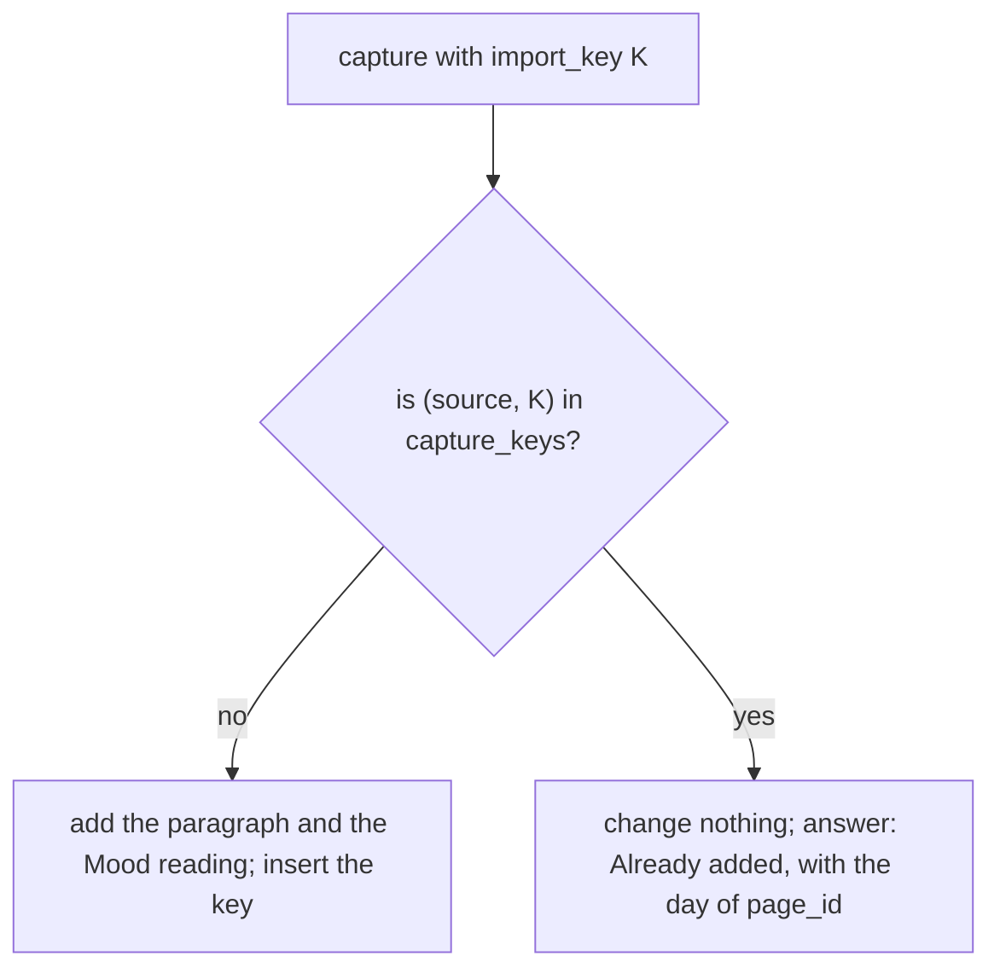

# Capture: append to the day page (the universal insert convention)

Every entity insert is two statements in one transaction: `entities` first, `RETURNING id`, then the
owned preferred name with that id, which the app keeps in a variable (below `:page_id`) and binds wherever the
page is meant (the `entities` comment in [schema.sql](../schema/schema.sql)). Capture appends to today's page; the first capture of a day creates it.

```sql
BEGIN IMMEDIATE;
-- today's page, if the day has one (a day page's key is its title, contract/titles-and-wikilinks.md): found, the app keeps its id
-- as :page_id and skips the two INSERTs; found tombstoned, it revives it as cookbook/save-a-body.md step 2a does
SELECT e.id, e.deleted_at FROM entity_names n JOIN entities e ON e.id=n.entity_id WHERE n.name_key = '2026-09-29';
INSERT INTO entities(entity_type, preferred_name_key, day, created_at, updated_at, source)
VALUES ('page', '2026-09-29', '2026-09-29', strftime('%Y-%m-%dT%H:%M:%fZ','now'), strftime('%Y-%m-%dT%H:%M:%fZ','now'), 'ui')
RETURNING id;   -- the app keeps it as :page_id
INSERT INTO entity_names(entity_id, title, name_key)
VALUES (:page_id, '2026-09-29', '2026-09-29');
-- the entry, after a blank line when the page already has text
UPDATE entities SET body = body || CASE WHEN body = '' THEN '' ELSE char(10, 10) END
                        || 'Shipped the schema doc. Review pending. [[Lifelog]]'
 WHERE id = :page_id;
-- the body names [[Lifelog]]: the link sync of cookbook/save-a-body.md runs here, inside this same transaction
-- optional mood: the app requires a live metric and validates the value under D6
-- before inserting; a missing metric or refused value rolls back the entire capture
-- (docs/decisions/D06-mood-is-a-measurement.md)
-- attached to the page it belongs to (D6):
INSERT INTO measurements(metric_id, day, value, source, captured_with_id, created_at)
SELECT e.id, '2026-09-29', 4, 'ui', :page_id, strftime('%Y-%m-%dT%H:%M:%fZ','now')
  FROM entities e JOIN metrics m ON m.id=e.id
 WHERE e.id = 1 AND e.deleted_at IS NULL;   -- a metric is a page (D27); a timed reading also sets taken_at and tz
COMMIT;
```

## A capture sent again changes nothing

A client that loses the reply of a capture cannot know that the capture committed, so it sends the capture again.
A sender that may do this gives the capture a key: one `import_key`, made once and sent unchanged on every retry
([import a row once](import-a-row-once.md)). The writer keeps the key in `capture_keys` ([D28](../decisions/D28-capture-keys.md)).
The key is per `source`, like the key of any other row. A capture with no key is not recorded there, so a second
capture with no key appends again: two equal captures can be two true facts.



```sql
BEGIN IMMEDIATE;
-- the key first: a row back = this capture was added before. Write nothing else, ROLLBACK, and answer with the day of that page_id
SELECT page_id FROM capture_keys WHERE source = 'ui' AND import_key = :import_key;
-- no row back: the capture above, in this same transaction (the day page, the entry, the link sync), then the key
INSERT INTO capture_keys(source, import_key, page_id, recorded_at)
VALUES ('ui', :import_key, :page_id, strftime('%Y-%m-%dT%H:%M:%fZ','now'));
-- the Mood reading of that capture carries the same key (the index measurements_import)
INSERT INTO measurements(metric_id, day, value, source, import_key, captured_with_id, created_at)
SELECT e.id, '2026-09-29', 4, 'ui', :import_key, :page_id, strftime('%Y-%m-%dT%H:%M:%fZ','now')
  FROM entities e JOIN metrics m ON m.id=e.id
 WHERE e.id = 1 AND e.deleted_at IS NULL;
COMMIT;
```

The unique pair is the last guard: under `BEGIN IMMEDIATE` there is one writer, so the read first finds every key
that an earlier transaction committed. A key is 1 to 512 bytes without NUL (`capture_keys_import_key`); a longer
source key is hashed by the sender ([imports](../contract/imports.md) step 3). A capture is the one use of a key
for the reading and for the capture together: do not give the same key to a `record` of Mood and to a capture of
the same writer, since both meet the index of `measurements` (D28).
