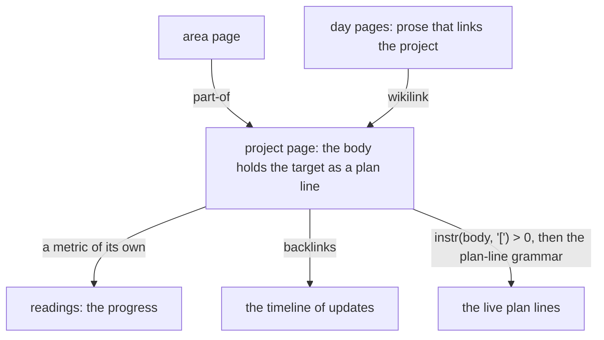

# Plan a project: a page, a target line, a reading, the live plan lines (D26, D29)

A project is a plain page, filed `part-of` an area page ([D26](../decisions/D26-metric-categories.md)). Its target
is a plan line in its body ([plan lines](../contract/plan-lines.md)). Its progress is a reading under a metric of
its own ([D7](../decisions/D07-measurements.md), [D27](../decisions/D27-a-metric-is-a-page.md)). Its updates are prose
in the day pages that link it, so its backlinks are its timeline ([backlinks](backlinks.md)). A goal is a page whose
number is a metric. The file holds no project table and no plan table ([D23](../decisions/D23-no-tasks.md)).



The plan lines are not stored. A writer fetches the live bodies that hold a box and reads the lines from them with
the grammar of the contract page. The `instr` test keeps the scan to the pages that can hold a box. A tombstoned page
is not read.

```sql
SELECT n.title, e.id, e.body
  FROM entities e
  JOIN entity_names n ON n.entity_id = e.id AND n.name_key = e.preferred_name_key
 WHERE e.deleted_at IS NULL AND instr(e.body, '[') > 0
 ORDER BY n.title;
```

This is one read, with no parameter. The grammar then picks the plan lines out of each body, and the writer keeps
those it needs: the lines planned on a day, or the lines of one project page.
