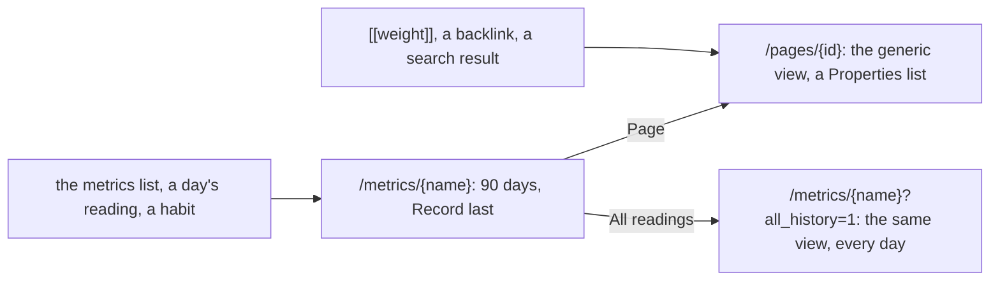

# 0069 — A metric is three pages, and Record is under its readings

- **Date:** 2026-10-13
- **Status:** open
- **Seen in:** the owner's request on 2026-10-13: "When I access a metric page, I want to have one page with Record
  and also with the All Readings and not have them as two separate pages. Everything should feel cohesive and well
  thought". Checked against the code at `acf70dd` on a synthetic database in Edge on Windows, at 1280 and 390 px.

## What happened

A metric has three addresses in the browser. Each one shows a part of the metric, and none of them shows all of it.

Each row is a fact of the code at `acf70dd`.

| part | what the browser does |
|---|---|
| the series | `/metrics/{name}` shows the 90 days to today. Record is the last form of the page, under the chart and the whole table. Its metric field is a list of other metrics, on the page of one metric. |
| All readings | a link in the line under the title. It opens the same view with `all_history=1`: a second page that looks like the first. |
| the metric's page | a metric is a page ([D27](../decisions/D27-metric-is-a-page.md)): its text, its links and its backlinks. `viewOf` has no template for the class `metric`, so the generic view draws it: "Is day page no", "Session kind no", "Version 1", and Save, Rename, Link, Unlink and Delete as bare buttons. A `[[weight]]` in the journal, a backlink and a search result open this view, not the readings. |
| the readings | the table is oldest first. In all history the newest reading is at the end of a long table. A Scope column says "unassociated" on every row. |
| a habit | Check in is a day and the choices "1" and "0"; Record is a second form under it. |

## Reproduce

1. Build `lifelog` at `acf70dd`. On a fresh file, register `weight` (kg), record 14 days and 20 readings of earlier
   years, and capture a day page that says `[[weight]]`.
2. Open `/metrics/weight`: 14 readings, Record at the end. Follow All readings: a second page.
3. Follow `[[weight]]` from the day page: the generic Properties list, with no reading and no Record.

## Rules involved

- [D27](../decisions/D27-metric-is-a-page.md): a metric is a page; its title is its name and its body its note.
- [README](../../README.md): "Metric ranges", "The app shell", "The browser for daily use".
- [AGENTS.md](../../AGENTS.md): "Every capability on every surface".
- [API.md](../../API.md): the series and the page.

## Resolution

Filled in when it closes.
