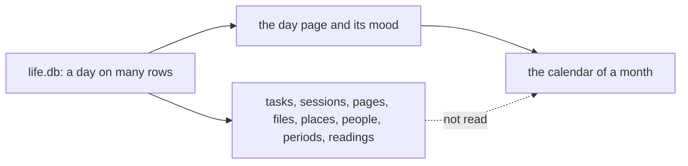

# 0070 — The calendar shows only the journal

- **Date:** 2026-10-13
- **Status:** resolved
- **Seen in:** the owner's request on 2026-10-13: "I want to see in the calendar also the due tasks and all the data
  that might have a date assigned". Checked against the code at `c53cf4a`.

## What happened

The calendar of a month (`/months/{YYYY-MM}`) tells four things about each day: its number, whether it has a day
page, the first line of that page and its mood. A due task, a session, a file and a birthday have a day too, but no
cell of the calendar shows them. The owner must open each day, or another list, to find them.

Each row is a fact of the code at `c53cf4a`.

| what has a day | its column | where the browser shows it |
|---|---|---|
| an occurrence of a task | `task_occurrences.due_day`, and the days a recurring task derives from `anchor_day` | Home (due and overdue), the Due of a day, What is due, the Done and skipped of a week |
| a session | `sessions.day` | `/sessions`, a list of every session; a day shows only the readings of a session |
| a page written on a day, a file | `entities.day` of a page that is not a day page | the Pages written this day of a day |
| a place the owner was at | a link of kind `at` from a day page | the Where of a day |
| a birth, a death | `people.birth_day`, `people.death_day` | the person's page, and nowhere else |
| a period | `periods.start_boundary`, `periods.end_boundary` | `/periods` and the period's page |
| a reading | `measurements.day` | a day, a metric, the Readings of a week, the count of a year |

## Reproduce

1. Build `lifelog` at `c53cf4a`. On a fresh file, capture a day page on 14 May 2031, create a task due on 14 May
   2031, capture a session on 14 May 2031 and create a person born on 14 May 1990.
2. Open `/months/2031-05`. The cell of 14 May shows the first line of the day page and nothing else.
3. Open `/days/2031-05-14`. It shows the task, but not the session and not the birthday.

## Rules involved

- [D22](../decisions/D22-events.md): sessions and periods; [period boundaries](../contract/period-boundaries.md):
  day membership.
- [Planning](../contract/planning.md): occurrences and their due days.
- [README](../../README.md): "The browser for daily use", "The app shell".
- [API.md](../../API.md): the month and the week.

## Resolution

Resolved by [plan 101](../plans/101-the-calendar-holds-every-dated-thing.md). Each day of the month and of the week has
`items[]`: the occurrences due on it, the births and deaths of each year, the period boundaries, the sessions, the
places and the pages and files. A day also has `more_pages` and `readings`, and the month has `periods[]`. The
calendar draws three items a cell, squares on a phone, Day by day under the grid with a link to each item, and the
Periods of the month. Every row of the table above has a place in the calendar now.
