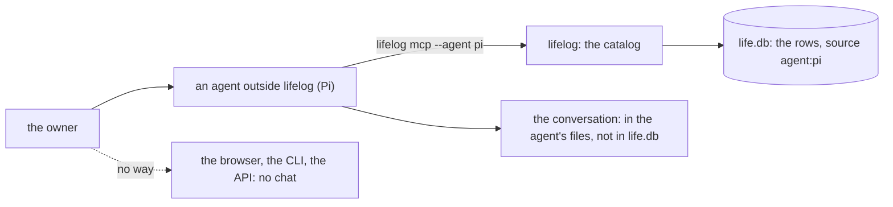

# 0071 — The owner cannot talk to lifelog: an agent works only from outside, and its conversation is lost

- **Date:** 2026-10-14
- **Status:** resolved
- **Seen in:** the owner's request on 2026-10-14, in a conversation with a coding agent: a chat inside the
  application, with an agent that can do all that the CLI and MCP can do, on the self-hosted model that the owner
  uses today in Pi. Checked against the code at `fa2cf64`.

## What happened

An agent can use the catalog today only from outside the application: the owner starts Pi, Claude Code or another
agent in the folder of the program (`lifelog agentic-init`), and that agent starts `lifelog mcp --agent NAME`. The
browser, the CLI and the API have no way to ask a question in words. When the agent's session ends, its
conversation stays in the agent's own files, outside `life.db`. The rows it wrote are kept with `agent:NAME`, but
not why they were written or what the owner said.

The [non-goals](../architecture/non-goals.md) row "Generic view system, AI generation" cuts AI from the product.
The owner reopens it with this request.

## Reproduce

1. Build `lifelog` at `fa2cf64`. Run `lifelog init` on a fresh file, then `lifelog serve`.
2. Open the browser. No page takes a question in words. `GET /actions` lists no action that does.
3. Run `lifelog actions`. No command sends a question to a model.
4. Start Pi with `.pi/mcp.json` from `lifelog agentic-init`, ask it to capture a note, and end the session. The
   note is in `life.db` with `source = 'agent:pi'`. The conversation is not.

## The owner's decisions (2026-10-14)

1. **The model.** The owner configures an OpenAI-compatible endpoint. For now that is the self-hosted model the
   owner uses in Pi.
2. **The conversations.** They are kept in `life.db`. The owner expects a schema change; the proposal decides how.
3. **Confirmation.** The model writes through the catalog with its own provenance. When it is not sure, it asks the
   owner in the chat. The application adds no approval step.
4. **Every surface.** The chat is a capability of the catalog, on the API, the CLI, the MCP server and the browser
   ([AGENTS.md](../../AGENTS.md), "Every capability on every surface").
5. **Owner-only actions.** They stay refused to the chat's agent, as they are to every `agent:*` writer.

## Rules involved

- [Non-goals](../architecture/non-goals.md): "Generic view system, AI generation".
- [README](../../README.md): "Owner-only actions", "Provenance per surface", `lifelog agentic-init`.
- [D2](../decisions/D02-typed-strict-tables.md) (no JSON columns), [D9](../decisions/D09-binary-files.md) (a
  transcript is a page body), [D11](../decisions/D11-tombstones.md) (no deletes),
  [D13](../decisions/D13-migrations-and-freeze.md) (the freeze), [D27](../decisions/D27-a-metric-is-a-page.md)
  (anything is filed by `part-of`).

## Resolution

Resolved by [RFC 0012](../rfcs/0012-a-conversation-with-lifelog.md), then closed the other way on 2026-10-15 by
[RFC 0015](../rfcs/0015-no-conversation.md): the conversation is removed; an agent works from outside, through the
MCP tools, and keeps its own conversation.
