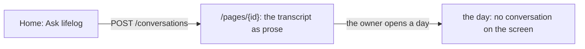

# 0072 — A conversation reads as a page, and it leaves the screen when the owner moves on

- **Date:** 2026-10-14
- **Status:** resolved
- **Seen in:** the owner's first use of `ask` in the browser on 2026-10-14: "I want it to act more like a
  conversation, for example having an always on sidebar chat with the agent and have a full screen chat page. If the
  user moves out of the full screen chat page, it becomes a toggleable right sidebar". Checked against the code at
  `04b636d`.

## What happened

`ask` answers with the conversation's page. The browser draws it as any page: the transcript as prose, a form to
continue under it, the facts and links in the margin. The owner reads it as a document, not as a conversation. When
the owner opens another page, the conversation is gone from the screen, and it comes back only by search or by its
title.

## Reproduce

1. Build `lifelog` at `04b636d` with a model configured. Ask a question from Home.
2. The answer is the page `Conversation …`: prose, a Continue form, and the margin of a page.
3. Open Today. No part of the screen shows the conversation.

## Rules involved

- [Plan 102](../plans/102-a-conversation-with-lifelog.md): the action `ask` and the conversation page.
- [README](../../README.md): "The app shell", "A conversation with lifelog".

## Resolution

Resolved by [plan 103](../plans/103-the-conversation-on-the-screen.md), then closed the other way on 2026-10-15 by
[RFC 0015](../rfcs/0015-no-conversation.md): the conversation is removed.
