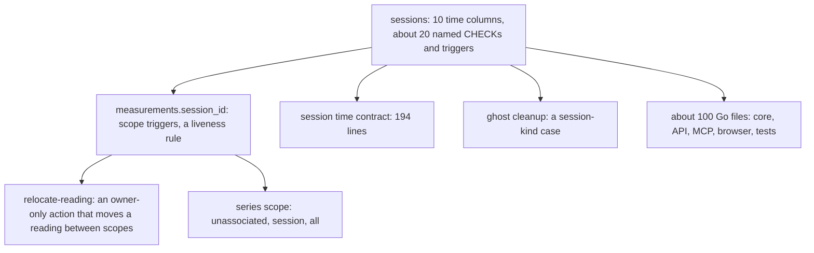

# 0073 — Sessions cost more than they give, and no data uses them

- **Date:** 2026-10-15
- **Status:** resolved
- **Seen in:** the owner's review of sessions on 2026-10-15: "i think it's quite complex and doesn't bring too much
  value". The owner confirmed that `life.db` has no session rows. Checked against the code at `fd73da6`.

## What happened

Sessions came from [issue 0020](0020-imported-sessions-need-time-and-measurement-scope.md). That issue is evidence of
the shape of Fit and Google Health exports. It is not a failed import. [RFC 0011](../rfcs/0011-no-import-process.md)
then removed the import process and lists the Fit import as lost. Thus the import that sessions were made for will
not run, and the owner has recorded no session by hand.

The cost stays in every layer:

A daily reading holds what a session would give for this owner: minutes of sleep on the reporting day, or the totals
of a workout under its own metric. The start and end clock of one sleep, and two workouts on one day with separate
summaries, have no structure without sessions. Day-page prose can keep them.

## Reproduce

1. Search the owner's use: no session row exists in `life.db` (the owner's word, 2026-10-15).
2. Count the surfaces that carry sessions: `grep -rli session docs tests internal` names more than 100 files.

## Rules involved

[D22](../decisions/D22-events.md), [D7](../decisions/D07-measurements.md), session time (removed by RFC 0013),
measurement scope (removed by RFC 0013), `lifelog_meta.measurement_scope`. The goals
([principles 6 and 7](../architecture/goals-and-principles.md)): a table needs real use, and a cut happens before the
freeze ([D13](../decisions/D13-migrations-and-freeze.md)).

## Resolution

Resolved 2026-10-15 by [RFC 0013](../rfcs/0013-no-sessions.md): sessions are removed.
