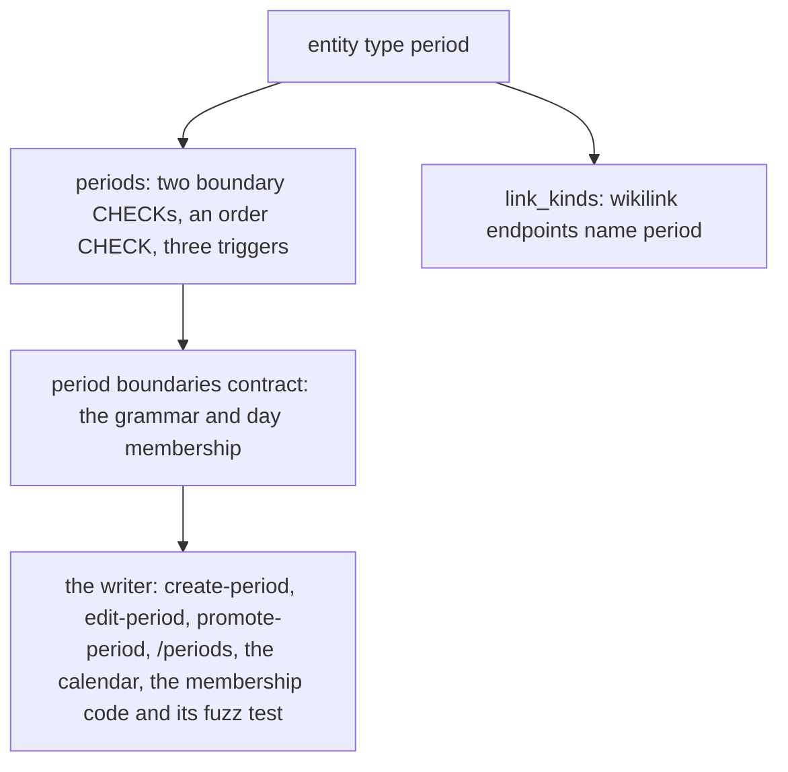

# 0074 — Recorded periods cost more than they give

- **Date:** 2026-10-15
- **Status:** resolved
- **Seen in:** the owner's review of periods on 2026-10-15, after sessions were removed (issue 0073): "i think i wanna
  remove periods also, they do not bring that much value either. I can just note in the day page where I was that
  day". `life.db` holds 3 periods. Checked against the code at `64fc35e`.

## What happened

A period is a typed page with two boundaries in a grammar of their own (`2018-09~`, `..`, `?`, `%`). The owner uses
3 of them. The answers they give (a day is definitely, possibly or incomparably inside a span) are not answers the
owner asks for. The day pages already say where the owner was: an `at` link to a place, and prose.

A plain page holds what a period holds for this owner: a title, a body that can say "2018-09 to now", and its
backlinks from the day pages that name it.

## Reproduce

1. Count the owner's periods: 3 rows (`SELECT count(*) FROM periods`, read-only, 2026-10-15).
2. Count the surfaces that carry periods: about 98 files under `docs`, `tests`, `internal` and `cmd`.

## Rules involved

[D22](../decisions/D22-events.md), the boundary profile (removed by RFC 0014), `entities_entity_type`,
`link_kinds` (`wikilink`). The goals ([principles 6 and 7](../architecture/goals-and-principles.md)): a table needs
real use, and a cut happens before the freeze ([D13](../decisions/D13-migrations-and-freeze.md)).

## Resolution

Resolved 2026-10-15 by [RFC 0014](../rfcs/0014-no-periods.md): periods are removed; the 3 periods of `life.db`
become plain pages with their boundaries at the top of the body.
