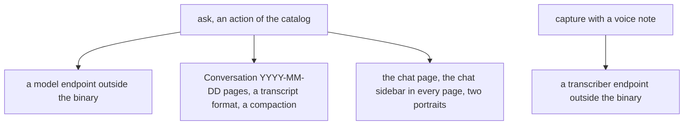

# 0075 — The conversation inside the writer costs more than it gives

- **Date:** 2026-10-15
- **Status:** resolved
- **Seen in:** the owner's review of the writer on 2026-10-15: "I am looking to strip all the unwanted or complex
  features in order to have a simpler more reliable software." Asked which, the owner chose the conversation first:
  `ask`, the Conversations pages, the chat sidebar and the voice note. Checked against the code at `518c3bb`.

## What happened

`ask` runs a model inside the writer: a loop over the catalog's tools, a transcript format of its own on a page a
day, a compaction of earlier days into the journal, a chat page and a chat sidebar in every page of the browser, and
two portraits. The voice note sends a recording to a transcriber before a capture. Both depend on an endpoint outside
the binary, read from the environment; without it they answer 503. They are the only parts of the writer whose
behaviour the writer does not control.

A coding agent with the MCP tools does what `ask` does, from outside the writer, with the owner watching. A
recording the owner wants to keep is a file with its text ([D9](../decisions/D09-binary-files.md)).

## Reproduce

1. Count what carries the conversation: the packages `internal/chat` and `internal/speech`, `conversations.go` and
   `voice.go` in `internal/api`, a template, a stylesheet block, two images, the `ask` command and `--audio` of the
   CLI, about 1,300 lines of Go without their tests.
2. Stop the model endpoint: `ask` answers 503 and the chat page says so; nothing else changes.

## Rules involved

[RFC 0012](../rfcs/0012-a-conversation-with-lifelog.md) (the conversation), plan 109 (the voice note). No decision
of the schema: the conversation is pages filed by `part-of`, and the recording was never stored.

## Resolution

Resolved 2026-10-15 by [RFC 0015](../rfcs/0015-no-conversation.md): the conversation and the voice note are removed.
The conversation pages already written stay plain pages, filed in `Conversations`.
