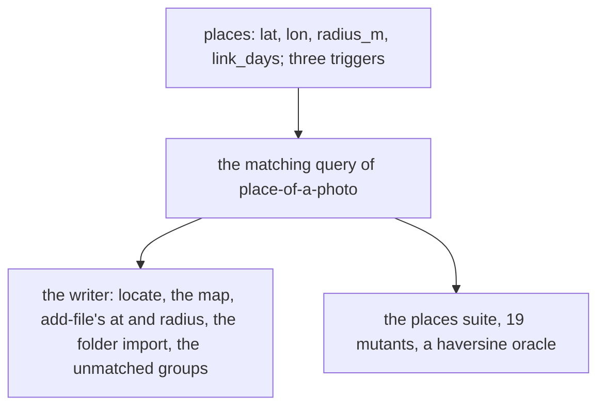

# 0076 — A place's point and a photo's position cost more than they give

- **Date:** 2026-10-15
- **Status:** resolved
- **Seen in:** the owner's review of the writer on 2026-10-15: "I am looking to strip all the unwanted or complex
  features in order to have a simpler more reliable software." The owner chose the photo positions and the place
  matching among the cuts. Checked against the code at `498cbb8`.

## What happened

A place could have a point, a radius and a `link_days` flag in a table of its own, so that a photo's position,
read from its metadata when the photo was kept, could be matched to the place whose circle holds it and link the
photo's day to that place. The matching needed a distance without math functions, a tie rule, a meridian limit, a
haversine oracle in the suites, a cookbook recipe, a `locate` action, a map of the places, a folder import of photos
with a dry run and a grouping of the positions near no place, and the owner's answer to each such group.

The owner writes the `at` link of a day by hand, as the day pages always did. A photo gives its day; its position
is never read.

## Reproduce

1. Count what carries the point: the table `places` and its triggers, the `places` suite and 19 mutants, the
   cookbook recipe, `core/places.go`, the matching in `core/files.go`, `api/placemap.go` and the world outline,
   `locate`, the `at` and `radius` fields of `add-file`, and the folder import of the CLI's `file`.
2. Keep a photo with a position and no place in its circle: the writer reports it and asks the owner to name the
   place, and the next run matches it.

## Rules involved

[D21](../decisions/D21-location-history.md) (rewritten), [D16](../decisions/D16-places.md), `places_lat`,
`places_lon`, `places_radius`, `places_link_days`, `places_not_null_island`, `places_fixed`, `places_touch`,
`places_no_delete` (all removed). The goals ([principles 6 and 7](../architecture/goals-and-principles.md)): a table
needs real use, and a cut happens before the freeze ([D13](../decisions/D13-migrations-and-freeze.md)).

## Resolution

Resolved 2026-10-15 by [RFC 0016](../rfcs/0016-no-location.md): the `places` table and the matching are removed;
the points of the owner's places are written into their pages as text.
