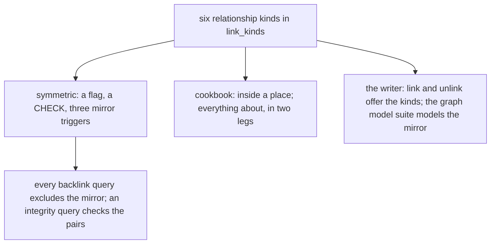

# 0077 — The relationship link kinds cost more than they give

- **Date:** 2026-10-15
- **Status:** resolved
- **Seen in:** the owner's review of the writer on 2026-10-15: "I am looking to strip all the unwanted or complex
  features in order to have a simpler more reliable software." The owner chose the typed links beyond `wikilink`,
  `at` and `part-of` among the cuts. Checked against the code at `9c5ecac`.

## What happened

The registry held six relationship kinds the owner never used: `about`, `located-in`, `parent-of`, `friend`,
`family` and `related`. Three of them were symmetric, which cost a flag in the registry, a CHECK, three mirror
triggers, a semantic integrity query, an exclusion in every backlink query and a cookbook recipe on containment.

A relationship is words in the page: "Ana is Bob's sister" names both, and the wikilinks say so.

## Reproduce

1. Count the links of those kinds in a file written by the owner: none of the six kinds was used.
2. Count what carries them: the registry rows, the mirror triggers, the `links` and `graph-model` suites, 17
   mutants, the cookbook recipe inside-a-place, and the kinds in the `link` action.

## Rules involved

[D8](../decisions/D08-entities-and-links.md) (rewritten), [D16](../decisions/D16-places.md), `link_kinds_symmetric`,
`link_kinds_mirror_valid`, `links_mirror_insert`, `links_mirror_note`, `links_mirror_delete` (all removed). The
goals ([principles 6 and 7](../architecture/goals-and-principles.md)): a rule needs real use, and a cut happens
before the freeze ([D13](../decisions/D13-migrations-and-freeze.md)).

## Resolution

Resolved 2026-10-15 by [RFC 0017](../rfcs/0017-no-typed-links.md): the six kinds and the symmetric mirror are
removed; a link of those kinds in `life.db` becomes a line of text in the page it left.
