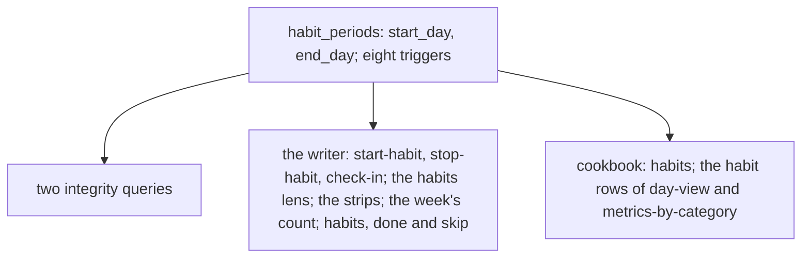

# 0078 — Habit periods cost more than they give

- **Date:** 2026-10-15
- **Status:** resolved
- **Seen in:** the owner's review of the writer on 2026-10-15: "I am looking to strip all the unwanted or complex
  features in order to have a simpler more reliable software." The owner chose habits among the cuts. Checked
  against the code at `347eaae`.

## What happened

A habit was a unitless metric with periods in a table of its own, so that a day with no check-in could be told
from a day outside the habit. The periods cost a table, eight triggers, two integrity queries, three actions, a
lens of the metrics view, a strip of 14 days on every day page and card, a section of the week, two CLI commands,
a cookbook recipe and 40 mutants.

A habit is a metric whose readings are 1 or 0: the owner records what was done with `record`, and when the habit
applies is words in its page.

## Reproduce

1. Count what carries the periods: the table and its triggers, the `habits` suite and 40 mutants, the cookbook
   recipe, `core/habits.go` past the registration, `api/habits.go`, the habit parts of five templates.
2. Register a unitless metric and record 1 on a day: the reading is kept, with or without a period.

## Rules involved

[D24](../decisions/D24-habits.md) (rewritten), `habit_periods_start_day`, `habit_periods_end_day`,
`habit_periods_source`, `habit_periods_order`, `habit_periods_check_insert`, `habit_periods_check_update`,
`habit_periods_no_delete`, `habit_periods_source_fixed`, `habit_periods_identity_fixed`, `habit_periods_touch_insert`,
`habit_periods_touch_update`, `measurements_habit_binary` (all removed). The goals
([principles 6 and 7](../architecture/goals-and-principles.md)): a table needs real use, and a cut happens before the
freeze ([D13](../decisions/D13-migrations-and-freeze.md)).

## Resolution

Resolved 2026-10-15 by [RFC 0018](../rfcs/0018-no-habit-periods.md): the table and the rules are removed; the
periods of the owner's habits are written into the metric pages as text.
