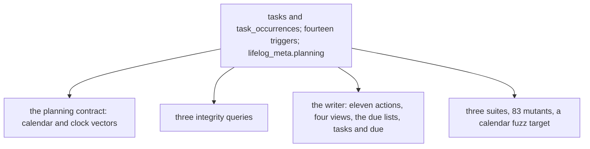

# 0079 — Tasks and occurrences cost more than they give

- **Date:** 2026-10-15
- **Status:** resolved
- **Seen in:** the owner's review of the writer on 2026-10-15: "I am looking to strip all the unwanted or complex
  features in order to have a simpler more reliable software." The owner chose tasks and occurrences among the
  cuts. Checked against the code at `c0affe9`.

## What happened

A task was a row with a label, a project page, a cadence anchored on a day, an end and a reminder clock; each of
its days was an occurrence row with a state, an outcome and a reminder override. The planning contract gave the
calendar arithmetic and the clock resolution with their vectors. The cost: two tables, fourteen triggers, a
`lifelog_meta` rule, three integrity queries, eleven actions, the views tasks, task, occurrence and deadlines, the
due lists of Home, of a day, of a month and of a week, two CLI commands, a cookbook recipe, three suites and 83
mutants.

A plan is words in a page: the owner writes what is to be done on the day page or a plain page, and reads it there.

## Reproduce

1. Count what carries the tasks: the two tables and their triggers, `core/tasks.go` and `core/task_time.go`,
   `api/tasks.go` and `api/planning_html.go`, the planning template, the `planning*` suites and 83 mutants.
2. Write "Call the bank on Friday" in a day page: it is kept, searched and read, with no task row.

## Rules involved

[D23](../decisions/D23-no-tasks.md) and [D15](../decisions/D15-recurrence.md) (both rewritten),
`lifelog_meta.planning` and every `tasks_*` and `task_occurrences_*` rule (all removed). The goals
([principles 6 and 7](../architecture/goals-and-principles.md)): a table needs real use, and a cut happens before the
freeze ([D13](../decisions/D13-migrations-and-freeze.md)).

## Resolution

Resolved 2026-10-15 by [RFC 0019](../rfcs/0019-no-tasks.md): the tables and the rules are removed; the owner's
tasks are written into a page as text.
