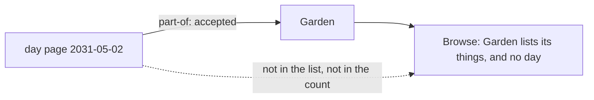

# 0080 — A day page can be filed in a category, and Browse then shows it nowhere

- **Date:** 2026-10-15
- **Status:** resolved
- **Seen in:** the review of [plan 117](../plans/117-one-browse-view.md), on 2026-10-15, when the owner asked how
  days are filed. No file in use was checked for such a link; the incident is a write that the schema accepts and
  that no reader of the writer shows. The owner decided: "we should block it in the schema".

## What happened

`link_kinds` registers `part-of` from any entity type (`from_types` NULL) to a `page`, and `links_endpoint_types`
refuses a `part-of` link that ends at a day page, but not one that starts at a day page. The writer's `file-pages`
action and its `link` action with `kind=part-of`, through the CLI or the MCP server, file a day page in a category.
Browse then shows the day page nowhere: Browse has no days ("a day is the time axis", README), so the day page is
not in the list of its category and not in its count. The browser offers no form that files a day, but the
catalog does.

Expected: a day page is not filed in a category, and a write that files one is refused with nothing written.

## Reproduce

On a fresh database built from [schema.sql](../schema/schema.sql), with synthetic data:

1. Insert the day page `2031-05-02` and the plain page `Garden` (entity row first, then its preferred name).
2. `INSERT INTO links(from_id, to_id, kind, created_at, source) VALUES (<day page>, <Garden>, 'part-of', <now>, 'cli')`:
   accepted.
3. Through the writer: `file-pages` with the day page's id and `category=Garden` answers 200, and `GET /browse?in=Garden`
   does not list the day page.

## Rules involved

- [D26](../decisions/D26-metric-categories.md): a category is a plain page, never a day page; what is filed in one.
- `links_endpoint_types` and the `part-of` row of `link_kinds` in [schema.sql](../schema/schema.sql).
- [D5](../decisions/D05-pages-and-day-pages.md): what a day page is (`entities.is_journal`).
- AGENTS.md: a rule about the data is a CHECK or a trigger, never Go.

## Resolution

Resolved 2026-10-15 by [RFC 0020](../rfcs/0020-a-day-page-is-never-filed.md): `links_endpoint_types` refuses a
`part-of` link that starts at a day page, `entities_day_identity` refuses a page with a `part-of` link that
becomes a day page, and [D26](../decisions/D26-metric-categories.md) says so.
