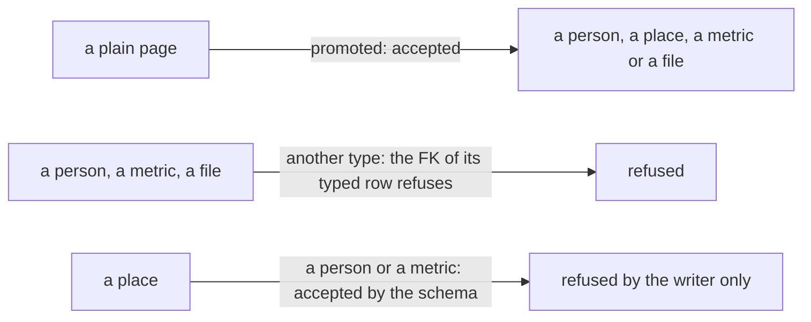

# 0081 — Only the writer keeps a place from becoming a person or a metric

- **Date:** 2026-10-17
- **Status:** resolved
- **Seen in:** the close of [plan 121](../plans/121-deep-modules-for-agents.md) (Part 8), on 2026-10-17, when the
  writer's 409s of `promote` and `register-metric` were read beside the DDL. No file in use was checked for such a
  place; the incident is a write that the schema accepts and that only the writer refuses. The owner decided (plan
  [123](../plans/123-the-owners-contract-decisions.md), decision 2): "Let's move it to schema".

## What happened

[D20](../decisions/D20-named-pages.md) promotes a plain page: a ghost becomes a person, a place, a metric or a file by
an `UPDATE` of `entities.entity_type`. The foreign key `(id, entity_type)` of a typed row refuses the type change of a
person, a metric or a file. A place has no typed row, so no rule of the schema refuses the type change of a place.
Only the writer refuses it: `promote` and `register-metric` answer 409 when the page is not a plain page (`have !=
"page"` and `p.Type != "page"` in `internal/core`, with comments that say why). A second writer, or `sqlite3` at the
prompt, makes a place a person or a metric, and the four [integrity checks](../contract/integrity-checks.md) do not
notice.

Expected: a place keeps its type, as a person, a metric and a file do, and the schema refuses the write with nothing
written.

## Reproduce

On a fresh database built from [schema.sql](../schema/schema.sql), with synthetic data:

1. Insert the place `Lakeside` (entity row first, then its preferred name).
2. `UPDATE entities SET entity_type = 'person' WHERE id = <Lakeside>`: accepted; `INSERT INTO people(id, name)
   VALUES (<Lakeside>, 'Lakeside')`: accepted. The place is now a person.
3. The same with `'metric'` and an `INSERT INTO metrics(id, unit)`: accepted.

## Rules involved

- [D20](../decisions/D20-named-pages.md): a plain ghost becomes a person; direct extension FKs refuse incompatible types.
- [D27](../decisions/D27-a-metric-is-a-page.md): a plain page of the metric's title becomes the metric.
- [D16](../decisions/D16-places.md): a place has no point and no typed row.
- AGENTS.md: a rule about the data is a CHECK or a trigger, never Go; a Go check that repeats a trigger is a defect
  ([issue 0068](0068-rules-the-writer-holds-alone.md)).

## Resolution

Resolved 2026-10-17 without a proposal: D20 and D27 already promote only a plain page, so the fix changes no
decision ([how a change happens](../process.md)). The trigger `entities_promote_from_page` in
[schema.sql](../schema/schema.sql) refuses a change of `entity_type` unless the old type is `page`;
[D20](../decisions/D20-named-pages.md) cites it, a mutant and the `named` suite hold it. Plan 123 applies the
trigger to the owner's file.
