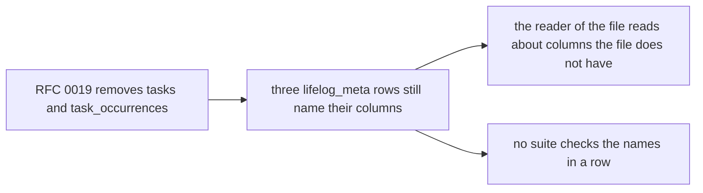

# 0082 — The lifelog_meta rows name the columns of the tasks that D23 removed

- **Date:** 2026-10-17
- **Status:** resolved
- **Seen in:** the review of step E1 of [plan 121](../plans/121-deep-modules-for-agents.md), on 2026-10-17, recorded
  for the owner in [its closing record](../plans/121-deep-modules-for-agents.md#the-closing-record-2026-10-17). The
  rows were read beside the DDL; no data was read. The owner decided (plan
  [123](../plans/123-the-owners-contract-decisions.md), decision 4): "fix it".

## What happened

[RFC 0019](../rfcs/0019-no-tasks.md) removed the tables `tasks` and `task_occurrences`
([D23](../decisions/D23-no-tasks.md)). Three `lifelog_meta` rows of [schema.sql](../schema/schema.sql) still name
their columns. A reader in 2075 has only the file, and these rows tell that reader about columns that the file does
not have.

| row | the words that name a removed table |
|---|---|
| `instants` | "task completed_at is supplied completion evidence and reminder_override_at is a chosen future or past reminder instant, not an assertion that an event happened" |
| `days` | "tasks.anchor_day, tasks.repeat_until_day, task_occurrences.due_day and date occurrence_key are chosen planning calendar days, not claims that an event happened" |
| `source` | "import_key is unique per source on entities, tasks and task_occurrences" |

No suite noticed: the 2075 test of the [threat model](../contract/threat-model.md) checks that a row says the words
of its answer. It does not check that a row names only what the file has.

The other seven rows (`schema`, `deletes`, `edit_revisions`, `typed_links`, `writers`, `sqlite`, `evolution`) were
read once for a word of each feature that RFCs 0013 to 0020 removed: sessions, recorded periods, a place's point, a
photo's position, the relationship link kinds, habit periods and tasks. None of them has such a word.

Two pages of `docs/` had words of the same kind. Neither page is stored in the file:

- the [threat model](../contract/threat-model.md) named "the points of the owner's places" as an asset (a place has
  no point since [issue 0076](0076-a-places-point-costs-more-than-it-gives.md));
- its control of a buggy writer named "`source` on every entity, task, task occurrence, link, measurement and habit
  period": a restatement of the row `source`, with two removed tables in it.

Two comments inside `CREATE` statements have words of a removed feature:

- `CREATE TABLE entities`: "a place's point is optional" (a place has no point since issue 0076);
- `CREATE TABLE people`: "relationships between them are links (friend, family, parent-of)" (the registry holds
  only `wikilink`, `at` and `part-of` since [issue 0077](0077-relationship-links-cost-more-than-they-give.md)).

## Reproduce

On a fresh database built from [schema.sql](../schema/schema.sql) as it was before the fix:

1. `SELECT value FROM lifelog_meta WHERE key = 'days'`: the value names `tasks.anchor_day` and
   `task_occurrences.due_day`.
2. `SELECT count(*) FROM sqlite_schema WHERE name IN ('tasks', 'task_occurrences')`: 0.

## Rules involved

- [D23](../decisions/D23-no-tasks.md) and [RFC 0019](../rfcs/0019-no-tasks.md): there is no table of tasks.
- [D10](../decisions/D10-time-model.md): the rules of time are the rows `instants` and `days`.
- [D13](../decisions/D13-migrations-and-freeze.md): until the freeze, `schema.sql` is edited in place.
- [How a change happens](../process.md), item 4 before the freeze: the `lifelog_meta` rows are read once more as a
  stranger would.

## Resolution

Resolved 2026-10-17 without a proposal: the fix removes words about tables that are not in the file, and it changes
no decision ([how a change happens](../process.md)). In [schema.sql](../schema/schema.sql) the three rows lose their
words about tasks; only the `VALUES` of the rows change, and no `CREATE` statement changes. The threat model names
the places where the owner was as an asset, and its control cites the row `lifelog_meta.source` instead of a
restatement of it. The `document` suite has a new witness: every name with an underscore in a `lifelog_meta` row is a
column, a schema object, a key or a pragma of the file. A mutant that puts `task_occurrences.due_day` back into the
row `days` holds the witness.

The two comments inside `CREATE TABLE entities` and `CREATE TABLE people` stay, and the owner decides when they
change. The file stores the text of each `CREATE` statement with its comments in `sqlite_schema`. A change of a
comment is a change of that stored text, and the owner's file then needs its tables rebuilt or its stored schema
edited. A change of a row needs only an `UPDATE`. Plan 123 applies the three rows to the owner's file.

2026-10-17: the owner decided to fix the two comments too ("Fix the old comments also").
[Plan 124](../plans/124-true-comments-in-the-file.md) changes them in [schema.sql](../schema/schema.sql) and in the
owner's file.
