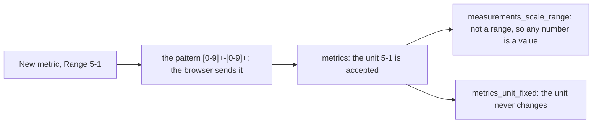

# 0084 — A scale's unit with its bounds out of order is the unit of a plain number for good

- **Date:** 2026-10-17
- **Status:** resolved
- **Seen in:** the review of step D4 of [plan 121](../plans/121-deep-modules-for-agents.md) (Part 8), on 2026-10-17,
  when the New metric form of `/metrics` was read beside the DDL. No file in use was checked for such a unit; the
  incident is a write that the schema accepts and that makes a metric the owner cannot correct. The owner decided
  ([plan 125](../plans/125-a-range-is-a-true-range.md)), after the question was shown with the New metric form:
  "let's fix it".

## What happened

[D6](../decisions/D06-mood-is-a-measurement.md): a scale names its range as its unit, `lo-hi` of ASCII digits with
`lo` less than `hi`, and `measurements_scale_range` holds the values of a scale to the whole numbers of that range. A
unit of the same shape with its bounds out of order (`5-1`, `3-3`) is not a range. The schema accepted it as the unit
of a plain number, so a reading of the metric was any finite number. `metrics_unit_fixed` then kept the unit for
good: one typo in the Range field of New metric made a metric that can never be a scale.

The score form of New metric asks for its range with the browser pattern `[0-9]+-[0-9]+`; a pattern cannot compare
two numbers. At `af93c8d`, with synthetic data: the score form sent the name `Pain` and the range `5-1`, and the server
made the metric (303 to `/metrics`). A reading of 7.5 was accepted. `/metrics` then showed it as "7.5 of 1", because
the view reads a unit of that shape as a scale.

Expected: the schema refuses such a unit when the metric is made, nothing is written, and the writer answers the
schema's 422 with its sentence.

## Reproduce

On a fresh database built from [schema.sql](../schema/schema.sql), with synthetic data:

1. Insert the metric `Pain` (entity row first, then its preferred name), then `INSERT INTO metrics(id, unit) VALUES
   (<Pain>, '5-1')`: accepted. The same with `'3-3'` for another metric: accepted.
2. Insert a reading of `Pain` with the value 7.5: accepted, since `5-1` is not a range.
3. `UPDATE metrics SET unit = '1-5' WHERE id = <Pain>`: refused by `metrics_unit_fixed`.

## Rules involved

- [D6](../decisions/D06-mood-is-a-measurement.md): a scale names its range as its unit (`measurements_scale_range`).
- [D7](../decisions/D07-measurements.md): a unit never changes (`metrics_unit_fixed`) and is at most 32 bytes
  (`metrics_unit`).
- AGENTS.md: a rule about the data is a CHECK or a trigger, never Go.

## Resolution

Resolved 2026-10-17 without a proposal: D6 already names a range `lo-hi` with `lo` less than `hi`, so the fix changes
no decision ([how a change happens](../process.md)). The trigger `metrics_range_order` in
[schema.sql](../schema/schema.sql) refuses, when a metric is made, a unit of the shape `lo-hi` whose `lo` is not less
than its `hi`; [D6](../decisions/D06-mood-is-a-measurement.md) cites it, a mutant and the `facts` suite hold it. An
`UPDATE` needs no trigger of its own: `metrics_unit_fixed` refuses every change of a unit. No Go check of the writer
refused such a unit, so `register-metric` and the New metric forms now answer the schema's 422 with the sentence of
the trigger, on every surface, and nothing is written; the writer's own tests and the parity table hold it. The
writer's `isScale` compared the two bounds again: it now reads the shape only, since the schema keeps the bounds in
order. Plan 125 applies the trigger to the owner's file.
