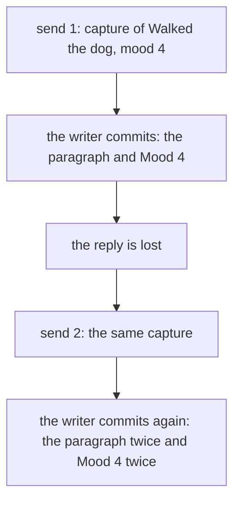

# 0085 — A capture that a client sends again appends its paragraph twice and records a second mood

- **Date:** 2026-10-17
- **Status:** open
- **Seen in:** the review of the writer against the rule books ([plan 126](../plans/126-the-rule-book-review.md),
  finding A2), on 2026-10-17. It is read from the code and the cookbook, not seen on a file in use. The case is
  ordinary: a client sends a capture, the writer commits, and the reply is lost.

## What happened

`capture` appends an entry to the journal page of a day and, when the client gives a mood, records one reading
([capture](../cookbook/capture.md)). The client cannot know that the first send committed when the reply is lost
(a timeout, a dropped connection). It sends the capture again, as the
[import recipe](../cookbook/import-a-row-once.md) says a sender may do. The second send appends the same paragraph to
the page again, and it records a second Mood reading for the day.

A page body that a client sends again unchanged needs no key. The writer can compare the resent body with the live
body and answer with the live version. A capture has no version to compare, because it adds to the body and does not
replace it. Two equal captures in a row can also be two true facts (the owner writes the same line twice), so the
writer cannot tell a retry from a repeat by the content.

Expected: a capture that the client sends again after a lost reply changes nothing the second time.

## Reproduce

On a fresh database built from [schema.sql](../schema/schema.sql), with synthetic data:

1. Capture the text `Walked the dog` with mood 4 on a day with no page: the page is made with that paragraph, and
   one Mood reading exists.
2. Send the same capture again: the body has the paragraph twice, and two Mood readings exist for the day.

## Rules involved

- [Capture](../cookbook/capture.md) and [import a row once](../cookbook/import-a-row-once.md): `import_key` is the
  key that the sender gives a row, for the rows that may arrive twice.
- [D7](../decisions/D07-measurements.md): a reading is append-only, and a second reading is a new fact.
- [Imports](../contract/imports.md): a key is unique per source.

## Resolution

Open. A request key for a capture is a new column or a new table. That is a schema question, and it waits for the
process ([how a change happens](../process.md)): a proposal that names the options (a key on the capture that the
writer keeps, or a key that the client gives to each paragraph and reading) and what each costs after the freeze.
