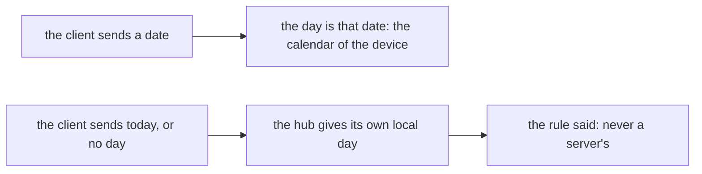

# 0086 — The days rule says never a server's day, and the word today is the hub's day

- **Date:** 2026-10-17
- **Status:** resolved
- **Seen in:** the review of the writer against the rule books ([plan 126](../plans/126-the-rule-book-review.md),
  finding A5), on 2026-10-17. The disagreement is between two texts, found by reading them side by side. No file in
  use was checked.

## What happened

`lifelog_meta.days` said that a day is written by the app from the local calendar of the device that captured it,
"never a server's". [D10](../decisions/D10-time-model.md) said the same: a phone's zone, never the clock or zone of a
hub. The writer does otherwise for one input. The word `today` is read on every surface through one function
(`Store.Today`), and it gives the local day of the clock and the zone of the writer, which is the hub. The browser,
the CLI and the MCP tools all send the word, or no day, to the hub. By design, the hub answers with its own day.

The two differ only when the hub and the device are in different zones, for example on a journey. Expected: the rule
and the writer say the same thing.

## Reproduce

On a fresh database built from [schema.sql](../schema/schema.sql), with a writer whose zone is UTC and a clock at
`2026-10-17T23:30Z`: `capture` for the day `today`. The page of `2026-10-17` is written. A phone in a zone at UTC+3
was already in `2026-10-18` at that instant.

## Rules involved

- `lifelog_meta.days` in [schema.sql](../schema/schema.sql) and [D10](../decisions/D10-time-model.md).
- [Exact time](../contract/exact-time.md).

## Resolution

Resolved 2026-10-17 without a proposal: the writer keeps its behavior, and no decision changes
([how a change happens](../process.md)). Two options were open: the text says what the writer does, or the catalog
requires the day from the client. The first one is chosen, since it is the smaller change and the one
client that matters, a hub on the owner's own network, has one zone. The `days` row of `lifelog_meta` and
[D10](../decisions/D10-time-model.md) now say that the day is the local day of the capturing device when the client
names a date, and the local day of the writer's clock and zone when the client sends the word `today` or no day.
A client that must have the device's day sends the date.
