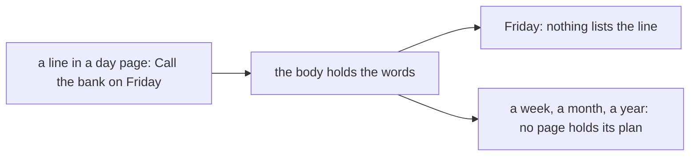

# 0087 — A plan written as words cannot be read as a plan

- **Date:** 2026-10-19
- **Status:** resolved
- **Seen in:** the owner's request of 2026-10-19 to reopen the planning axis after [RFC 0019](../rfcs/0019-no-tasks.md):
  "Until now we focused on logging our past but now I want to do the other axis, planning, tasks, projects, timed
  projects, goals and everything in between." The example below is synthetic.

## What happened

The owner writes "Call the bank on Friday" in a day page. The writer holds the words and nothing else. No view
lists the line on Friday. No view says what was planned for a week. A month, a quarter and a year have no page of
their own, so a plan for them has no home. A line that repeats is written again by hand.

Expected: a line that says it is a plan can be read as one, listed on its day and ticked, and a longer horizon has
a page.

## Reproduce

On a fresh database built from [schema.sql](../schema/schema.sql), capture the line "Call the bank on Friday" into
the day page of a Monday. Read Home on Friday. The line is not there.

## Rules involved

- [D23](../decisions/D23-no-tasks.md): a plan is words in a page; no `tasks` table.
- [D15](../decisions/D15-recurrence.md): no recurrence table.
- [D5](../decisions/D05-pages-and-day-pages.md): the day page and the pages with a reserved key.
- [D22](../decisions/D22-events.md): an intention is not an event row.
- [Non-goals](../architecture/non-goals.md): the rows on tasks and on planned appointments.

## Resolution

Resolved 2026-10-19 by [RFC 0022](../rfcs/0022-plan-lines-and-period-pages.md): [D29](../decisions/D29-plan-lines.md)
and [D30](../decisions/D30-period-pages.md).
