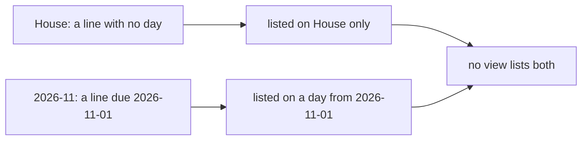

# 0088 — The open plans are scattered over their pages

- **Date:** 2026-10-20
- **Status:** resolved
- **Seen in:** the owner's request of 2026-10-20, a day after [plan lines](../contract/plan-lines.md) shipped: "Can we
  add beside Today, This Week Calendar Metrics and browse a Todos/Tasks page, to show them in order of due time, or
  on categories, or to show them all or simply manage them". The example below is synthetic.

## What happened

The owner writes `- [ ] Ask the builder for a quote` in the page "House" and `- [ ] Pay rent due:2026-11-01` in a
month page. A day lists only the lines planned on or before it. A line with no day is listed only on its own page.
No view lists every open line, so the owner must open each page to see what is still open.

Expected: one list of every open line, in the order of its day or grouped by its page, where each line can be
closed, carried, or given new dates.

## Reproduce

On a fresh database built from [schema.sql](../schema/schema.sql), plan the two lines above. Read Home on
2026-10-20. Neither line is there, and no other view lists them together.

## Rules involved

- [Plan lines](../contract/plan-lines.md): a line with no day is planned on no day.
- [D23](../decisions/D23-no-tasks.md) and [D29](../decisions/D29-plan-lines.md): a plan is a line of a page.

## Resolution

Resolved 2026-10-20 by [plan 140](../plans/140-the-plans-page.md): the read `plans` lists every open line by day or
by page, and the action `schedule` changes the dates of a line. A line with no day is listed on its own page and in
that list, never under a day. No decision changed, so the change has no RFC.
