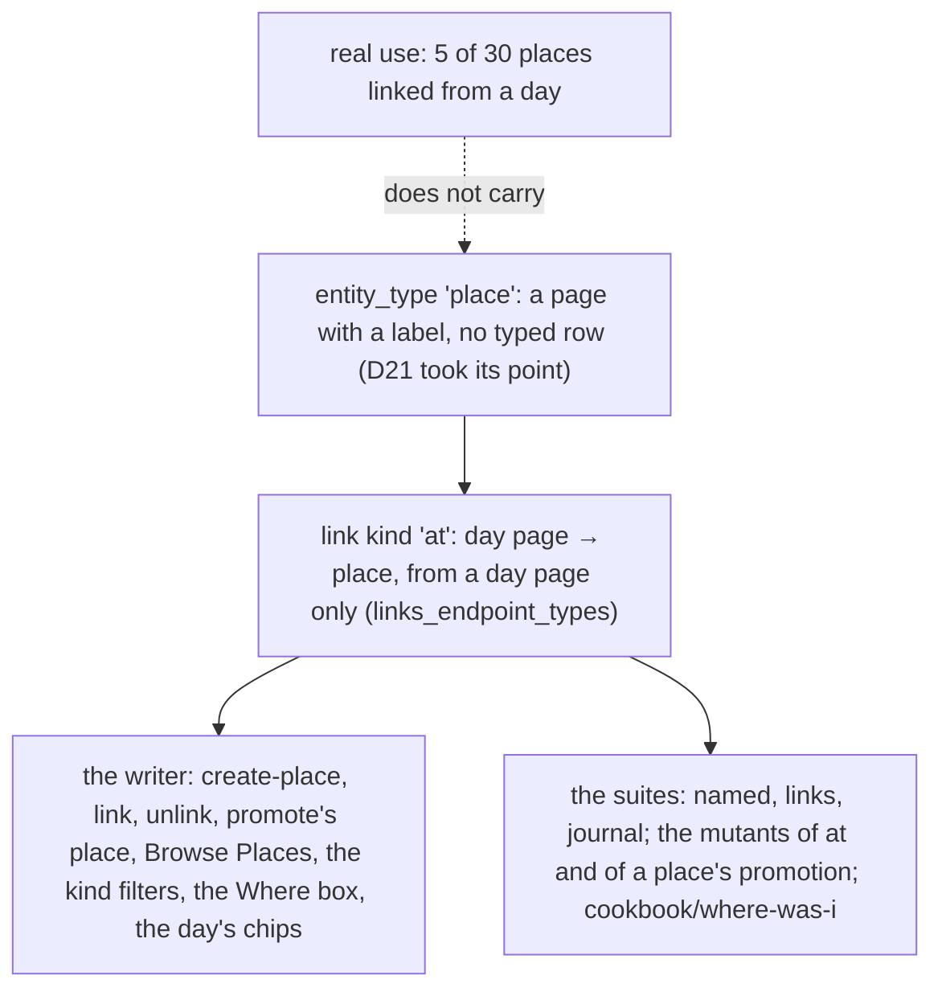

# 0091 — Places and the `at` link cost more than they give

- **Date:** 2026-10-29
- **Status:** open
- **Seen in:** the owner's review of the day view on 2026-10-29. The Where box of a day ("No place on this day. I was
  at a place") is the one surface of the `at` link, and the owner said they do not use it. The owner then counted
  the places of the live file with the writer's own Browse list (`GET /browse?kind=place`); the counts are below.
  Checked against the code at `577fde7`.

## What happened

[D16](../decisions/D16-places.md) made a place a page of its own type, `place`, and made "where was I on a day" a link
kind of its own, `at`, from the day page to the place. The reason was the difference between a day that *names*
a place and a day the owner *was at* the place. The owner's file shows that the difference is not used:

| of the 30 places of the live file | places |
|---|---|
| no live page links to them, by `at` or by `[[wikilink]]` | 21 |
| one page links to them, and it is not a day page | 4 |
| a day page links to them | 5 |

The busiest place has 8 pages that link to it, and the last of them is a day of 2025. Most of the thirty came in
with the 2022 import and were never touched again. The `at` links are at most the links of the five, since the
Browse count holds wikilinks too.

A place has nothing behind its type but this one kind: [D21](../decisions/D21-location-history.md) already took its
point, so a place with no `at` link is a plain page with a label, a list of its own and a filter. Expected
(principles 6 and 7 of the [goals](../architecture/goals-and-principles.md)): a type and a link kind are in the file
because real use asks for them, and anything still in the schema at the freeze stays for good
([D13](../decisions/D13-migrations-and-freeze.md)).

## Reproduce

Nothing fails on a fresh database: the incident is one of use, not of a defect, as in
[0073](0073-sessions-cost-more-than-they-give.md) to [0079](0079-tasks-cost-more-than-they-give.md).

1. Count what carries the type and the kind: `'place'` in `entities_entity_type` and in the `wikilink` row of
   `link_kinds`; the `at` row of `link_kinds` and its clause in `links_endpoint_types`; the sentence of
   `entities_promote_from_page` that exists for a place alone ([0081](0081-only-the-writer-keeps-a-place-a-place.md));
   the `at` check of [integrity checks](../contract/integrity-checks.md) and row 20 of the 2075 table of the
   [threat model](../contract/threat-model.md); the recipes [where was I](../cookbook/where-was-i.md),
   [a person or a place](../cookbook/person-or-place.md), [everything about](../cookbook/everything-about.md) and the
   `at` clause of [the day view](../cookbook/day-view.md); the actions `create-place`, `link` and `unlink` and the
   `place` option of `promote`; the Places list of Browse, the `place` kind of `browse`, `search` and `random`; the
   Where box of a day and the place chips of a day's card; the mutants of the `named`, `links` and `journal` suites
   that name a place or `at`.
2. Make a day page and a place on a fresh file, write "I was at [[Lakeside]]" in the day, and add the `at` link
   too: the day names the place twice, in its words and in a row, and the Browse count of the place is one either
   way.

## Rules involved

[D16](../decisions/D16-places.md), [D21](../decisions/D21-location-history.md), [D8](../decisions/D08-entities-and-links.md)
(the five linkable types, the three link kinds), [D20](../decisions/D20-named-pages.md) (a person or a place is a
page), `entities_entity_type`, `links_endpoint_types`, `entities_promote_from_page`. The goals
([principles 6 and 7](../architecture/goals-and-principles.md)): a table, a type or a kind needs real use, and a cut
happens before the freeze ([D13](../decisions/D13-migrations-and-freeze.md)).

## Resolution

[RFC 0024](../rfcs/0024-no-places.md), accepted by the owner on 2026-10-29: the type `place` and the kind `at` are
removed; a place is a plain page, and where a day was is the words of the day page. The issue closes with the change.
