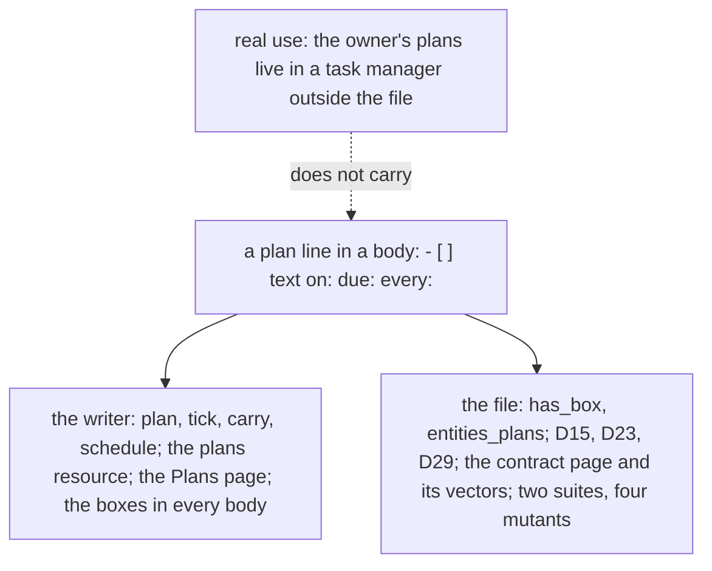

# 0092 — Plan lines cost more than they give: the owner plans in a task manager

- **Date:** 2026-10-29
- **Status:** resolved
- **Seen in:** the owner's review of the app on 2026-10-29. The owner keeps their plans in a task manager outside
  `lifelog`, and said that the plan lines of [D29](../decisions/D29-plan-lines.md), with their four actions and their
  Plans page, are not used. Checked against the code at `860e9b3`.

## What happened

[D23](../decisions/D23-no-tasks.md) cut the tasks tables on 2026-10-15 ([RFC 0019](../rfcs/0019-no-tasks.md)), and
[D29](../decisions/D29-plan-lines.md) brought a plan back four days later as a line of a page: a list item that starts
with a box, read from the body at read time, with a grammar and its vectors ([plan lines](../contract/plan-lines.md)),
four actions of the writer (`plan`, `tick`, `carry`, `schedule`), a `plans` resource, a Plans page in the browser, a
generated column `entities.has_box` with the partial index `entities_plans`, a parser, two suites and four mutants.

The owner's words (2026-10-29): "I am thinking of removing again the todo and tasks functionalities of the app and in
exchange to create an agnostic adapter that I can build integrations upon it. For my first integration, I am thinking
of integrating ticktick." And: "I want in lifelogdb to aggregate all the 'apps' functionalities through an extremely
agnostic interface, and create my own integration in a simple modular way."

So a plan has two homes again, as [RFC 0019](../rfcs/0019-no-tasks.md) found for the tasks table: the task manager
the owner uses, and the line `lifelog` offers and the owner does not write. The file is a life log, what happened and
what was measured ([goals](../architecture/goals-and-principles.md)); a plan is the future, and the owner keeps it
elsewhere. What the file lacks is not a plan but the opposite: a way for what the owner did in that other app to come
back as an entry of the day, and a way for the agent and the browser to reach that app without the core naming it.

## Reproduce

Nothing fails on a fresh database: the incident is one of use, not of a defect, as in
[0079](0079-tasks-cost-more-than-they-give.md) and [0091](0091-places-cost-more-than-they-give.md).

1. Count what carries a plan line: `has_box` and `entities_plans` in [schema.sql](../schema/schema.sql); the four
   actions and the `plans` resource of the catalog; the parser of the writer; the Plans page, the box glyphs and the
   tick forms in every body, the plan blocks of a day, a week, a month, a year and a period page; the `plan-lines` and
   `plan-lines-index` suites, four mutants, two diagrams, two JSON vector blocks; [D15](../decisions/D15-recurrence.md),
   [D23](../decisions/D23-no-tasks.md), [D29](../decisions/D29-plan-lines.md); the recipe
   [plan a project](../cookbook/plan-a-project.md).
2. Write `- [ ] call the dentist due:2026-11-03` in a page of a fresh file, and the same task in a task manager: the
   plan has two homes, and a tick in one does not reach the other.
3. Ask the agent to add a task to the task manager: no tool exists, since the core names no third party
   ([plan 135](../plans/135-extensions-outside-the-core.md)) and no extension can add an action to the catalog.

## Rules involved

[D23](../decisions/D23-no-tasks.md), [D29](../decisions/D29-plan-lines.md), [D15](../decisions/D15-recurrence.md),
[D30](../decisions/D30-period-pages.md) (a period page as a plan horizon), the page [plan lines](../contract/plan-lines.md),
`entities.has_box`, `entities_plans`. The goals ([principles 6 and 7](../architecture/goals-and-principles.md)): a
column, an index or a convention needs real use, and a cut happens before the freeze
([D13](../decisions/D13-migrations-and-freeze.md)). The four rings (AGENTS.md, [plan 135](../plans/135-extensions-outside-the-core.md)):
the core names no third party and dials only its own server.

## Resolution

[RFC 0025](../rfcs/0025-no-plan-lines-and-connected-apps.md), accepted by the owner on 2026-10-29: plan lines are
removed; a plan lives outside the file, in the owner's task manager; an extension run under `lifelog serve --with NAME`
may serve a catalog of its own, which the core aggregates, so the agent, the browser and the API reach the app through
the one catalog. Resolved 2026-10-29 by [plan 154](../plans/154-connected-apps-through-the-catalog.md): the contract, the writer and the browser changed on master, and the owner's file followed (2143 rows unchanged, 12 bodies keep their boxes as prose; `has_box` and `entities_plans` dropped).
