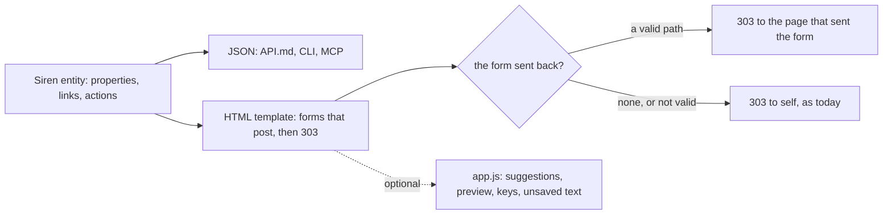

# 091 — The browser for daily use: planning, the journal, navigation and editing

> Dated implementation record. Tests use temporary folders and synthetic data only. Screenshots are made from a
> synthetic database and are not kept in git.

## Status

- **Date / baseline:** 2026-10-12, `79d8496` (master).
- **Priority:** P1. **Effort:** L. **Risk:** MEDIUM: new properties and actions on four entities, three new
  resources, one new catalog action, a return path for browser forms, and the first script of the application.
  None for the schema.
- **Status:** DONE (four commits: `ae48f64`, `c768dd4`, `bac47b0`, and the commit that closes this record).
- **Resolves:** issue [0060](../issues/0060-the-browser-cannot-carry-daily-use.md). No RFC: the contract in `docs/`
  does not change, and [D14](../decisions/D14-ui-and-tools.md) leaves the screens to the application. The README
  decision "No JavaScript" changes by the owner's decision below.

## The owner's decisions (2026-10-12)

| question | decision |
|---|---|
| a separate client, or the browser that `lifelog` serves | the browser that `lifelog` serves; no second web application |
| JavaScript | a script makes a page better, but no page needs it: one hand-written file, embedded like the two sheets; no framework, no CDN, no build step |
| moving between days | a month calendar, with the mood of each day, and a date to jump to |
| Home | today at a glance: capture, what is due, today's habits, the last entries; the forms that make new things go into one closed section |

## The rules for every part

- A template reads only the properties that the JSON carries, and places only the actions that the entity offers
  (README). So when a screen needs new data, its entity gets a new property or action, and every client gets it:
  `API.md`, the CLI's `get` and `do`, the MCP `get` tool and the MCP tools of the catalog.
- Every form works without the script. The script only adds to a page that already works.
- Every change to the wire is an addition. No property, action or field changes its name or its meaning.

## Part 1 — The return path, and planning

| what | where |
|---|---|
| **The return path.** A browser form may send `back`: a path on this server. After a write, the browser gets 303 to `back` (with its query, and the feedback receipt) instead of `self`. `back` is valid only when it starts with one `/`, is not `//…` or `/\…`, has no scheme and no host, and has at most 2,048 bytes. Any other value is ignored, and the answer goes to `self`. A JSON client gets the same answer as today (`Location: self`). `back` is not a field of an action: it is how a browser asks to return, and the README names it. | `internal/api/handler.go` (`serve`), `internal/api/feedback.go` |
| **An action for each occurrence.** `/deadlines`, a task and an occurrence offer, for each occurrence they show, the write that is legal on it: `capture-occurrence` for a virtual slot, `edit-occurrence` for a written one, filled with `task_version` and `version`. A tombstoned task offers none. The template draws **Done** (`state=done`, `completed_at=now`) and **Skip** (`state=skipped`) as small forms with fixed fields, as `/habits` does with `check-in`. A done or skipped occurrence gets **Reopen** (`state=open`). | `internal/api/tasks.go` |
| **Groups.** `/deadlines` carries `today`, the local day the server read. The template puts the occurrences into four groups: overdue (open, due before today), today, the next 7 days, later. In "later", a series shows its first slot and "N more", linked to the task. | `internal/api/tasks.go`, `internal/api/html/planning.html` |
| **Templates.** `tasks`: grouped by project, each task with its cadence and reminder in words. `task`: the same words, then the next open occurrences with Done and Skip, then edit, stop and tombstone in closed boxes. `occurrence`: label, due day, state and reminder in words, then Done, Skip or Reopen, then the edit form closed. `deadlines`: the four groups, then the window form. | `internal/api/html/planning.html`, `viewOf` in `internal/api/html.go` |
| **Words.** One template function makes the cadence words from the task's properties: "every 3 days from 2026-10-05", "every month from 2026-10-01 until 2027-06-30", "once, due 2026-10-15", "once, no due day". Another makes the reminder words: "09:00 Europe/Bucharest", "at 2026-11-01 07:00 UTC", "none". | `internal/api/html.go` |

## Part 2 — The journal and Home

| what | where |
|---|---|
| **The day entity.** New properties: `due`, the open occurrences due that day (on today, the overdue ones too), each with the actions of Part 1; `mood`, the values of the current Mood readings of the day with no session, in id order, read as [mood over time](../cookbook/mood-over-time.md) reads them (by the name key `mood`, not by a display title). New actions: the `check-in` of each habit active that day, as `/habits` offers them, and the `save-body` of the day page when it exists, with its body and `version`. | `internal/api/handler.go` (`day`), `internal/core` |
| **The day view.** The mood beside the heading. The journal, with an Edit box under it (closed). Capture. Due, with Done and Skip. Habits, with Done and Not done. Readings: the columns `scope` and `taken at` are shown only when a row has a session or a time; the measurement page still shows both. | `internal/api/html/day.html` |
| **The root entity.** New properties: `due` (overdue and today, with the actions of Part 1), `habits` (today's, with their `check-in` actions) and `recent` (the last 5 day pages: day, mood, the first line of the body, in day order, newest first). | `internal/api/handler.go` (`root`) |
| **Home.** Capture; due; habits; the last entries. Then one closed section "New" (id `new`, so `/#new` still opens it) with the forms that make new things, and one closed section "Owner". The `More` links stay. | `internal/api/html/root.html` |

## Part 3 — Navigation

| what | where |
|---|---|
| **The month.** `GET /months/{YYYY-MM}`, class `month`: properties `month`, `today` and `days`, one item for each day of the month with `day`, `page` (true when a day page exists) and `mood` (as in Part 2); links `prev` and `next` (the months before and after) and one link for each day. `GET /months/current` answers 303 to this month, as `/days/today` does. `/days` stays as it is. | `internal/api/handler.go`, `internal/api/html/month.html` |
| **The calendar.** A table of weeks, Monday first. Each day links its day view; a day with a page is marked, with its mood. Previous and next month. Today is marked. | `internal/api/html/month.html` |
| **Go to a day.** `open-day`, a GET action of the catalog: `GET /days/go?day=YYYY-MM-DD` answers 303 to `/days/{day}`; a day that is not valid is 422. It is a catalog action like `find`, so the CLI's `do` and an MCP tool carry it. The month and the day view show its form (a `date` field). | `internal/api/handler.go`, the catalog |
| **The top bar.** Today, Calendar, Due, Tasks, the search box, and **More**: a `details` menu with Home, People, Places, Files, Metrics, Habits, Sessions, Periods, Ghost pages, Every action and Integrity checks. On a phone, the links are one row that scrolls to the side, then the search box. No script. | `internal/api/html/layout.html`, `internal/api/html/app.css`, `navItems` in `internal/api/html.go` |

## Part 4 — Editing, and the script

| what | where |
|---|---|
| **The editor without the script.** On a page with a body, the Edit box is directly under the heading (closed), so a long page needs no scroll to the end. The `rows` of the `save-body` field `body` follows the line count of the body, from 12 to 40. | `internal/api/html/page.html`, `internal/api/handler.go` |
| **Titles.** `GET /titles?prefix=…&limit=…`, class `titles`: the names of active named pages whose name key starts with the prefix folded by `title_key` ([titles and wikilinks](../contract/titles-and-wikilinks.md)), in key order; for an alias, the name and its preferred title. `limit` 1–20, default 10; an empty prefix is 422. The read is a range on the index of `entity_names.name_key`, not `LIKE`; its query plan is checked once by hand and not asserted by its text. It is a resource, so the CLI's `get` and the MCP `get` tool carry it. | `internal/api/handler.go`, `internal/core` |
| **The preview.** `POST /render` with the field `body` answers `text/html`: the same renderer as a saved body (CommonMark, safe defaults, raw HTML omitted, wikilinks and tags linked). It writes nothing. It has the request limits of an action, and it is behind the origin guard and the token like every POST. It is presentation, not a capability, so it is not in the catalog; the README names it as a browser route, beside `/login`. | `internal/api/handler.go`, `internal/api/markdown.go` |
| **The script.** `app.js`, embedded and written into each page like the two sheets. It does four things. **Suggestions:** after `[[` in a textarea, a list from `/titles`; arrows and Enter insert `Title]]`. **Preview:** a Preview tab beside the editor (side by side on a wide screen), sent to `/render` 400 ms after typing stops. **Keys:** Ctrl+Enter (Cmd+Enter) sends the form of the textarea; outside a text field, `/` goes to search, `c` to capture, `t` to today, `[` and `]` follow the page's `prev` and `next` links. **Unsaved text:** when the text of a textarea differs from its first text, leaving the page asks first; sending the form does not ask. It fetches nothing except `/titles` and `/render`. | `internal/api/html/app.js`, `internal/api/html.go`, `internal/api/html/layout.html` |
| **README.** "No JavaScript" is rewritten as the new decision. `back`, `/render`, `/titles`, `/months` and `open-day` are named. | `README.md`, `API.md` |

## Done criteria

1. Go tests beside their packages, on a real SQLite file under `t.TempDir()`, built through the writer, with
   hand-checked values:
   - **return path:** a valid path with a query gets 303 there, with the feedback; `//evil.example`, `/\evil`,
     `https://evil.example/`, `javascript:alert(1)`, a path of 2,049 bytes and an empty value get 303 to `self`; a
     JSON client never follows `back`.
   - **planning:** each occurrence offers the correct action (virtual, written, done, skipped, tombstoned task);
     Done through the offered form writes `state=done` with a completion instant; Skip; Reopen clears the
     completion; a stale `task_version` is 409 and writes nothing. `deadlines.today`; the groups as a table of cases
     (overdue, today, the edge of the 7 days, later, a folded series); the cadence and reminder words as a table of
     cases.
   - **day:** `due` on a past day, on today (with overdue) and on a day with none; `mood` with zero, one and two
     readings, and after a retraction; the `check-in` actions; `save-body` of the day page with its `version`.
   - **root:** `due`, `habits`, `recent` (order, first line, a day page with an empty body).
   - **month:** months of 30 and 31 days, February of a leap year, a month with no page; `prev` and `next` across
     a year; `mood`; `2026-13` and `x` are 422; `/months/current` gets 303.
   - **open-day:** a valid day gets 303; `2026-02-30`, `x` and an empty value are 422.
   - **titles:** case and Unicode folding from the contract's vectors; an alias; a tombstoned page is not listed;
     `limit` 0 and 21 are 422; an empty prefix is 422.
   - **render:** the HTML equals the HTML of the same body when it is saved and shown; raw HTML is omitted; GET is
     405; a cross-origin POST is refused; a body over the limit is 413.
   - **parity:** the new resources through the CLI's `get` and the MCP `get` tool; `open-day` through `do` and its
     MCP tool; the owner-only actions unchanged.
   - **views:** each new template renders the synthetic database; Done, Skip and check-in forms appear only where
     the entity offers the action; a page has the same forms with the script removed.
   - **API.md:** the new properties and classes; `TestAPIReferenceMatchesTheCode` passes.
2. **The script** is embedded and written once into each page. Its behaviour is checked by hand in Edge on
   Windows, at 1280 px and 390 px, and the result of this plan records what was checked and in which browser. It is
   not automated: the baseline has no JavaScript runtime, and this plan adds none.
3. Screenshots of the four areas before and after, at 1280 px and 390 px, on a synthetic database.
4. Baseline green on Windows: `go generate ./... && go vet ./... && go test ./...`; `gofmt` on changed files;
   `go test -count=1 -shuffle=on ./...` for the change to `serve`; staticcheck and govulncheck if they are available
   (reported as not run if not).
5. Four commits, one for each part, each with the baseline green. The issue is resolved and this plan is DONE in
   the commit of Part 4.

## Result (2026-10-12)

All four parts are done. These points differ from the text above, or add to it:

| point | what was done, and why |
|---|---|
| the day's `due` | every state of the occurrences due on the day, not the open ones only: a past day shows what was done and skipped on it, with Reopen. On today, the open work of the 30 days before comes first. |
| more properties | the day carries `habits` and `today`, so its view pairs each habit with its check-in and says "today" or "4 days ago". The task carries `today`, and a one-off's task carries `once`, its one occurrence whatever its due day: an undated one-off is in no window, and its page must offer Done. The month's days carry `first_line`, the title of a day's link. |
| one clock | the handler reads the local day from one function: `New` passes `core.Today`, and a test makes a handler with a fixed day (`NewOn`, in `export_test.go`). The tests of what is due use fixed dates, so a run over midnight cannot change a group. |
| outcomes | the outcome action is made from the occurrence alone: every read fills the task's version and tombstone on it from one snapshot. |
| `num` | a template wrote a number with an exponent (`/pages/1e+06` for an id of a million). It now writes every number in full. |
| the top bar | "New" (`/#new`) is in the More menu too. The menu's button names the page of it the browser is on. |
| the script | Escape leaves a field: the day view and Home start in their capture box, and the keys work only outside a field. The browser check found this. |
| the preview | on a screen 1200 px wide or more, the open box of the editor leaves the column and shows the editor and the preview side by side (CSS `:has`; a browser without it shows the two columns inside the column). Under 1200 px the preview is under the editor. |
| the titles test | the prefix test uses cases made by hand (case, `ß`, a decomposed accent, an alias, a tombstone). The folding is `title_key`, which `internal/text` tests against the vectors of the contract. The query plan, checked once by hand: `SEARCH n USING INDEX sqlite_autoindex_entity_names_1 (name_key>? AND name_key<?)`. |

**Checks** (Windows 11, Go 1.27.1): `go generate ./... && go vet ./... && go test ./...` passes, mutants included;
`go test -count=1 -shuffle=on ./...` passes; `gofmt` is clean. staticcheck and govulncheck were not run: they are not
installed. Nothing was run on Linux.

**The script in a browser.** A program in a scratch folder (not in the repo) drove Edge 154 (headless, Chromium) on
Windows 11 through its DevTools protocol, on a synthetic database, at 1400 px and 1000 px. 16 checks passed: the
suggestions after `[[sa`; the arrow and Enter keys write `[[Sam Example]]`; the list closes; the preview shows the
new link and omits raw HTML; leaving text that was not sent asks first, and "stay" stays; two columns at 1400 px and
one at 1000 px; the day view starts in its capture box and Escape leaves it; `/` goes to the search; `[` opens the
previous day; `c` goes to the capture; Ctrl+Enter sends the capture with no question; the footer names the keys. Not
checked: the script at 390 px, and Firefox (not installed). Screenshots of the four areas before and after, at
1280 px and 390 px, are in that scratch folder.
