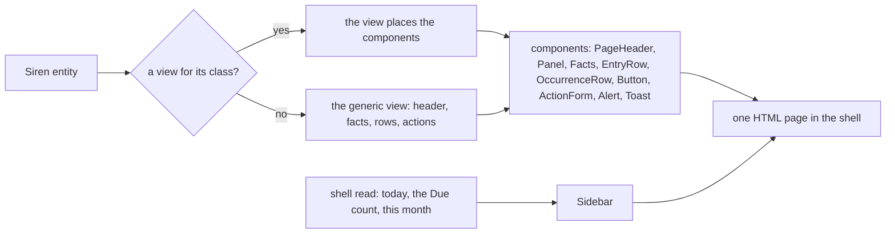

# 092 — The app shell: the Almanac design system in the browser

> Dated implementation record. Tests use temporary folders and synthetic data only. Screenshots are made from a
> synthetic database and are not kept in git.

## Status

- **Date / baseline:** 2026-10-12, `44b661b` (master).
- **Priority:** P1. **Effort:** L. **Risk:** MEDIUM: every template and both sheets change; one read is added to
  every HTML page; one browser route serves embedded fonts; one field of the catalog gets `options`. None for the
  schema.
- **Status:** TODO.
- **Resolves:** issue [0061](../issues/0061-the-browser-does-not-feel-like-an-application.md). No RFC: the contract
  in `docs/` does not change, and [D14](../decisions/D14-ui-and-tools.md) leaves the screens to the application.

## The owner's decisions (2026-10-12)

| question | decision |
|---|---|
| a separate client, or the browser that `lifelog` serves | the browser that `lifelog` serves, as in plan 091 |
| the direction | **Almanac**, of three drafts (Almanac, Notebook, Console): cool paper, ink blue, dates and numbers in mono, time as the spine |
| the sidebar | as Almanac draws it: brand and date, search, New, two groups of sections, this month, the owner's links |
| the theme | light first; dark follows the system setting (`prefers-color-scheme`) |

The design system is the artifact **Lifelog Almanac** (private to the owner): its tokens in light and dark, 17
components, 14 icons, and a section "The Siren contract" that says which component draws each part of an entity.
This plan builds the browser from it. Where this plan and the artifact differ, this plan wins and the artifact is
updated after.

## The rules for every part

- The rules of plan 091 stay: a template reads the properties the JSON carries and places the actions the entity
  offers; every form works with no script; every change to the wire is an addition.
- One component, one markup. A template draws a part of an entity only through the component the contract names
  (the table below). A view of its own only places components; it does not draw a row or a form of its own.
- Every colour, size and font is a token on `:root` in `base.css`, with its dark value in the
  `prefers-color-scheme: dark` block. No rule outside the token blocks names a colour.
- Nothing is fetched from another host. The fonts are embedded like the sheets and the script.

| part of the entity | component |
|---|---|
| `class`, `title` | the view; PageHeader |
| `links` `self`, `prev`, `next`, `index`, other rels | Sidebar (current item); PageHeader (pager, crumbs); Panel (the link of its label line) |
| `properties` | Facts, Panel, Reading |
| `entities` | EntryRow; OccurrenceRow for class `occurrence` |
| `actions` | Button (no visible field), ActionForm (fields), Segmented (5 options or fewer), Capture; `owner` adds the owner mark, `danger` draws the danger button |
| class `error` | Alert, its words picked by `code` |
| `result` | Toast |

## Decisions this plan makes

| decision | why |
|---|---|
| **The shell reads three things on every HTML page:** today, the Due count (open occurrences overdue or due today) and the days of this month that have a page. The read is one function, `shell(ctx, today)`, beside the handler, and it runs only for `text/html`. | The sidebar is on every page, and these three are what "time is the spine" means. They are not a new capability: every client gets the same data from `GET /` (`due`) and `GET /months/{month}`. The README rule "a template reads only the properties the JSON carries" gets one sentence: the sidebar reads the root's Due count and this month. |
| **The fonts are embedded files.** Atkinson Hyperlegible (400, 700, 400 italic) and IBM Plex Mono (400, 500), latin woff2, with the text of their licence (SIL Open Font License 1.1), in `internal/api/html/fonts/`. A README there names the source and the sha256 of each file. `GET /assets/fonts/{file}` serves them, by exact name from the embedded folder, with `Cache-Control: public, max-age=31536000, immutable`. | A font cannot be written into each page like a sheet: it is too big to send again on every page. The binary grows by about 100 KB (measured in Part 1). The route is presentation, like `/render`: it is not in the catalog. It has the same token and origin rules as every other route. |
| **The sheets stay in the page.** `base.css` and `app.css` are still written into each page. | They are small, and a page then needs one request. |
| **`capture`'s field `mood` gets `options` "1" to "5".** | So the browser draws it as a Segmented choice. It is an addition: the catalog carries the options (`GET /actions`, so `lifelog get /actions` too), and the MCP tool's schema gets the `enum` 1 to 5. The values that the API takes do not change: it refuses a mood out of range or with a fraction now (`internal/core`, "fractional mood"). |
| **No theme switch.** | The owner asked for light first; the system setting picks dark. A switch would need the browser to keep a choice, which no page does now. |
| **Home and Today stay two pages.** The sidebar's Today is `/days/today`, drawn as the Almanac Today; the brand links Home (`/`), which keeps what plan 091 gave it. | The day view already has capture, the journal, Due, habits, mood and readings. No entity changes for it. |

## Part 1 — Tokens, fonts and the components' styles

| what | where |
|---|---|
| `base.css`: the tokens of the design system on `:root` (colours, the two font families, spacing, radii, shadows, sizes) and their dark values; the elements on the tokens (body, headings, links, focus, fields, buttons, tables, `kbd`, `mark`). The comment "no web font" goes. | `internal/api/html/base.css` |
| `app.css`: the components of the design system, by the class names of its `bundle.css` (`.shell`, `.rail`, `.page-head`, `.panel`, `.occ`, `.entry`, `.facts`, `.reading-tile`, `.tag`, `.alert`, `.toast`, `.segmented`, `.action-form`, `table.month`, `table.calendar`). The rules of plan 091 that a component replaces go. | `internal/api/html/app.css` |
| The fonts, their licence and README; the route; `@font-face` in `base.css` with `font-display: swap` and the system fonts as fallback. | `internal/api/html/fonts/`, `internal/api/handler.go`, `internal/api/html.go` |

## Part 2 — The shell

| what | where |
|---|---|
| `layout.html` becomes the shell: the skip link, `.rail` (brand and today's date, the search with Ctrl K, New, two groups of sections with their icons, the Due count, this month, the owner's links), and `main.main`. The More menu goes. | `internal/api/html/layout.html` |
| `navItems` gets its two groups (every day: Today, Calendar, Due, Tasks; the record: People, Places, Files, Metrics, Habits, Sessions, Periods, Ghost pages) and the owner's links (Every action, Integrity checks, Snapshot). The rule that marks the current item does not change. | `internal/api/html.go` |
| `shell(ctx, today)`: the Due count and this month's written days, read once a page. | `internal/api/handler.go`, `internal/api/months.go` |
| The 14 icons as inline `<svg class="icon">`, from one template. | `internal/api/html/layout.html` |
| Under 900 px the sidebar is a bar over the page: brand, New, the search on its own row, the sections as one row that scrolls to the side. | `internal/api/html/app.css` |

## Part 3 — Today and the day

| what | where |
|---|---|
| The day view as the Almanac Today: the PageHeader (date line, the day as the title, the mood pill, the pager, the actions with fields as ActionForms); then two columns: Capture, the journal (Prose on a sheet), the pages written this day (EntryRow); and Due (OccurrenceRow in a flush Panel), Habits (Segmented check-ins), Readings (Reading tiles), Where. | `internal/api/html/day.html` |
| Home on the same components: Capture, Due, Habits, Last entries, then the closed sections New and Owner. | `internal/api/html/root.html` |
| `capture`'s `mood` gets its `options`; API.md says so. | `internal/api/siren.go`, `API.md` |

## Part 4 — Every other view, the states and the script

| what | where |
|---|---|
| The planning views (tasks, task, occurrence, deadlines) on Panel, OccurrenceRow and Facts. | `internal/api/html/planning.html` |
| The month on `table.calendar`, with each written day's first line and mood. | `internal/api/html/month.html` |
| The lists (days, people, places, files, ghosts, search) on EntryRow; a page, a person, a place and a file on PageHeader, Prose and Facts; metrics, a series and habits on Reading and Facts. | `internal/api/html/*.html` |
| The generic view and the `form` and `boxed` templates on PageHeader, Facts, EntryRow, Button and ActionForm. The owner mark on an owner-only action. A required field says "required" in words. | `internal/api/html/layout.html` |
| An error as an Alert, its first words by `code` (the table of the design system); the feedback receipt as a Toast. | `internal/api/html/layout.html`, `internal/api/html.go` |
| The script: Ctrl K puts the cursor in the search; the toast goes after 6 seconds or on Escape; a danger button asks once in the page ("Press again to delete") before it sends. The rest of `app.js` stays. | `internal/api/html/app.js` |
| README: the decisions "The browser gets the same entity" and "The page is semantic HTML" get the shell read and the design system; a new decision "The Almanac design system" names the artifact, the fonts and the route. | `README.md` |

## Done criteria

1. Go tests beside their packages, on a real SQLite file under `t.TempDir()`, built through the writer, with
   hand-checked values and the fixed clock of plan 091 (`NewOn`):
   - **shell:** the Due count with none, with an overdue one-off, with a series slot due today, with a done and a
     skipped occurrence (not counted), and with a tombstoned task (not counted); the written days of a month with
     none, and with a day page whose body is empty; a JSON answer does not run the read.
   - **fonts:** each embedded file is served with its type (`font/woff2`) and the cache header; an unknown name,
     `../base.css`, `%2e%2e/`, an empty name and a name with a `/` are 404; HEAD works and POST is 405; on a
     public listener the route needs the token like every route.
   - **tokens:** a table test reads the token blocks of `base.css` and checks the contrast of each pair that a
     token's use names (text 4.5:1, field borders and the focus ring 3:1), in light and in dark.
   - **mood options:** the `capture` action carries them through the API, `lifelog get /actions` and the MCP
     tool's schema (`enum`); a capture with mood 4 and one with no mood still work, and mood 6 is still refused.
   - **views:** each view renders the synthetic database inside the shell; the current sidebar item for each
     section; the forms of plan 091 are all still there, and they are the same with the script removed;
     `TestEveryPageIsSemanticHTML` still passes (it changes only where the markup changes, and the commit says so).
   - **API.md:** `TestAPIReferenceMatchesTheCode` passes.
2. **In a browser:** the Edge driver of plan 091 runs again (its 16 checks), with three more: Ctrl K, the toast,
   and the danger button's second press. Screenshots of Today, a day, Due, the month, a page and a list, at
   1280 px and 390 px, in light and in dark. The result of this plan records the browser and the checks.
3. Baseline green on Windows: `go generate ./... && go vet ./... && go test ./...`; `gofmt` on changed files;
   `go test -count=1 -shuffle=on ./...` for the shell read; staticcheck and govulncheck if they are available
   (reported as not run if not). The cost of the shell read is measured once on the synthetic database and
   recorded; it is not a test.
4. Four commits, one for each part, each with the baseline green. The issue is resolved and this plan is DONE in
   the commit of Part 4.
