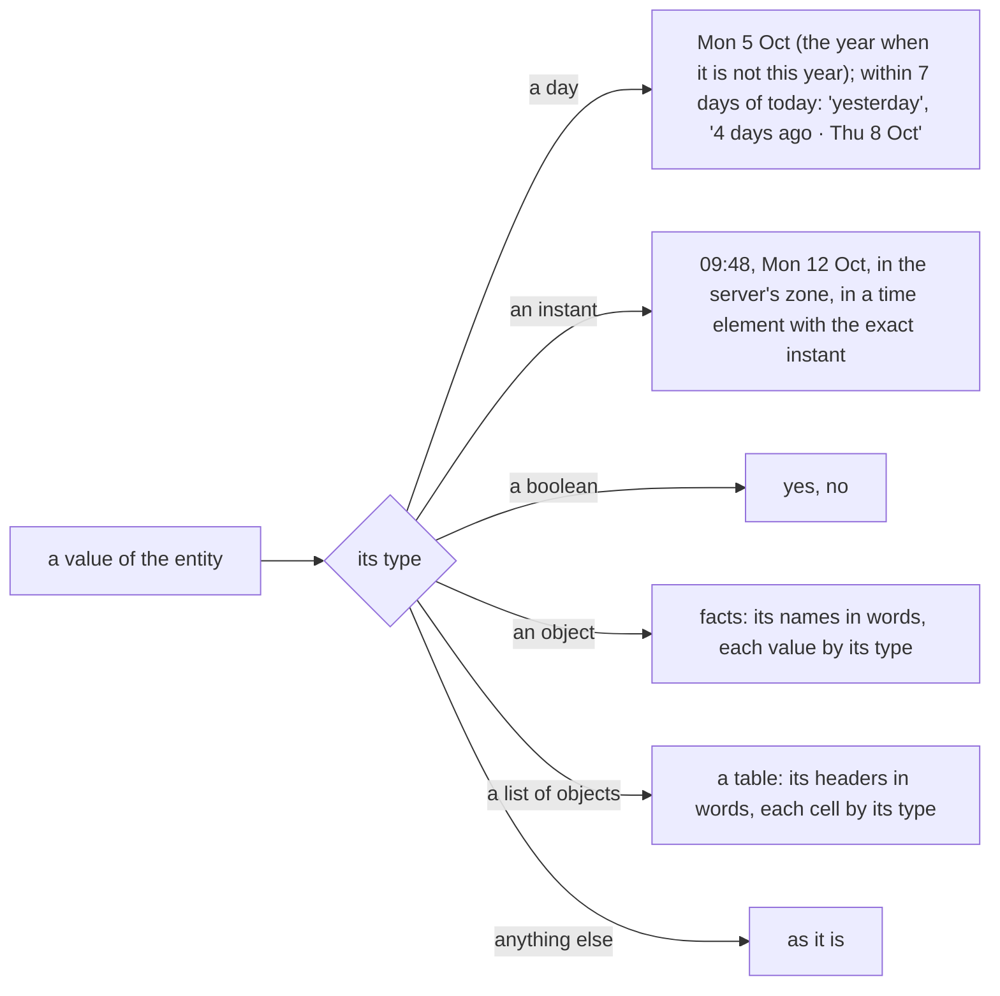

# 093 — Words, not data; the phone first; a richer Today

> Dated implementation record. Tests use temporary folders and synthetic data only. Screenshots are made from a
> synthetic database and are not kept in git.

## Status

- **Date / baseline:** 2026-10-12, `3fa2fb6` (master).
- **Priority:** P1. **Effort:** L. **Risk:** MEDIUM: every view shows times and days in new words; the result of a
  write is read back as data; the shell gets a second layout for a phone; the day and the root get two new
  properties. None for the schema.
- **Status:** DONE (three commits: `8a0d9e7` for Part 1, `58bcb10` for Part 2, and the commit that closes this
  record).
- **Resolves:** issue [0062](../issues/0062-the-browser-still-shows-data-not-words.md). No RFC: the contract in
  `docs/` does not change.

## The owner's decisions (2026-10-12)

| question | decision |
|---|---|
| what next | three areas of four: **words, not data**; **the phone first**; **a richer Today**. Not now: the command list of Ctrl K. |

## The rules for every part

- The rules of plans 091 and 092 stay: a template reads the properties the JSON carries and places the actions the
  entity offers; every form works with no script; every change to the wire is an addition.
- A value is drawn by its type, never by the name of its property: a string that is a day is a day, one that is an
  instant is an instant (`core.IsDay`, `core.IsInstant`).
- A word for a time uses the clock of the server's day: the local zone of the machine that runs `lifelog serve`, the
  zone `core.Today` reads. The exact instant stays in the page, in `<time datetime>` and its title.

## Part 1 — Words, not data

Presentation only: no entity changes.

| what | where |
|---|---|
| **The clock of the words.** The view gets today and the server's zone. `New` reads the zone of the machine (`time.Local`, the zone `core.Today` reads); the test handler `NewOn` uses UTC, so the tests have fixed words. A page drawn before the handler has no clock and writes times in UTC with "UTC". | `internal/api/handler.go`, `internal/api/shell.go`, `internal/api/export_test.go`, `internal/api/html.go` |
| **Days and times in words**, as the diagram says. `dueWords` writes the days of the design system ("7 days ago · Mon 5 Oct", "in 3 days · Thu 15 Oct", "Sun 1 Nov 2026" for another year). Every raw instant of a view goes: a page's and a task's creation, an occurrence's completion and writing, a reading's time, the series table, the day's readings. | `internal/api/planning_html.go`, `internal/api/html.go`, `internal/api/html/*.html` |
| **The generic view in words.** An object is a `dl.facts`, its names in words (`start_utc` → "start utc", `task_version` → "task version"); a list of objects is a table with headers in words; every value is drawn by its type. This is the view of sessions, a session, periods, integrity, a snapshot, a query, the catalog and any class to come. | `internal/api/html.go` (`writeValue`) |
| **The result as sentences.** The receipt keeps the result's JSON, and the toast says it by the result shapes of API.md: "Linked Garden project.", "Created Dana Example.", "Not linked: `[[a/b]]` is not a valid title.", "Filed under Mon 12 Oct.", "Wrote 12 readings; 3 were there before." Each title links its page. A key that no sentence knows is shown as a fact, so nothing of a result is lost. | `internal/api/feedback.go`, `internal/api/html.go`, `internal/api/html/layout.html` |

## Part 2 — The phone first

Presentation only: the same links and forms, in a second layout under 900 px.

| what | where |
|---|---|
| **A top bar**: the brand, today's date, a Search link (`/search`) and New. | `internal/api/html/layout.html`, `internal/api/html/app.css` |
| **A bottom bar**, fixed, with the safe-area inset: Today, Calendar, Due with its count, Tasks, and More. It is the sidebar's first group, laid out again; no link is drawn twice. | `internal/api/html/app.css` |
| **More** is a link to `#sections`: the rest of the sidebar (the sections of the record, this month and the owner's links) is a sheet over the page while it is the target (CSS `:target`), with a Close link. It needs no script. The script closes it with Escape. | `internal/api/html/layout.html`, `internal/api/html/app.css`, `internal/api/html/app.js` |
| **The page header on a phone**: the pager's buttons small, and an action's form opens in place, full width, not floating. | `internal/api/html/app.css` |

## Part 3 — A richer Today

| what | where |
|---|---|
| **Trends.** The day gets the property `trends[]`: for each metric with a current unassociated reading on the day, its `metric`, `unit` and `readings[]` (`day`, `value`): its current unassociated readings of the 14 days through the day, oldest first (the series of the cookbook). A reading tile shows the unit (a scale `1-5` as "of 5") and draws the line of those readings, the day's value marked. | `internal/api/handler.go` (`day`), `internal/api/html/day.html`, `API.md` |
| **The last days of a habit.** Each item of `habits[]` on the day and on the root gets `recent[]`: the habit's state on each of the 14 days through the day, oldest first: `done`, `not done`, `not recorded`, `invalid`, or `inactive` (no period of the habit holds the day). The Habits panel draws them as a strip, with "8 of the last 14 days" in words. The state is the one `core.Habits` reads, day by day, so the rule has one home. | `internal/api/habits.go`, `internal/api/handler.go`, `internal/api/html/day.html`, `API.md` |
| **A series on its own page**: the group Later shows the next 5 slots, then "and N more until {through}". The other groups stay whole. | `internal/api/planning_html.go`, `internal/api/html/planning.html` |

## Done criteria

1. Go tests beside their packages, on a real SQLite file under `t.TempDir()`, built through the writer, with
   hand-checked values and the fixed clock (`NewOn`):
   - **words:** days and instants as a table of cases (today, yesterday, 7 and 8 days, another year, a value that is
     not a day or an instant); the server's zone and UTC; the generic view of a session and of integrity in facts;
     no raw instant on a page, a task, an occurrence or a reading.
   - **result:** each result shape of API.md (the sync shape with every list, add-file with a day, a place and an
     unmatched point, readings-from-table, relocate-reading, a snapshot) as sentences; an unknown key as a fact;
     a title with markup is escaped.
   - **phone:** the bottom bar holds the first group and More; the sheet holds the rest; one link marked current;
     the pages carry the same forms as before.
   - **trends:** a day with readings of two metrics over 14 days, one outside the window, a session-scoped one (not
     in the trend), a corrected and a retracted one; the unit; a day with none (`[]`).
   - **habits:** `recent` with every state, a day before the habit's start and after its end (`inactive`), on the
     day and on the root.
   - **task page:** a series with more than 5 later slots, and one with fewer.
   - **parity:** `trends` and `recent` through the CLI's `get` and the MCP `get` tool; `TestAPIReferenceMatchesTheCode`.
2. **In a browser:** the 21 checks of plan 092 again, and: More opens the sheet and Close closes it with no script;
   Escape closes it with the script. Screenshots of Today, Home, a task, a session, a page and a write's result, at
   1280 px and 390 px, in light and in dark.
3. Baseline green on Windows: `go generate ./... && go vet ./... && go test ./...`; `gofmt`;
   `go test -count=1 -shuffle=on ./...`; staticcheck and govulncheck if available (reported as not run if not). The
   cost of the day's new reads is measured once on the synthetic database and recorded.
4. Three commits, one for each part, each with the baseline green. The issue is resolved and this plan is DONE in the
   commit of Part 3.

## Result (2026-10-12)

All three parts are done, one commit each. These points differ from the text above, or add to it:

| point | what was done, and why |
|---|---|
| an instant | said date first, then the time: "Mon 12 Oct, 09:48"; "today, 09:48" and "yesterday, 21:14" near today. A day before or after today by more than 7 days is its date, with the year when it is not this year. |
| an occurrence moved off its slot | "moved from the slot of Sun 11 Oct": the slot as a date, not against today. |
| the result | each title links its page; the sync shape of a file's page and of its day page are said "In its page:" and "In its day page:". A dry run of add-file has its result as an object, not a receipt, and is said the same way. |
| the toast | its `[[code]]` is framed, not filled: a filled code chip was unreadable on the dark toast. |
| the phone's shell | it is a block, not a grid, under 900 px: a grid stretched the top bar on a short page. The script no longer scrolls the sections' row: there is none. The footer's keys are not shown on a phone. |
| More | marked when the page is in the sheet (`class="here"`, not `aria-current`: one link a page is the current one). |
| a reading's tile | one tile a metric, from the day's `trends`: the last reading of the day (the one to correct), "and N more this day" when there are more. A scale `1-5` is "of 5". The day's readings of a session are a list under the tiles, as no trend holds them. |
| a habit's strip | each state has its own shape (done a full cell, not done an empty frame, not recorded a low bar, inactive a dashed frame), so no state is told by colour alone; "6 of 12 days" counts the active days. |
| a series on its own page | "and N more in this window", with no link: the page is the task's own. |
| the test of a habit's days | it covers done, not done, not recorded and inactive. `invalid` needs a value that only another writer can store (deliberate damage); the state comes from `core.Habits`, whose own test covers it. |

**Checks** (Windows 11, Go 1.27.1): `go generate ./... && go vet ./... && go test ./...` passes, mutants included;
`go test -count=1 -shuffle=on ./...` passes; `gofmt` is clean. staticcheck and govulncheck were not run: they are not
installed. Nothing was run on Linux, and no browser but Edge was tried.

**In a browser.** The program of plan 091, in a scratch folder, drove Edge 154 (headless) on Windows 11 on a synthetic
database: 25 checks passed, the 21 of plan 092 and, at 390 px, the sheet of sections starts closed, More opens it, and
Close and Escape close it. Screenshots of Today, Home, a task, the sheet, People, a page and a write's result, at
1280 px and 390 px (a full page and one phone screen), in light and in dark. They are not kept in git.

**The cost of the day's new reads**, measured once with benchmarks that are not kept, on the synthetic database (one
habit, two metrics), warm, on Windows 11 with Go 1.27.1: a habit's 14 days 0.66 to 0.68 ms (14 reads of the habits of
a day), the trends 0.16 ms, each about 13 to 17 KB a call. This is a small database, not the lifetime workload.
