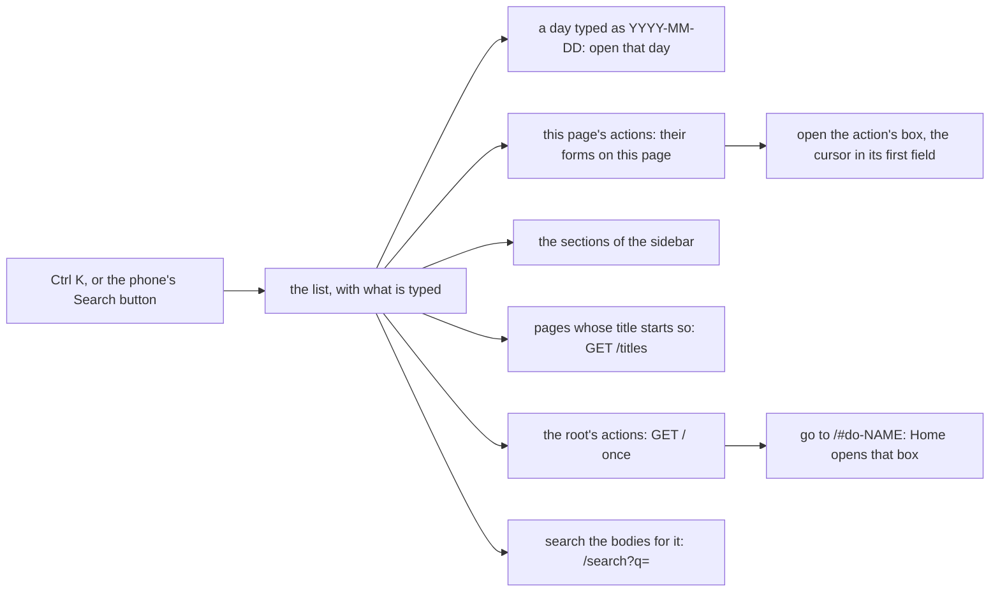

# 094 — The command list of Ctrl K

> Dated implementation record. Tests use temporary folders and synthetic data only. Screenshots are made from a
> synthetic database and are not kept in git.

## Status

- **Date / baseline:** 2026-10-12, `9713306` (master).
- **Priority:** P2. **Effort:** M. **Risk:** LOW: the script grows and reads one more resource; every form gets one
  attribute. No entity changes, none for the schema.
- **Status:** TODO.
- **Resolves:** issue [0063](../issues/0063-ctrl-k-only-moves-to-the-search.md). No RFC: the contract in `docs/` does not
  change.

## The owner's decision (2026-10-12)

| question | decision |
|---|---|
| the fourth area of the review | "let's do that one too": Ctrl K opens a command list, as in the Console draft |

## The rules

- **No page needs it.** The list is the script's. With no script, Ctrl K is the browser's, and the sidebar's search
  and every form work as before.
- **The catalog decides.** The list offers only actions that an entity offers: the actions of this page, and the
  actions of the root, which start something anywhere. It never builds a form of its own: choosing an action opens
  the form the server drew for it.
- **One more read.** The script reads `/` (the root, as Siren JSON) for the root's actions, once a page and only when
  the list opens; it still reads `/titles` and `/render`, and nothing else.

## The work

| what | where |
|---|---|
| **The action's name on its form.** Every form drawn from an action carries `data-action` with the action's catalog name, so the script finds the form the server drew for it. It is data of the entity, like `danger`, not an id. | `internal/api/html/layout.html` (`form`) |
| **The list.** A modal `<dialog>` with a combobox and a listbox (ARIA 1.2): Up and Down move, Enter opens, Escape and a click outside close, and the focus goes back where it was. The kinds in order: a day, this page's actions, the sections, pages, the root's actions, and "Search the bodies for …". A word that starts a name ranks first; case and accents do not matter. At most 12 rows. | `internal/api/html/app.js`, `internal/api/html/app.css` |
| **What is chosen.** A day goes to `/days/{day}`; a section to its link; a page to `/pages?title=` (the find route); an action of this page opens its box (and the boxes around it), scrolls to it and puts the cursor in its first field; an action of the root goes to `/#do-{name}`, and Home does the same with that action's form; the search goes to `/search?q=`. | `internal/api/html/app.js` |
| **The keys.** Ctrl K (Cmd K) opens the list from anywhere, a field too. `/` still puts the cursor in the sidebar's search. On a phone, the top bar's Search button opens the list. The footer's keys and the search's hint say so. | `internal/api/html/app.js` |
| **README.** "One script, which no page needs" names the list and the read of `/`. | `README.md` |

## Done criteria

1. Go tests: every form drawn from an action carries `data-action` with its name (a box on Home, a one-button form, the
   capture); the script fetches `/titles`, `/render` and `/`, and nothing else, and keeps nothing in the browser.
2. **In a browser** (the Edge driver of plans 091 to 093): Ctrl K opens the list from a field; a title's start finds
   the page and Enter opens it; a section is found and opened; on a day, an action of the day opens its box with the
   cursor in its field; an action of the root ("New task") goes Home with its box open; a typed day opens that day;
   "Search the bodies" opens the search; Escape closes the list and the focus goes back; on a phone the Search button
   opens it. The 25 checks of plan 093 still pass. Screenshots of the list, at 1280 px and 390 px, light and dark.
3. Baseline green on Windows: `go generate ./... && go vet ./... && go test ./...`; `gofmt`; staticcheck and
   govulncheck if available (reported as not run if not).
4. One commit after the records; the issue is resolved and this plan is DONE in it.
