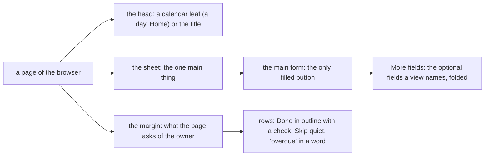

# 095 — The leaf and its margin: a calm Almanac

> Dated implementation record. Tests use temporary folders and synthetic data only. Screenshots are made from a
> synthetic database and are not kept in git.

## Status

- **Date / baseline:** 2026-10-12, `6d0b35e` (master).
- **Priority:** P1. **Effort:** L. **Risk:** MEDIUM: every template and both sheets change; the form template can fold
  optional fields; a row's Done is no longer a primary button. No entity changes, nothing on the wire, none for the
  schema.
- **Status:** TODO.
- **Resolves:** issue [0064](../issues/0064-every-group-of-a-page-has-the-same-weight.md). No RFC: the contract in
  `docs/` does not change.

## The owner's decisions (2026-10-12)

| question | decision |
|---|---|
| the layout of a day | **sheet and margin**: the day's writing is one sheet; Due, Habits, Readings and Where are a margin beside it, with no cards |
| the head of a day | **a calendar leaf**: the month on a band, the day's number large in mono, beside the weekday as the title |
| the rest | "you have full control over the design, pages, ui, ux. It should follow the best practices, be adhd friendly and have full functionality" |

## The rules for every part

- The rules of plans 091 to 094 stay: a template reads the properties the JSON carries and places the actions the
  entity offers; every form works with no script; one component, one markup; every colour is a token of `base.css`
  with its dark value, and the contrast test holds them.
- **One main thing a page.** The sheet holds what the page is for: the day's writing, a page's body, a list. The
  margin holds what the page asks of the owner. On a phone the margin comes after the sheet.
- **One loud button a screen.** Only the submit of the page's main form (Add, Save) and of a form the owner opened is
  filled. A row's Done is an outline button with a check; Skip and Reopen are quiet.
- **Fewer decisions at once.** A form shows the fields that most writes need. A view can name optional fields that
  fold under "More fields". A folded field stays in the form: the browser sends it, with no script. A required field
  never folds.
- **Time in view.** The day's head is a calendar leaf. An overdue row says "overdue" in a word, not only by its date.
- **Words.** Headings in sentence case; nothing in capitals. Mono for days, times and numbers only.
- **Calm.** Fewer borders and more space. No motion that the owner did not start; `prefers-reduced-motion` stops
  all of it.
- **Targets.** 40 px controls; 44 px under 900 px, where the screen is a touch screen.

## Part 1 — The type, the forms and the rows (every page)

| what | where |
|---|---|
| **The type scale** 13 / 15 / 18 / 24 / 34 px. `h2` is a heading of a group in sentence case (18 px, ink), not a grey label in capitals; table headers and the kinds of a page's links are in sentence case. Mono is for `.date`, `.meta`, `.value`, `.reading` and fields of days, times and numbers; a word in a row of facts is in the sans. | `internal/api/html/base.css`, `internal/api/html/app.css` |
| **Controls** 40 px, 44 px under 900 px; the mood's choices too. | `base.css`, `app.css` |
| **The toast** on the surface with a frame in the done colour, not a dark block: it says what a write did, calmly. Its tokens stay aliases, so the contrast test checks them. | `base.css`, `app.css` |
| **Folded fields.** `formOf` takes `more`: names of optional fields drawn under `

More fields
` inside the form. One sub-template `field` draws a field, shown or folded. | `internal/api/html.go`, `internal/api/html/layout.html` |
| **A row's outcome.** Done, Skip and Reopen are not primary; each form gets its own class (`outcome done`, `outcome skip`, `outcome reopen`), and the sheet draws Done in outline with a check. | `internal/api/planning_html.go`, `app.css` |
| **Overdue in a word.** `occRow` gets `Overdue` (open, due before today); the row has the tag "overdue". | `internal/api/planning_html.go`, `internal/api/html/planning.html` |

## Part 2 — The day and Home

| what | where |
|---|---|
| **The leaf.** The head of a day: a block with the month on a band and the day's number in mono, which links the month; the weekday as `h1` with the mood; "October 2026, week 42" and "Today" under it; the previous and next day as step buttons; the day's actions with fields. | `internal/api/html/day.html`, `app.css` |
| **Sheet and margin on a day.** The sheet: the journal (18/30 px, at most 62 characters a line), then Capture as the next part of the same sheet, then "Edit the day page" and the pages written that day. The margin: Due, Habits, Readings, Where, each a heading and its rows, with no card. One column under 1100 px. | `day.html`, `app.css` |
| **Home** on the same parts: the leaf of today; the sheet with Capture and the last entries; the margin with Due and Habits; New and Owner below. | `internal/api/html/root.html` |
| **More fields** where a form is long: `record` (`session_id`, `taken_at`, `tz`, `import_key`), `create-task` (the repeat, the anchor, the reminder, `import_key`: label, project and due day stay), `capture-session` (all but kind, day, start and end local), `add-file` (`preview`, `at`, `radius`, `dry_run`). | `day.html`, `root.html`, `planning.html`, `metrics.html` |

## Part 3 — Every other view

| what | where |
|---|---|
| **A page, a person, a place, a file, a period**: the head; the sheet with the body and its editor; the margin with the links and backlinks; More under them. A day page's title is a day in words wherever a page is listed ("Fri 2 Oct"). | `internal/api/html/page.html` |
| **Planning**: Tasks, What is due, a task and an occurrence on the margin's groups; the group Overdue in its tone, with its count. | `internal/api/html/planning.html` |
| **The rest** on the new type: the month's head, the lists, the search, metrics, a series, habits, the generic view, an error and the login. | `internal/api/html/*.html` |
| **The phone**: the leaf in a smaller size, the step buttons with the day's number only (the full day stays for a reader), the margin after the sheet. | `app.css`, `day.html` |
| **README**: the decision "The app shell: the Almanac design system" names the leaf, the sheet and the margin, the one loud button and the folded fields. | `README.md` |

## Done criteria

1. Go tests beside their packages, on a real SQLite file under `t.TempDir()`, built through the writer, with
   hand-checked values and the fixed clock (`NewOn`):
   - **folded fields:** a field named in `more` is drawn inside `details.more-fields` with its value; a required field
     named in `more` is not folded; a reading recorded through the browser form with a folded `taken_at` keeps it.
   - **outcomes:** an open occurrence's Done and Skip, and a done one's Reopen, are not primary and carry their class.
   - **overdue:** the tag on an open occurrence due before today; not on one due today, nor on a done one.
   - **the day:** the leaf (the month, the number, the week, the weekday, the previous and next day); the sheet before
     the margin in the source; the capture form with the same fields as before.
   - **words:** a backlink from a day page is the day in words.
   - The tests that read markup this plan changes change with it, and the commit names them.
   - `TestTheTokensHoldTheirContrast` passes with the new tokens; `TestEveryPageIsSemanticHTML` passes.
2. **In a browser:** a program in a scratch folder drives Edge (headless) on Windows through its DevTools protocol, on a
   synthetic database: Ctrl K opens the list; a capture adds its text and shows the toast; Done on Today takes the row
   off Due; More fields opens and its field is sent; on a phone More opens the sheet of sections and Close closes it.
   Screenshots of Today, Home, a past day, the month, a page, a task, What is due, Tasks, People, Metrics, a series,
   Habits and an error, at 1280 px and 390 px, in light and in dark.
3. Baseline green on Windows: `go generate ./... && go vet ./... && go test ./...`; `gofmt` on changed files;
   `go test -count=1 -shuffle=on ./...`; staticcheck and govulncheck if available (reported as not run if not).
4. One commit for the records, then one a part, each with the baseline green. The issue is resolved and this plan is
   DONE in the commit of Part 3.
