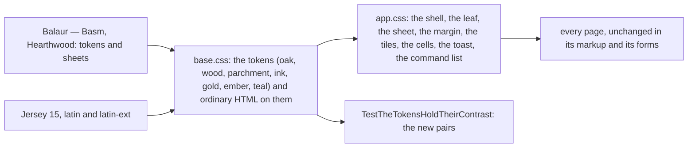

# 096 — Bound in Hearthwood: the Almanac takes Balaur's materials

> Dated implementation record. Tests use temporary folders and synthetic data only. Screenshots are made from a
> synthetic database and are not kept in git.

## Status

- **Date / baseline:** 2026-10-12, `e79b3eb` (master).
- **Priority:** P1. **Effort:** L. **Risk:** MEDIUM: both sheets change in full and every page looks different; the
  tokens and their contrast pairs change, so the contrast test changes with them; one face is added to the embedded
  fonts. No template loses a form or a link. No entity changes, nothing on the wire, none for the schema.
- **Status:** TODO.
- **Resolves:** issue [0065](../issues/0065-the-almanac-reads-as-a-generic-app.md). No RFC: the contract in `docs/`
  does not change.

## The owner's decisions (2026-10-12)

| question | decision |
|---|---|
| the source | the owner's design system **Balaur — Basm, Hearthwood canon** (a Claude Design project): its tokens, `basm/base.css`, `basm/components.css`, `basm/pages.css` and the Storybook's Life and Tasks screens |
| how far | **full Hearthwood materials**: dark oak ground, wood rail, parchment for the sheet and every written thing, square corners, bevels and hard drops, gold, ember and teal; the ink-blue Almanac goes |
| the display face | **Jersey 15** embedded like the other faces, for `h1`, the leaf's number and a reading's value, 20 px and above only; every word stays Atkinson Hyperlegible |
| the palette | **Hearthwood alone**, dark as the identity and the daylight study as light, chosen by `prefers-color-scheme` as plan 092 decided; Forest and Dungeon and a switch are not in |

## The rules for every part

- The rules of plans 091 to 095 stay: a template reads the properties the JSON carries and places the actions the
  entity offers; every form works with no script; one component, one markup; the leaf, the sheet and the margin; one
  loud button a screen; sentence case and nothing in capitals; mono for days, times and numbers only; 44 px targets on
  a phone; `prefers-reduced-motion` stops every motion.
- **Materials are honest.** The page is oak with a 4 px grain. The rail and the phone's bars are wood planks with a
  raised bevel and a near-black outline. What is written is parchment with an ink grain, a 2 px edge, a paper bevel
  and a 3 px hard drop: the sheet, the leaf, a reading's tile, a calendar's cell, a list of rows, the toast. A field is
  a well carved into the parchment. No blur, no gradient, no rounded corner.
- **Three accents, each with one job.** Gold marks where the owner is and what is today: the current section, the
  leaf's band, today's cell, the stitch of a heading. Ember is the one loud button of a screen, and the word
  "overdue". Teal is a link and the focus ring. The good green stays Done; ember-red stays danger.
- **Words stay plain.** Simplified Technical English as everywhere in this repo: no mythic seasoning, no exclamation,
  no tracked capitals. Balaur's uppercase mono labels are not imported.
- **No image.** The icons stay inline SVG; the grain, the planks, the bevels and the stitch are CSS. The one new file
  is the display face.
- **Every colour is a token** of `base.css` with its dark value, and `TestTheTokensHoldTheirContrast` holds every text
  pair at 4.5:1 and every edge and the focus ring at 3:1, in both themes. Balaur's gold-ink and ink-muted sit under
  4.5:1 on parchment, so the text shades here are darker than the source's until the test holds.
- **One motion.** A button sinks 3 px when pressed; nothing else moves. Reduced motion keeps the press and drops the
  transition.

## Part 1 — The face, the tokens and ordinary HTML

| what | where |
|---|---|
| **Jersey 15** (400, latin and latin-ext woff2, as Google Fonts serves it) with its OFL licence; the README gets its rows; `base.css` names it `--display` with the `unicode-range` of each file. The fonts test counts 12 files and 3 licences. | `internal/api/html/fonts/`, `internal/api/html/base.css`, `internal/api/shell_test.go` |
| **The tokens.** Materials: `--ground` (oak), `--rail` (wood), `--rail-deep` (wood, carved), `--surface` (parchment), `--surface-deep` (parchment, a well or a pressed slab), `--edge` (the parchment's edge), `--outline` (the near-black pixel outline), `--line` (a hair on oak), `--line-soft` (a rule on parchment), `--bevel-light`, `--bevel-dark`, the grains and the planks. Text: `--ink` and `--muted` on parchment; `--page-ink`, `--page-strong` and `--page-muted` on oak; `--rail-ink` on wood. Accents: `--accent` (gold on oak and wood), `--accent-ink` (gold on parchment), `--accent-soft` (a gold wash on parchment), `--on-accent`, `--link` and `--link-page` (teal), `--primary` (ember), `--warn`, `--done`, `--danger` with their `-ink` and `-soft`, `--mark`, `--focus`, the toast's aliases. Shapes: `--bevel-up`, `--bevel-in`, `--parch-bevel`, `--drop-hard`; no radius. Light and dark are Balaur's `light-dark()` pairs, one block each. | `base.css` |
| **Ordinary HTML on the tokens.** The body is oak with its grain in `--page-ink`; `h1` is the display face in `--page-strong`; `h2` to `h4` stay Atkinson bold. A field is a well: `--surface-deep`, a 2 px `--edge`, an inset top shadow; focus is the teal ring. A button is a parchment slab with the outline, a light top bevel, a hard drop, and it sinks 3 px when pressed. `article` and `aside` are parchment; `pre` and `code` are carved wood with `--rail-ink`; `kbd` is a wood tag. Tables keep their rules in `--line-soft` on parchment. The print sheet stays. | `base.css` |
| **The contrast test** names the new pairs: `ink` and `muted` on `surface`, `surface-deep`, `accent-soft` and `mark`; `page-ink` and `page-muted` on `ground`; `rail-ink` and `accent` on `rail` and `rail-deep`; `accent` on `ground`; `accent-ink`, `link`, `warn`, `done` and `danger` on `surface`; `link-page` on `ground`; `on-accent` on `accent` and `primary`; the `-ink` on the `-soft`; the toast's; `edge` and `outline` and `focus` at 3:1 on their grounds. | `internal/api/tokens_test.go` |

## Part 2 — The components

| what | where |
|---|---|
| **The shell.** The rail is wood: planks and grain, the outline on its right, the bevel; its words in `--rail-ink`; the current section in gold on a carved well; the Due count a wood tag in ember; the brand in gold; the search a carved well in the wood; New a wood slab. On a phone the top bar and the bottom bar are the same wood. The column is oak. | `app.css` |
| **The leaf** is parchment: the month on a gold band in `--on-accent`, the number in Jersey 15 at 44 px, the edge and the hard drop; the step buttons are parchment slabs. | `app.css` |
| **The sheet** is parchment with the paper bevel, the hard drop and the 7 px gold notch in its corner; its parts divide with a dotted `--edge` rule; the journal's text is ink at 18/30 px. Capture's text box is a dashed well that turns solid gold while it has the focus (Balaur's draft). | `app.css` |
| **The margin** sits on the oak: each group's heading is `--page-strong` with Balaur's stitch rule after it; the rows of Due, the habits, the readings and the places are small parchment slips. Done is an outline in the good green on parchment; Skip and Reopen are quiet ink; "overdue" is ember. | `app.css` |
| **A reading's tile** is Balaur's StatCard: the metric's name, the value in Jersey 15 at 30 px with its unit in mono, the 14-day line in teal with a square mark at its end. | `app.css`, `internal/api/html/day.html` |
| **The calendar** is parchment cells on wood spacing: today has the gold edge and the notch; a written day keeps its first line in ink on a warmer parchment. The sidebar's month is the same in small. | `app.css` |
| **The lists, the search, Tasks and What is due** are one parchment sheet with their groups; Overdue's heading is ember. A tag is a small `--surface-deep` slab with a 1 px edge; a state keeps its colour and its word. | `app.css` |
| **The toast** is Balaur's capture strip: parchment, a gold edge, the check in the good green. **An alert** is a parchment slab with an ember or ember-red edge. **The command list** is the one ornate panel: parchment, a gold edge and gold corner brackets. **A form that opens** (`details.action`) is a parchment panel with the hard drop. | `app.css` |
| **Segmented choices** are joined parchment slabs; the chosen one is pressed: `--surface-deep` and the inset bevel. The habit's strip keeps its shapes. The series chart keeps its line, in teal on parchment. | `app.css` |

## Part 3 — In a browser, and the records

| what | where |
|---|---|
| A program in a scratch folder (not in the repo) drives Edge (headless) on Windows through its DevTools protocol on a synthetic database: screenshots of Today, Home, a past day, the month, a page, a person, a task, What is due, Tasks, People, Metrics, a series, Habits, the command list, the toast and an error, at 1280 px and 390 px, light and dark. The look is reviewed against them and corrected until the hierarchy of plan 095 reads: the sheet first, one loud button, the leaf as the head. | scratch |
| README: the decision "The app shell: the Almanac design system" says the look is the owner's Hearthwood (Balaur) in the Almanac's parts; "two embedded faces" becomes three. The fonts README names the third face. | `README.md`, `internal/api/html/fonts/README.md` |

## Done criteria

1. Go tests beside their packages:
   - `TestTheTokensHoldTheirContrast` passes with the new pairs, light and dark; the test changes only to name the
     tokens of this plan, and the commit says so.
   - `TestTheFontsAreServedByExactName` counts 12 files and the third licence.
   - `TestTheBaseSheetCarriesNoAppVocabulary`, `TestEveryPageIsSemanticHTML`, `TestTheDayIsALeafAndItsMargin`,
     `TestThePhoneHasABottomBarAndASheet`, the outcome and overdue tests pass unchanged, or change only where the
     markup legitimately changes, and the commit names them.
2. **In a browser:** the screenshots of Part 3, and these checks on them: no text under 4.5:1 (the tokens test is the
   gate; the screenshots are the eye); the sheet is the largest parchment on a day; one ember button a screen; the
   leaf's number is Jersey 15; the press sinks; a phone page is not wider than the screen and its controls are 44 px;
   the pages are the same with the script off.
3. Baseline green on Windows: `go generate ./... && go vet ./... && go test ./...`; `gofmt` on changed files;
   `go test -count=1 -shuffle=on ./...`; staticcheck and govulncheck if available (reported as not run if not).
4. One commit for the records, then one a part, each with the baseline green. The issue is resolved and this plan is
   DONE in the commit of Part 3.
