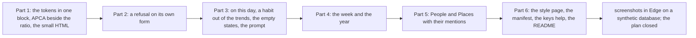

# 097 — The Almanac reflects: the past on the page, a refusal on its form, the week and the year

> Dated implementation record. Tests use temporary folders and synthetic data only. Screenshots are made from a
> synthetic database and are not kept in git.

## Status

- **Date / baseline:** 2026-10-12, `8691164` (master).
- **Priority:** P1. **Effort:** L. **Risk:** MEDIUM: the token blocks of `base.css` change shape and the contrast
  test with them; two resources and three properties are added to the API (nothing on the wire changes meaning);
  a refused browser POST answers with another page's view. Nothing for the schema, nothing for the contract.
- **Status:** DONE. One commit for the records, then one commit a part (Part 5 merged from its branch), then one commit for the
  findings of the screenshots and this record.
- **Resolves:** issue [0066](../issues/0066-the-almanac-does-not-reflect-and-a-refusal-loses-the-form.md). No RFC:
  the contract in `docs/` does not change.

## The owner's decision (2026-10-12)

"Make a plan to fix all of them": every row of the review in issue 0066, by sub-agents, reviewed part by part.

## The rules for every part

- The rules of plans 091 to 096 stay: a template reads the properties the JSON carries and places the actions the
  entity offers; every form works with no script; one component, one markup; the leaf, the sheet and the margin; one
  loud button a screen; sentence case and nothing in capitals; mono for days, times and numbers only; 44 px targets
  on a phone; `prefers-reduced-motion` stops every motion; Simplified Technical English in every word.
- **Every capability on every surface.** A week, a year and "on this day" are resources and properties of the
  entities, documented in `API.md`, so the CLI's `get` and the MCP server carry them without further work. A style
  page, a manifest and an icon are presentation, like `/render` and the fonts: served to a browser, not in the
  catalog, refused by a public listener without the token.
- **No streak, no chain, no badge.** A habit is told as "N of M days"; nothing counts days in a row.
- **Materials stay honest.** Every new part is drawn with the tokens and the components of plan 096; no new colour,
  no new face, no image but the one SVG icon of the manifest.
- **Nothing in the browser is kept.** The script reads `/titles`, `/render` and `/` and nothing else; no storage.
- **Tests change with the behaviour, never to pass.** The contrast test changes shape because the tokens do; the
  commit says so. Every other test that changes names the markup that legitimately changed.

## Part 1 — The tokens in one block, APCA beside the ratio, the small HTML

| what | where |
|---|---|
| **One block of tokens.** Every colour token of `:root` is written once as `light-dark(<light>, <dark>)`; a token whose two values are equal is written once as the colour. The `@media (prefers-color-scheme:dark)` block keeps only `color-scheme:dark`. The gradients (`--grain-ground`, `--planks`) keep their `light-dark()` inside the colour stop where the two differ. The header comment of `base.css` says a test reads the one block. | `internal/api/html/base.css` |
| **The contrast test reads the one block.** `tokenBlock` parses `light-dark(a, b)` into the light and the dark map, and a plain colour into both; the pairs stay as they are; the `dark` regexp goes. A token with `light-dark()` of two equal values fails the test with the words "write it once". | `internal/api/tokens_test.go` |
| **APCA, advisory.** The test computes the APCA Lc (version 0.1.9, the published constants, written in the test and not in the application) of every text pair in both themes and logs each with `t.Logf` as `apca dark: --page-muted on --ground Lc -58`; it fails nothing. A table in the test's comment says Lc 75 is the target for body text and Lc 60 the floor, so a reader knows what the log means. Where the log shows a dark text pair under Lc 60, its shade is moved by hand until it reaches Lc 60 while the 4.5:1 gate still holds, and the commit names each token moved. | `internal/api/tokens_test.go`, `base.css` |
| **The capture box grows.** `.capture textarea{field-sizing:content; min-height:calc(4 * 24px + …)}` with the phone's 45vh cap kept; a browser without `field-sizing` keeps `rows`. | `app.css` |
| **The search is a `search` element.** The rail's form is wrapped in `<search>`, `role="search"` goes; the script's selector for `/` finds the input inside `search`. | `layout.html`, `app.js`, `app.css` |
| **The list of names after `[[` is a popover.** `ul.suggest` gets `popover="manual"`, is shown with `showPopover()` and hidden with `hidePopover()` where the script shows and hides it today (guarded: a browser without the API keeps the current way), positioned as now but with `position:fixed` in the top layer, so no `overflow` clips it. Escape still closes it first. | `app.js`, `app.css` |
| **The second motion: the day's step.** `@view-transition{navigation:auto}` in `base.css`; `.leaf{view-transition-name:leaf}` and `.sheet{view-transition-name:sheet}` in `app.css`, so the previous and next day move the leaf and cross-fade the sheet; `@media (prefers-reduced-motion:reduce){@view-transition{navigation:none}}`. Only one element a page carries each name (the sheet of a day; a list's `.sheet.list` is excluded by the selector `.sheet-margin>.sheet`). | `base.css`, `app.css` |
| **A focused field is never under the phone's bar.** `html{scroll-padding-block-end:calc(var(--control) + var(--space-4))}` under 900 px. | `app.css` |

Done when: `TestTheTokensHoldTheirContrast` passes on the one block and logs the APCA of every pair; `base.css` has
no `--x:` written twice; `TestTheBaseSheetCarriesNoAppVocabulary`, `TestTheScriptReadsTitlesRenderAndTheRootOnly`,
`TestTheScriptDeclaresEachFunctionOnce` and the browser tests pass; the baseline is green.

## Part 2 — A refusal on its own form

| what | where |
|---|---|
| **A browser POST that fails answers with the page it came from.** In `serve`, when `err != nil`, the request is a POST, the browser wants HTML and `backOf(r)` is a path: the server runs its own GET of that path (a new request on the same context and headers, through the mux; the server keeps its mux as a field) with a value in the context that carries the error entity, the status, the failed action's `href` and `name`, and the posted form. `renderHTML` reads that value: the status is the error's; the view gets `Refused` (the error's view: `status`, `code`, `message`, the alert's words of `alertOf`) and `Sent` (the posted values). If that GET fails or does not answer HTML, the plain error view answers as today. A POST with no `back`, or from a client that wants JSON, is unchanged. | `handler.go`, `html.go` |
| **The form is filled and open.** `view.Action` and `view.ActionFor` return a copy of the action whose `Href` and `Name` are the refused one's, with each field's `Value` replaced by the sent value (a sent field that the action does not have is ignored); the copy is marked, so `boxed` draws its `details` open and `MoreOpen` holds. The `form` template adds `aria-describedby="refused"` to the refused form. | `html.go`, `layout.html` |
| **The alert.** The `head` template, after `feedback`, draws `
` with the alert's first words in `strong` and the message, when `Refused` is set; the page's `title` becomes "Not saved: {first words or message} · {title}". A page with `Refused` draws no `autofocus` on any field (the `form` template checks `$.Refused` through the formView's flag). | `layout.html` |
| **The error view stays** for a GET (a 404, a refusal of the token) and for a POST with no `back`: its "What you sent" box stays, since it is the only copy then. | `root.html` |
| **Tests.** `TestBrowserKeepsWhatAFailedSaveSent` splits: with `back`, a stale save answers 409 with the page's own view (`<title>Not saved`, the alert with `autofocus`, the textarea holding the draft, the `details` of Edit open, no second `autofocus`); without `back`, the error view as before. A new test posts a capture with a mood of 9 from Home with `back=/`: 422, Home's view, the alert, the text still in the capture box. A JSON client's refusal is unchanged (an existing test). | `html_test.go` |

Done when: those tests pass; `TestEveryViewRenders` and the planning browser tests pass; the baseline is green.

## Part 3 — On this day, a habit out of the trends, the empty states, the prompt

| what | where |
|---|---|
| **A reader: the day pages of this date in earlier years.** `Store.OnThisDay(ctx, day string, limit int) ([]DayEntry, error)`: the live day pages whose day has the month and the day-of-month of `day` and a year before it, newest first, at most `limit`, each with its first line as `DayEntries` gives it. 29 February matches 29 February only. A core test on a fresh file writes pages on four years and one other date and checks the order, the first lines and the limit by hand. | `internal/core/read.go`, `read_test.go` or beside the day reads |
| **`on_this_day[]` on the day and the root.** The day's view and the root carry `on_this_day[]`: `day`, `page_id`, `first_line`, `mood` (as `recent[]` of the root), at most 10, newest first; empty when none. API.md gets the rows in the day and the root. | `handler.go`, `API.md` |
| **The margin draws it.** A group "On this day" in the margin of a day and of Home, after Due, only when the list has an entry: one parchment slip of `.entry` rows, the date in words with its year ("Sun 12 Oct 2025"), the first line, the mood. `shortDay` takes the year when the day is not in this year (a helper `shortDayYear`). | `day.html`, `root.html`, `app.css` |
| **A habit is not a trend.** `trends` skips a metric that is among the day's `habits[]` (the names come from `habitsOn`), so a check-in is told by its strip only. `TestTheDayCarriesItsTrends` gains a habit checked in on the day and asserts it is absent from `trends` and present in `habits`. API.md says it. | `habits.go`, `handler.go`, `today_test.go`, `API.md` |
| **Every empty state names the way forward.** Each `.empty` of the templates becomes the state and the pathway: "Nothing written today yet. Add to today below." · "Nothing written on this day. Add to it below." · "Nothing is due today or overdue. [What is due] has the weeks ahead." · "No readings on this day. Record one below." · "No page matches. Try fewer words, or a prefix*." · "Nothing yet. [New] makes a page, a person, a place or a file." (the list) · "No task yet. A task is explicit intent: something to do once, or again and again. [Create one] above." · "Nothing is due in this window. [Another window] or [every task]." · "No occurrence in this window." stays. The links are to the form or the page named. | `day.html`, `root.html`, `planning.html`, `layout.html` |
| **One quiet prompt.** The capture's text box carries `placeholder="What happened? Who was there?"` through a form option `"placeholder" "text=…"` of `formOf`; the placeholder is never sent or stored. | `html.go`, `layout.html`, `root.html`, `day.html` |

Done when: the core test and the api tests pass; `TestEveryPageIsSemanticHTML` and the day tests pass; the
baseline is green.

## Part 4 — The week and the year

| what | where |
|---|---|
| **The week.** `GET /weeks/{YYYY-Www}` (ISO 8601 week, Monday first; `/weeks/current` redirects; a value that is not a week is 422): class `week`; properties `week` (`YYYY-Www`), `from`, `through`, `today`, `days[]` (the month's day shape: `day`, `page`, `first_line`, `mood`), `habits[]` (`metric`, `done`, `active_days` over the week, from `core.Habits` day by day as the habits view's completion does), `metrics[]` (`metric`, `unit`, `readings` (count), `mean` of the current unassociated readings of the week, `previous_mean` of the week before, absent when it had none), `occurrences[]` (the occurrences due in the week in every state, the occurrence shape). Links: `self`, `prev`, `next`, `month` (of its Thursday), `index`. Embedded: a `day` link to each day. Actions: `open-day`. | `internal/api/weeks.go`, `handler.go`, `API.md` |
| **The year.** `GET /years/{YYYY}` (`/years/current` redirects; 422 otherwise): class `year`; properties `year`, `today`, `written` (day pages in the year), `readings` (current unassociated readings in the year), `months[]` (`month` `YYYY-MM`, `written`, `days[]` with `day` and `page`). Links: `self`, `prev`, `next`, `index`. Embedded: a `month` link to each month. Actions: `open-day`. | `weeks.go`, `handler.go`, `API.md` |
| **The week's page.** `week.html`: the head with "Week 41 of 2026" in `h1` and "Mon 5 Oct to Sun 11 Oct" in `.sub` with links to the month and the year, the previous and next week as `.step` buttons, Go to a day; the sheet with the seven days as `.entry` rows (a day with no page says "nothing written" in `.meta` and still links); the margin with Habits ("5 of 7 days" each, the strip not drawn), Readings (each metric's mean with its unit, and "up from 71.2" / "down from …" / "same as last week" in words), and Done and skipped (the occurrences of the week with their state tags, Done rows first). Empty states name the way forward. | `internal/api/html/week.html`, `app.css` |
| **The year's page.** `year.html`: `h1` the year, the previous and next year as steps; a grid of twelve `.month-box` (the sidebar's markup, in a template `yearmonth` the sidebar does not share, as its types differ), each with its name linking to the month and "N written"; under the grid, "N days written, N readings" in words. Four columns at 1280 px, two under 900 px, one under 520 px. | `year.html`, `app.css` |
| **The links to them.** The leaf's "week 41" in the day's and Home's `.sub` becomes a link to the week; the month's `.sub` gains "This week" and "This year" (its own year); the sidebar's Calendar stands for `/weeks` and `/years` too; the root gets links `week` and `year`; the command list's sections come from the sidebar, so nothing changes there. `viewOf` maps `week` and `year`. | `day.html`, `root.html`, `month.html`, `html.go`, `handler.go` |
| **Tests.** A week test on a fresh file (today fixed, 2026-10-12): pages on three days of week 41, a habit active with two check-ins, a metric read twice in the week and once the week before, one task done and one open: `days` in order with its first lines, `habits[0].done` 2 of 7, `metrics[0].mean` and `previous_mean` by hand, `occurrences` two with their states, `prev` and `next` hrefs, `/weeks/current` redirects to `2026-W42`, `2026-W60` and `2026-10` are 422; the page renders with the seven rows and the words "up from". A year test: pages in two months, `written`, `months[9].written`, `prev`/`next`, `/years/current`. `TestEveryViewRenders` adds both. `TestNavMarksThePageTheBrowserIsOn` adds `/weeks/2026-W41` → Calendar. | `weeks_test.go`, `html_test.go`, `browser_view_test.go` |

Done when: those tests pass and the baseline is green.

## Part 5 — People and Places with their mentions

| what | where |
|---|---|
| **A reader.** `Store.NamedMentions(ctx, typ string, limit, offset int) ([]NamedRow, error)`: each live person or place in the order `Named` gives, with `Mentions` (the live pages that link to it, any kind, counted once a page) and `LastDay` (the day of the newest live day page among them, `""` when none). One query with a left join on `links`; no N+1. A core test writes two people, links one from two day pages and one ordinary page, and checks the counts and the day by hand. | `internal/core/read.go`, a core test |
| **`rows[]` on `people` and `places`.** The list entity's properties gain `rows[]`: `id`, `title`, `mentions`, `last_day` (absent when none), one a row, in the order of the embedded `item` links. API.md says so under "days, people, places, files, ghosts". `files` and `ghosts` are unchanged. | `handler.go`, `API.md` |
| **The rows on the sheet.** The list template draws a person or a place as an `.entry` row: the title, then "mentioned on 12 pages, last Sun 11 Oct" (or "mentioned on 1 page", or "not mentioned yet") in `.meta`, with `shortDayYear`. | `root.html` (the `list` template), `app.css` |
| **Tests.** The api test of the lists asserts the rows of `/people` with their counts; the page shows the words. | `hygiene_test.go` or a new `named_test.go` |

Done when: the tests pass and the baseline is green.

## Part 6 — The style page, the manifest, the keys help, the README

| what | where |
|---|---|
| **The style page.** `GET /styleguide`, presentation like the fonts: not in the catalog, a public listener refuses it without the token. It is a template `styleguide` rendered in the shell with synthetic words and no read of the database: the leaf; a day's head with its steps; the sheet with journal text (headings, a list, a wikilink, a tag, a code span), Capture, Edit folded; the margin with Due (an overdue row, a row due today, a settled row; Done, Skip, Reopen), Habits (a strip with every state: done, not done, not recorded, invalid, inactive), Readings (two tiles with lines), On this day, Where; the buttons (primary, danger pressed once, small, tiny, step, a wood slab); the fields (text, number, date, select, textarea, segmented, a field in error); the tags and badges of every state (open, done, skipped, overdue, deleted, unwritten, edited, owner); an alert (warn and danger) and the refused alert; the toast; the command list drawn open and non-modal (a `dialog.palette` with `open`); a calendar of one week; a series table and a chart of synthetic points; a pager; an empty state. Each group has an `h2` that names the component and the file it lives in. A test renders it, checks every class named in the list above appears, and that the page makes no query (the store is closed before the request: the shell's read fails as it may and the page still renders). | `internal/api/html/styleguide.html`, `handler.go`, `html.go`, `shell_test.go` |
| **The manifest and the icon.** `GET /manifest.webmanifest` (`application/manifest+json`): `name` "Lifelog", `short_name` "Lifelog", `start_url` "/", `scope` "/", `display` "standalone", `background_color` and `theme_color` the wood (`#3a2210`), `icons` one SVG (`/assets/icon.svg`, `sizes` "any", `purpose` "any maskable"), `shortcuts` Today (`/days/today`), Add to today (`/#new`), What is due (`/deadlines`), and `share_target` (`POST /days/today/capture`, `application/x-www-form-urlencoded`, `params` `text`→`text`). The capture route accepts `today` as the day (it resolves to the local day), as `/days/today` does. The icon is an inline SVG of the brand's mark drawn in the tokens' gold on wood, 64 by 64, no text. The `head` template links the manifest and two `theme-color` metas (light: the oak `#efe2bd`; dark: `#140c06`). Both routes are served with the fonts' cache headers and refused by a public listener without the token, like the fonts. | `shell.go`, `handler.go`, `layout.html`, `internal/api/html/icon.svg`, `shell_test.go` |
| **The keys help.** Outside a field, `?` opens the command list with its key legend shown; the legend lists every key the script takes (Ctrl K, Ctrl Enter, Escape, `/`, `c`, `t`, `[`, `]`, `?`) in `kbd`. The search's hint stays. | `app.js`, `app.css` |
| **The README.** The decision "The app shell: the Almanac design system" gains a short list "Do and don't" of the rules the Almanac keeps: one loud button a screen; no streak, no chain, no badge; sentence case, nothing in capitals; mono for days, times and numbers only; a material sets its own text through the aliases; no colour outside the tokens; a value drawn by its type, never by its name; every form works with no script; the two motions (a press sinks; the day's step moves the leaf). It names the style page, the manifest and the week and the year in the paragraphs they belong to. | `README.md` |

Done when: `TestTheFontsAreServedByExactName` or a sibling covers the manifest, the icon and the style page (200 with
the right type and headers, 401 on a public listener); the script tests pass; the baseline is green.

## In a browser, and the records

The program of plan 096 (`shots.js`, a scratch folder, not in the repo) drives Edge (headless) on Windows on a
synthetic database with pages on the same date in three years: Today, Home, a past day, the week, the year, the
month, People, the style page, a refused save and a refused capture, at 1280 px and 390 px, light and dark. The look
is reviewed on them: the alert is first on a refused page and the form is filled; On this day sits after Due; the
week's rows and the year's grid read; no text under 4.5:1.

## Done criteria

1. Every part's tests pass; the baseline is green on Windows after every part: `go generate ./... && go vet ./... &&
   go test ./...`; `gofmt` on changed files; `go test -count=1 -shuffle=on ./...` at the end; staticcheck and
   govulncheck at the end (reported as not run if not available).
2. API.md names every new resource and property; `TestAPIReferenceMatchesTheCode`
   passes.
3. The screenshots of the section above are reviewed and their findings fixed before the plan closes.
4. The issue is resolved and this plan is DONE in the last commit.

## Result (2026-10-12)

Six parts, six commits (`cd5f2de`, `46cd08c`, `27589c9`, `ce730ee`, `86524cd` merged as `cf77544`, `c28e286`), then the
closing commit. Each part was built by a sub-agent and reviewed before its commit. These points differ from the text
above, or add to it:

| point | what was done, and why |
|---|---|
| the dark shades | the APCA log showed ten dark text pairs under Lc 60; their dark shades moved until each held Lc 60 with the 4.5:1 gate kept (`--muted`, `--page-muted`, `--rail-ink`, `--accent-ink`, `--link`, `--link-page`, `--done`, `--danger-ink`); no text could reach Lc 60 on the old dark ember, so `--primary` and `--primary-hover` are lighter in dark instead. The light theme had no pair under 60. |
| the refused title | "Not saved · {title}", since the alert's first words already say it; the alert takes a focus ring like any focused thing. |
| the refused save | a page's Edit form carries `back` as the capture form does (the entity's `self`, since a page reached through `/pages?title=` is a redirect and a redirect draws no page), so a stale save comes back on its page: the screenshots showed it falling to the error view before. |
| the week in progress | the habits count through today, so a Monday does not read as six days missed, and a day to come says "not yet"; a unit is in words ("of 5") as on a day. |
| the suggest list | a `manual` popover placed by the script under its field; a scroll or a resize closes it; a browser without the API keeps the list in the page. |
| the week's readings | the metrics come from the two weeks in use (`InUse`) and one `Series` read each, split by day; a habit is excluded. |
| not done | the occurrence rows of a week carry no Done or Skip, since the week's only action is `open-day`; the generic view fills no refused form (it draws the raw actions and has no `autofocus`). |

**In a browser.** `shots.js` drove Edge 154 (headless) on Windows 11 on the synthetic database of plan 096 with pages
on 12 October in 2023, 2024 and 2025 added: Today, Home, a past day, the week, the year, the month, People, the
style page, a refused save, a refused capture and the command list, at 1280 px and 390 px, light and dark. Reviewed
on them: the refused capture is first on Home with its text kept; On this day sits after Due with the year in each
date; the week's seven rows and the year's twelve boxes read; the people row says its mentions; the style page shows
every component; the darker muted text still reads as muted. The three findings above (the save's `back`, the week's
window and unit) were fixed and the two pages shot again.

**Checks** (Windows 11, Go 1.27.2): `go generate ./... && go vet ./... && go test ./...` passes after every part and
after the fixes; `gofmt` is clean; staticcheck 2026.2.1 (`honnef.co/go/tools` v0.8.1): no finding; govulncheck v1.9.0,
default text mode: no vulnerability; `go test -count=1 -shuffle=on ./...` passes. Nothing was run on Linux, and no
browser but Edge was tried.
