# 098 — The codebase made cohesive: dead code out, one helper a rule, one convention a concept

> Dated implementation record. Tests use temporary folders and synthetic data only. Nothing in the schema or the
> contract of `docs/` changes.

## Status

- **Date / baseline:** 2026-10-12, `ef29fe6` (master).
- **Priority:** P1. **Effort:** L. **Risk:** MEDIUM: many files move and many call sites change; a few answers on the
  wire change (`stale_version` on tasks, sessions and periods; a failed restore check answers an error; a missing
  entity is 404; a flag a command does not take is refused). Nothing for the schema, nothing for the contract.
- **Status:** DONE. One commit for the records, then one or more commits a part (parts 2, 3 and 5 in two each), then
  the closing commit.
- **Resolves:** issue [0067](../issues/0067-one-rule-in-several-places.md). No RFC: the contract in `docs/` does not
  change.

## The owner's decisions (2026-10-12)

- Everything in the review, including the structural refactors.
- The write style: a `Store.X(ctx, source, …)` one-liner for every write; the api never builds a `Do` closure.
- A plan page first; the judgment calls are decided here and fixed: lifecycle statuses, the implicit project page's
  day, the owner-only status.

## The rules for every part

- **Reproducer first** for a defect: the test fails at the baseline, then the fix makes it pass.
- **The baseline after every part:** `go generate ./... && go vet ./... && go test ./...`; `gofmt` on changed files;
  `staticcheck ./...`; `go run golang.org/x/tools/cmd/deadcode@v0.52.0 -test ./...` names nothing.
- **A move is a move.** A commit that splits a file changes no line inside a function; `git diff --color-moved` shows
  it.
- **Adapters stay thin.** A shortcut wraps an action; the rule lives in the api or in core.
- **The docs say the truth.** README, API.md and `tests/README.md` change in the part that changes the code they name.
- Simplified Technical English in every comment and commit message.

```mermaid
flowchart LR
  P1["Part 1: dead code out"] --> P2["Part 2: one write style, one helper a rule"]
  P2 --> P3["Part 3: one convention a concept"]
  P3 --> P4["Part 4: the CLI's defects"]
  P4 --> P5["Part 5: the api's and core's defects"]
  P5 --> P6["Part 6: the judgment calls"]
  P6 --> P7["Part 7: the N+1 reads"]
  P7 --> P8["Part 8: handler.go split"]
  P8 --> P9["Part 9: main.go split, a command table"]
  P9 --> P10["Part 10: core's file boundaries"]
  P10 --> C["the plan closed"]
```

## Part 1 — Dead code out

| what | where |
|---|---|
| Delete `Tx.MetricID`, `Tx.FillPersonDays`, `Tx.ReadingByKey`; `FileIn.RequireCaptureDayAgreement` and its two branches; the two unreachable checks of `photo.itemData`; the FuncMap entries `post` and `dueWords`; the CSS `.columns`, `.stack`, `.panel.flush`; `refusedView.Status` and `.Code`. | `internal/core`, `internal/photo`, `internal/api` |
| Functions only tests reach: delete `Store.Counts`, `Tx.File`, `Tx.MaterializeTaskOccurrence` and move their tests to the production path or a `_test.go` helper. Delete the context-less `client.Get/Do/DoFiles/Catalog`, `mcp.New` and the CLI's `do`; the `…Context` variants take the plain names. | `internal/core`, `internal/client`, `internal/mcp`, `cmd/lifelog` |
| Unexport what only its package uses: `core.Now`, `FirstLine`, `RangeUnit`, `MetresPerDegreeLon`, `Store.DryRun`, `Store.PlaceOf`, `Tx.Savepoint`, `Tx.ByImportKey`, `Tx.MetricUnit`, `Tx.Lookup` and `PageRef`; `api.TokenMinLength`, `CookieName`; `preview.MaxEdge`, `MaxBytes`; `db.MinVersion`, `Schema`. `preview.ErrFormat` is matched with `errors.Is` in the api, or unexported. | the same packages |
| Stale references: `docs/plans/033` in `main.go`; `docs/guides/importing.md` and `*.lifelog/` in `.gitignore`. The root's `untitled.md` and `lifelog.exe~` go. | `cmd/lifelog`, `.gitignore` |

## Part 2 — One write style, one helper a rule

| what | where |
|---|---|
| **The missing `Store` one-liners:** `CaptureSession`, `EditSession`, `SessionLifecycle`, `CreatePeriod`, `EditPeriod`, `PromotePeriod`, `StopTask`, `TaskLifecycle`, `CaptureTaskOccurrence`, `EditTaskOccurrence`, `TaskOccurrenceLifecycle`. `ReadingsFromTable` becomes a `Tx` method with a `Store` wrapper. Every `h.s.Do` closure in the api is replaced. Every wrapper zeroes its result on error. | `internal/core`, `internal/api` |
| **Exported error constructors** `core.Invalid`, `core.NotFound`, `core.Conflict` replace the unexported ones and every `&core.Error{Status: 422|404, …}` literal in the api. | `internal/core/core.go`, `internal/api` |
| **`internal/api/request.go`:** `form`, `required`, `idOf`, `number`, `pageOf`, `paged`, `optionalID`, `flag`, `radius`, and `idForm(r, required…)`. `flag` is used wherever "0 or 1" is read; `number` wherever a number is parsed; `required` for `find` and `titles`. | `internal/api` |
| **Small lookups once:** `(*Entity).linkByRel`, `(*Action).field`, `idParam`, `boolField`, `sessionHref`, `metricHref`, `taskHref`; `action()` escapes its path parameters. | `internal/api` |
| **Core's shared validators and queries:** `zoneLabel`, `dayWindow`, `checkDay`, `checkTitle`, `instantLayout` with `parseInstant`, `relocationAncestors`, `metricRules` (and `MetricUnit` filters tombstones), one `queryRower` for the by-id reads, one reading column list with `scopeOf`, `setTombstone(table, id, deleted)` over an allowlist, `promote(id, typ)`, `is_journal` for "a day page", `CreatePage` through `createNamed`, `isMood` dropped. | `internal/core` |
| **A table-driven `Integrity`:** `{name, sql, dst}` rows; `OK` loops the table. | `internal/core/integrity.go` |
| Named constants for the states `open`, `done`, `skipped`; the reminder modes; the scopes. | `internal/core` |

## Part 3 — One convention a concept

| what | where |
|---|---|
| `index` is `/` on every entity, a parent is `up`; a list's `self` is built from validated values. | `internal/api/sessions.go`, `periods.go` |
| Entity builders take `ctx`; `checkIn`, `metricEntity` and `capture` stop cloning or changing the request. One `localDay()` read per request. | `internal/api` |
| `dayOf` and `addDays` for every day step; `$.Date` the one day formatter in templates; the format literals become constants. | `internal/api`, `html/*.html` |
| Templates: one `mood` block, one "On this day", one "Due", `step` for every prev/next, one `monthbox` for the shell and the year, one weekday header; `shell.go` reuses `weeks()`; `calendarDays` shared by month and week. | `html/*.html`, `shell.go`, `months.go`, `weeks.go` |
| Catalog hygiene: `occurrenceFields`, `sessionFields` in `siren.go`; `Danger` a `spec` field; `templated` copies `Fields`; owner-only routes wrapped from `spec.Owner`; the tests loop the catalog's owner actions. | `internal/api/siren.go`, `handler.go`, tests |
| Names: no free function named as a handler method; FuncMap `monthOf` and `title` renamed; `namedRow` and `weekHabit` use core's rows; `Key` is `ImportKey`; habit periods are `HabitPeriod`; an inclusive bound is `through`; `LinkKindsFrom` returns an empty list; every list read validates its limit. | `internal/api`, `internal/core` |
| `db.copyWith` says why it does not use `dsn(…, true)`: `query_only` refuses `VACUUM INTO` (probed). | `internal/db/db.go` |
| `sessions.go`, `periods.go`, `scope.go`, `feedback.go` in the package's style: blank lines, doc comments, short lines. | `internal/api` |
| The CLI's output on an `io.Writer`; one JSON encoder for the CLI, MCP, `agentic` and `lifescale`. | `cmd/lifelog`, `internal/mcp`, `internal/agentic`, `tools/lifescale` |
| Docs: the README layout table names `internal/scaletest` and `tools/lifescale`; the preview routes are among those the CLI and MCP do not carry; `snapshot_refused` is in the README's codes; API.md's field keys name `pages`; `tests/README.md` names every suite file; the usage and the error of `rename` agree. | `README.md`, `API.md`, `tests/README.md`, `cmd/lifelog` |

## Part 4 — The CLI's defects

| what | where |
|---|---|
| `init PATH` honours PATH: one `dbPath` with the precedence `--db`, PATH, `$LIFELOG_DB`, beside the program; `init PATH --db OTHER` is refused. Used by `init`, the open path and `agentic-init`. | `cmd/lifelog` |
| A failed restore check is an error on the API (status 409, the entity carries `snapshot` and `restore_check`); the shortcut is a plain wrapper; an internal error of `snapshot` is not flattened to 422. | `internal/api/handler.go`, `cmd/lifelog` |
| Today is the server's: `capture` sends `today`, `habits` sends no day, `done`/`skip` send `today`. | `cmd/lifelog` |
| `serve` builds no client; `serve --url` is refused before the file opens; `--snapshots` is refused outside `serve` and `snapshot`. | `cmd/lifelog` |
| Shortcuts wrap actions: `page` wraps `find`; `day` and `habits` escape the day. The batch report of `file` groups photos by `core.DefaultRadius` with core's distance. | `cmd/lifelog` |
| A client error names the status and the content type, never the body. | `internal/client` |
| Flags a command does not take are refused: by the command table of Part 9. | `cmd/lifelog` |

## Part 5 — The api's and core's defects

| what | where |
|---|---|
| `checkVersion(kind, have, want)` answers `stale_version` at every version check of tasks, sessions and periods; the api's `staleTask` and `asError` go. | `internal/core`, `internal/api/tasks.go` |
| `metricOf`, `unitless`, `recordAction` return their errors; `metricOf` reads one metric. | `internal/api` |
| `Query` and `Search` check `ctx.Err()` first and wrap with `%w`: a timeout is 504. | `internal/core/read.go` |
| The connection check refuses a failed PRAGMA read; a reader is detected from the parsed DSN. | `internal/db` |
| `ctx` through `Copy`, `Snapshot`, `Init`, `Open`; `core.Snapshot` passes it. | `internal/db`, `internal/core` |
| `MetricUnit` filters tombstones; "no metric" is 404 in every place. | `internal/core` |
| MCP: no id conversion of its own; the instructions drop "a page title never changes"; `version` is described by the catalog; `ReadOnlyHint` from the method; `Danger` becomes `DestructiveHint`. | `internal/mcp` |
| The agentic template's shell lines carry `--source agent:NAME --db "{{.DB}}"` and use `"{{.Exe}}"`. | `internal/agentic/templates` |
| `picture`, the local guard and the public listener answer error entities; a 500 does not echo its error. | `internal/api` |
| `checkIn` runs its period check and its write in one `Tx` method. | `internal/core`, `internal/api/habits.go` |
| `scaletest`'s timed checks write as `import:scale`. | `internal/scaletest` |

## Part 6 — The judgment calls

| what | where |
|---|---|
| An entity's `Tombstone`, `Revive` and `Promote`: a missing id is 404; the same state again is a no-op. A write that targets a tombstoned page by title revives it (the one rule, as today). | `internal/core/write.go` |
| A task's implicit project page gets no day, like a wikilink target. | `internal/core/write.go` |
| One `core.IsOwner(source)`; core and the api answer 403. | `internal/core`, `internal/api` |

## Part 7 — The N+1 reads

| what | where |
|---|---|
| `habitsOn` reads the window once; `dueIn` joins the tasks; `Deadlines` reads one snapshot; the day's deadlines and the shell's due count are read once a request. The entities are the same before and after. | `internal/api`, `internal/core/tasks.go` |

## Part 8 — `handler.go` split

`serve.go`, `request.go`, `days.go`, `pages.go`, `measurements.go`; `integrity` and `registerMetric` out of
`habits.go`; `capLater` to `planning_html.go`; the calendar helpers to `calendar.go`; `locate` to `pages.go`; the
fonts, the manifest and the icons to `assets.go`. Moves only.

## Part 9 — `main.go` split, a command table

`main.go`, `serve.go`, `file.go`, `output.go`, `agentic.go`. One `command` table (name, usage, flags, needs a client,
cancellable, run) replaces the switch, `commandConsumesContext` and the four copies of the command list; the usage is
generated from it; a flag a command does not take is refused. `client.Remote(base, source, token)` replaces `SetToken`.

## Part 10 — Core's file boundaries

Only where Parts 2 to 7 touched the code: the session and period validators next to their users; the embed logic in
`files.go`; `imports.go` dissolved; `MimeOf` and `MapLink` in the api (core loses `net/http`); `seriesScope` takes a
`Scope`; `AddFile`, `ReadingsFromTable`, `series`, `fileForm`, `resultSentences` and `week` split along their seams.

## Done criteria

1. Every part's tests pass; the baseline is green on Windows after every part; `gofmt` is clean;
   `go test -count=1 -shuffle=on ./...` at the end; staticcheck, govulncheck and deadcode at the end.
2. `TestAPIReferenceMatchesTheCode` passes; the `document` suite finds every page.
3. The parity suites pass: no surface loses a capability; the owner-only actions stay refused to an agent.
4. The issue is resolved and this plan is DONE in the last commit, with a list of what was consciously left.

## Result (2026-10-12)

Fifteen commits after the records (`b028ed3` to `eba0838`), one or more a part, then the closing commit. These points
differ from the text above, or add to it:

| point | what was done, and why |
|---|---|
| the write style | `Store.CreateTask` and `EditTask` take a `TaskForm` (the project as a title, a one-off's due day, the key), and an outcome arrives as an `OccurrencePatch`: the rules "due_day is a one-off's" and "a slot is due on its day unless the outcome says" moved into core with the closures. |
| the window read | `HabitStates` is the one statement over a window; `Habits` is that read of one day, so the rule of a state keeps one home. `Deadlines` reads every task inside one read transaction and each `Deadline` carries its `Task`. |
| the words of a day | a day is written by `Date`, with its year when it is not this year's: the people list now says "last Fri 9 Oct" in the same year, where it said the year always. The month's previous and next are the shared step buttons. |
| the MCP numbers | a number travels as its JSON text and the API's parser is the one rule for an id; the numeric test asserts the new dispatch. `query` keeps its read-only hint: it is the one POST that only reads. |
| the owner | `core.IsOwner` is one rule: not an agent, not an import. The api's owner-only actions now refuse `import:*` too, as core's relocation did; the README and AGENTS.md say so. |
| the snapshot's check | a failed restore check answers 500 `restore_check_failed` on every surface, the file kept; the CLI shortcut is a plain wrapper. API.md and the README name the code and `snapshot_refused`. |
| the connection check | a `fakeConn` in the db tests drives the check without a database: a failed PRAGMA read refuses, and a folder named `mode=ro` does not make a reader. |
| the scale test | its timed checks write as `import:scale-timed`: the oracle verifies the fixture's writer and must not see the probe rows. |

**Consciously left**, each a small item for a later pass, none a rule written twice:

- `errorEntity` still echoes an internal error's message on a 500: the server is the owner's, and the cause is the
  owner's to read. A public listener behind a proxy is the day to hide it.
- `weekHabit` stays a subset of `core.Completion`: the week's wire shape is API.md's, and a change there is a doc change.
- The JSON encoders of `internal/agentic` and `tools/lifescale` stay their own: they write files, where HTML escaping
  changes nothing a reader sees.
- `AddFile`, `ReadingsFromTable`, `fileForm`, `resultSentences` and `week` are as long as they were: the plan named
  seams, and a split that is not a move was not worth its risk in this pass.
- `limit` and `offset` are still checked by the api's `pageOf` alone; the core list reads trust it.
- `shortDay` stays for the three places that write a day without its year on purpose (the sidebar's today, a day's own
  heading, the step to the day beside it).

**Checks** (Windows 11, Go 1.27.2): `go generate ./... && go vet ./... && go test ./...` passes after every part;
`go test -count=1 -shuffle=on ./...` passes on the final tree; `gofmt` is clean; staticcheck 2026.2.1
(`honnef.co/go/tools` v0.8.1): no finding; govulncheck v1.9.0, default text mode: no vulnerability;
`go run golang.org/x/tools/cmd/deadcode@v0.52.0 -test ./...` names nothing. Nothing was run on Linux.
