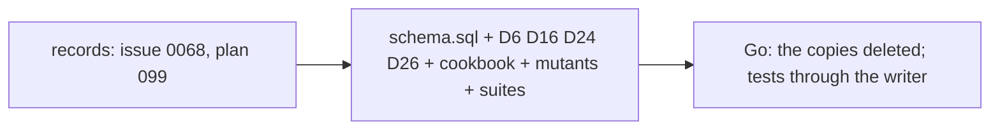

# 099 — Rules into the schema: a Go copy deleted, a writer-held rule made a trigger

> Dated implementation record. Tests use temporary folders and synthetic data only.

## Status

- **Date / baseline:** 2026-10-13, `771c9e8` (master).
- **Priority:** P1. **Effort:** M. **Risk:** LOW for the deletions (the status stays 422; the sentence is now
  SQLite's); MEDIUM for the triggers (a scale value, a check-in and an `at` link are refused by the file itself, so
  the suites that wrote them freely change in the same edit).
- **Status:** IN PROGRESS. One commit for the records, then the schema change with its docs and suites, then the Go.
- **Resolves:** issue [0068](../issues/0068-rules-the-writer-holds-alone.md). No RFC: D6, D16, D24 and D26 are
  rewritten in place; their substance (the rule) does not change, only where it is held.

## The judgment calls

- **A Go check is deleted when the DDL refuses the same input with the same status.** `core.refused` already turns
  every `SQLITE_CONSTRAINT` into a 422 with SQLite's sentence, so a deleted check changes only the words.
- **A check that answers 409 or 404 stays in Go.** A tombstone, a stale version and a missing row need a status the
  DDL cannot give; those lookups stay (`liveTaskVersion`, `checkVersion`, the `kind == nil` and `kind.Deleted`
  branches of a session, the existence lookups of `Locate`, `Promote`, `RegisterMetric`).
- **A read's check stays in Go.** The DDL never sees a window, a series bound or a month; `checkWindow` and the
  read-side `IsDay` calls stay. `validateTaskSchedule` stays in `taskCalendar`, which runs on read.
- **The title predicate stays in Go.** The contract says the writer is stricter than the DDL (Unicode 15.0).
- **The habit's action rule stays in Go.** A check-in needs a period on that day; a reading outside a period is a
  legal reading (D24), so only `CheckIn` refuses it.
- **The period-category rule stays in Go**, since no page states it (issue 0068).

## The change

### The schema

- `links_endpoint_types` refuses an `at` whose `from_id` is not a journal page (`is_journal`) and a `part-of` whose
  `to_id` is one. The `at` note in `link_kinds` names the trigger instead of the app.
- `measurements_scale_range` (BEFORE INSERT): when the metric's unit is `lo-hi` of ASCII digits with `lo < hi`, a
  non-NULL value is a whole number inside the range. A unit is at most 32 bytes, so both bounds are exact in a REAL.
- `measurements_habit_binary` (BEFORE INSERT): a non-NULL value of a metric with a habit period is 0 or 1.
- `habit_periods_check_insert` and `habit_periods_check_update` also refuse a metric with a current value outside
  0 and 1 (`measurement_values`).
- `task_occurrences_open` also fires on a revive (`deleted_at` cleared) of an open occurrence past the end.
- `docs/schema/README.md`: 76 triggers. `tests/README.md`: the mutant count.

### The docs

D6, D16, D24, D26 name the trigger where they named the app; `cookbook/habits.md` says the DDL refuses a non-binary
check-in and the diagnostic read still labels a row an older file may hold.

### The suites

One mutant per new rule, each with a witness in `links`, `facts`, `habits` or `planning`. The `facts` probe of the
largest finite double moves from Mood to a `kg` metric: Mood is a scale, and the file now says so.

### The Go

Deleted: `validateSession`, `validateSessionEndpoint`, `validateTaskSpec`, `validateOccurrenceChanges`,
`validReminderClock`, `validPlanningZone`, `validateMeasurementZone`, `zoneLabel`, `taskSlot`, `Point.check`,
`shaRE`, `mimeRE`, the scale and habit branches of `validateMeasurementValue`, the `at` and `part-of` day-page
branches of `Link`, the non-binary readings check of `StartHabit`, the `periodSpan` calls on writes, the cadence
and end checks of `EditTask` and `StopTask`, the open-after-end checks of `CaptureTaskOccurrence` and
`TaskOccurrenceLifecycle`, the `checkDay` calls on writes. A unit test that asserted a Go refusal asserts the same
422 through the production writer.

## Done criteria

- `go generate ./... && go vet ./... && go test ./...` green; `gofmt`; `staticcheck ./...`;
  `go run golang.org/x/tools/cmd/deadcode@v0.52.0 -test ./...` names nothing.
- `sqlite3` on a fresh file refuses `Mood = 9`, a check-in of 2 and an `at` from a person.
- `lifelog capture "x" --mood 9` answers 422 on every surface.

## Result

Filled in at the closing commit.
