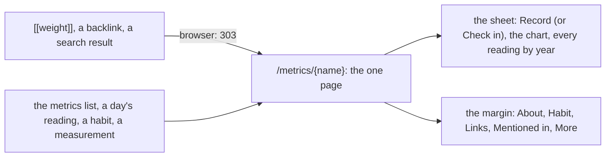

# 100 — One page a metric: Record, every reading, and its own page

> Dated implementation record. Tests use temporary folders and synthetic data only. Screenshots are made from a
> synthetic database and are not kept in git.

## Status

- **Date / baseline:** 2026-10-13, `acf70dd` (master).
- **Priority:** P1. **Effort:** M. **Risk:** LOW to MEDIUM: the series of the API reads all history when no `from`
  is named (it read 90 days), and it gains the page's properties and actions (nothing on the wire changes meaning);
  in a browser, the page of a live metric answers 303 to its metric. Nothing for the schema, nothing for the contract.
- **Status:** IN PROGRESS. One commit for the records, then one commit for the change and this record.
- **Resolves:** issue [0069](../issues/0069-a-metric-is-three-pages.md). No RFC: the contract in `docs/` does not
  change.

## The owner's decision (2026-10-13)

"When I access a metric page, I want to have one page with Record and also with the All Readings and not have them
as two separate pages. Everything should feel cohesive and well thought." Asked what the one page holds, the owner
chose **everything**: Record, every reading, and the metric's own page (its text, its backlinks, its habit, its
categories and its other actions). In a browser, a `[[weight]]` link and a backlink open that page.

## The design

- **The head.** The kind ("metric", or "habit" while a period is open), the name, the categories as badges and
  Every metric. Beside them, the reading tile of the day margin (plan 095): the latest reading, its unit and its day.
- **The sheet.** First the one filled button of the page: **Record** (the day and the value; the unit as the value's
  prompt; the metric fixed to this one; the session, the time, the zone and the import key folded). For a habit with
  an open period, **Check in** leads instead: Done and Not done for today, the joined pair of the day margin. Then
  **Readings**: the chart, then every reading, newest first, in one fold a year ("2025 · 214 readings · 76.2 to
  81.0 kg"). The newest year is open; every year is open when the series has at most 60 readings. A row is the day
  in words (a link to the day) and the value (a link to the reading, where it is corrected); a scope column only
  when the scope is not the default; a time column only when a reading has a time.
- **The margin.** **About**: the metric's text (its page body, D27), with Edit; an empty text names the way to
  write one. **Habit**: its periods, Start or Stop, and Check in another day. **Links**: its typed links by kind,
  File in category, Add a typed link, Remove a typed link. **Mentioned in**: its backlinks by kind, as a page shows
  them. **More**: Readings from a table (when its text has one), Record a value (a habit), Rename, Delete.
- **A habit is not charted.** Plan 097 told a habit by its strip, not a line of 0 and 1. On a habit's page the
  readings say "done" and "not done", and a year's fold counts them.

## The judgment calls

- **The series reads all history when no `from` is named, on every surface.** The owner asked for every reading on
  the page, and AGENTS.md puts consistent client behaviour first: one address gives one answer, so the default
  changes for the CLI and the MCP server too, not for the browser alone. `from` still selects `(from, to]`, and
  `all_history=1` stays accepted. The cost: an agent that follows a series link reads all of it; a window is one
  parameter away. The `all-readings` link stays, so a window leads back to the whole.
- **The series' own address is the address it was asked by.** With no query, `self` is `/metrics/{name}`, so a
  browser that registers a metric lands on the page, not on a pinned day. With a query, `self` names every
  parameter, as before.
- **The series carries the page, built once.** When the name (or an alias) is a live metric, the series takes the
  page's `id`, `body`, `links` and `backlinks`, the metric's `unit`, and the page's own actions from `pageEntity`:
  `save-body`, `rename`, `link`, `unlink`, `readings-from-table` (when the text has a table) and `tombstone`. `link`
  keeps the title "File in category" and the kind `part-of` as its value, with the kinds a metric may start as its
  options, so the browser draws it twice (File in category; Add a typed link) from one action. No action is built
  twice and no rule moves into Go.
- **In a browser, the page of a live metric is its metric.** `GET /pages/{id}` of a live metric answers 303 to
  `/metrics/{name}` when a browser asks; a feedback receipt moves with it, so a toast is not lost. JSON, the CLI and
  the MCP server keep the page entity. A deleted metric stays a page: the page template draws it, with Revive
  (`viewOf` maps the class `metric` to it), never the generic view.
- **The view orders, the API does not.** `readings[]` stays oldest first; the template reverses it and folds it by
  year. Nothing of the folds is in the JSON.
- **A point a reading while there are at most 200.** Beyond that the points overlap on the chart's 640 units and only
  add weight; the line stays, and the table holds every value.

## The change

| what | where |
|---|---|
| The series: the all-history default, the bare `self`, the page's properties and actions, the metric's name as the title | `internal/api/measurements.go` |
| A browser at the page of a live metric: 303 to it, the receipt moved | `internal/api/pages.go`, `internal/api/feedback.go` |
| The template `metric` (was `series`); `metric` to `page` in `viewOf`; the year folds and the latest reading as view methods; the chart's points capped | `internal/api/html/metrics.html`, `internal/api/html.go`, a new `internal/api/metric_view.go` |
| The record section and the year folds | `internal/api/html/app.css` |
| The year fold on the style page | `internal/api/html/styleguide.html` |
| The series' properties, actions and default; the page's 303 in a browser | `API.md` |
| "Metric ranges"; the browser's metric page | `README.md` |

## Tests

- **One page.** A browser at `/metrics/{name}` gets Record before the readings, every reading of every year with no
  All readings link, newest first, the text, the backlink of a day page, and the forms of `save-body`, `rename`,
  `link`, `unlink` and `tombstone`; the record form's metric is hidden and fixed.
- **The page leads to it.** `GET /pages/{id}` of a live metric: 303 to the metric for a browser, the page entity for
  JSON. A browser save without a back path ends on the metric page with its toast. A deleted metric's page is the
  page template with Revive.
- **The series carries its page.** The JSON has `id`, `unit`, `body`, `links`, `backlinks` and the page's actions; a
  rename through the series' action renames the metric, and the old name still opens it.
- **A habit.** Check in leads; the rows say done and not done; no chart; Record under More.
- **All history by default.** The JSON of `/metrics/{name}` holds a reading of an earlier year; `from` still bounds.
- Changed with the behaviour, never to pass: `api_test.go` (the metric's page is a 303 in a browser),
  `reference_test.go` (the series shape).

## Done criteria

- `go generate ./... && go vet ./... && go test ./...` green; `gofmt`; `staticcheck ./...`; `govulncheck ./...`.
- Screenshots in headless Edge at 1280 and 390 px, light and dark, on a synthetic database: a metric, a habit, a
  metric reached from `[[weight]]`, a deleted metric.

## Result

Filled in at the closing commit.
