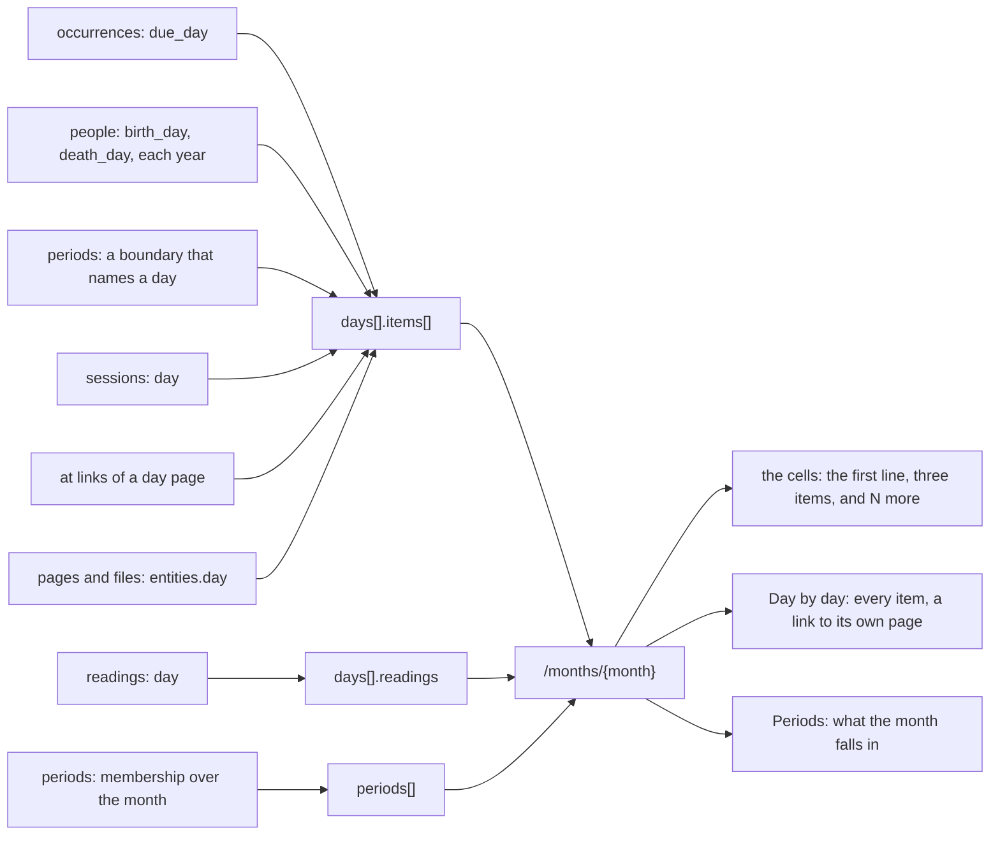
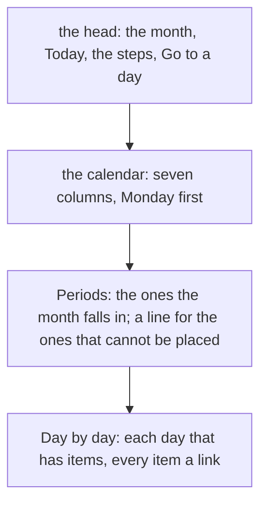

# 101 — The calendar holds every dated thing

> Dated implementation record. Tests use temporary folders and synthetic data only. Screenshots are made from a
> synthetic database and are not kept in git.

## Status

- **Date / baseline:** 2026-10-13, `c53cf4a` (master).
- **Priority:** P1. **Effort:** M. **Risk:** LOW: the month and the week gain properties, and no property changes its
  meaning. The month reads more (the occurrences, the sessions, the pages, the people and the periods of the month).
  The sidebar does not read the month resource, so its cost stays the same. Nothing for the schema, nothing for the
  contract.
- **Status:** DONE. One commit for the records, then one commit for the change and this record.
- **Resolves:** issue [0070](../issues/0070-the-calendar-shows-only-the-journal.md). No RFC: the contract in `docs/`
  does not change.

## The owner's decision (2026-10-13)

"I want to see in the calendar also the due tasks and all the data that might have a date assigned." The owner gave
the design of the browser to the agent on 2026-10-12 (best practice, calm for a reader with ADHD, every function
kept). The decisions below are the agent's, recorded here.

## The design

### What a day of the calendar holds

Each day of `days[]` (the month's and the week's: one read serves both) keeps `day`, `page`, `first_line` and
`mood`, and gains three properties.

- **`items[]`**: every other thing that names the day, each with its `kind`, its `title` and the `href` of its own
  resource. They come in this order:

  | kind | what | title | its other properties |
  |---|---|---|---|
  | `task` | an occurrence due on the day, of a live task, in every state; a recurring task's days included, as the deadlines give them | the task's label | `state`: `open`, `done` or `skipped` |
  | `birthday` | a live person's birth day, and its day in each later year | the person's title | `years`: the whole years since the birth; absent on the birth day |
  | `death` | a live person's death day, and its day in each later year | the person's title | `years`, as for a birthday |
  | `period` | a boundary of a live period that names this day | the period's title | `boundary`: `start` or `end`; `qualifier`: `?`, `~` or `%` when the boundary has one |
  | `session` | a live session reported on the day | its kind's title | `at`: its start as recorded, an instant or a local clock |
  | `place` | a live place that the live day page of the day links with `at` | the place's title | |
  | `page`, `file` | a live page that is not a day page and has the day: one written on the day, or a file of the day | its title | |

  Open occurrences come before done ones, and done ones before skipped ones. Pages and files are in the order of
  their titles, at most 20 a day.
- **`more_pages`**: the pages and files of the day after the first 20; absent when none. The day view lists all.
- **`readings`**: the current readings with no session on the day, of every metric but the Mood: `mood` holds
  those, and a day with a mood alone must not read "mood 3, 1 reading". Absent when none.

The month also gains **`periods[]`**: each live period that a day of the month can fall in, with its `membership`
over the month. That is the strongest membership of its days ([period boundaries](../contract/period-boundaries.md)):
`definite`, then `possible`, then `incomparable`. A period outside on every day is not listed. An ongoing end is read
as of `today`, which the month gives; the contract asks for an explicit day, and `today` is that day.

### How the month draws it

- **A cell** keeps its number, its tint and its frame. Under the first line (two lines now, not three), at most three
  items, one line each: a small square, the title, and a muted word when the title alone does not say what it is
  ("birthday", "born", "died", "starts", "ends", a session's time, "place"). A task's square has the colour of its
  state, as the tags have it: open, overdue (open and before today), done; a skipped task's square and every other
  square are muted. Then "and N more" when the day has more. Last, the mood and "N readings".
- **On a phone** (under 600 px), a cell has no room for words. It keeps its number and shows at most four squares,
  in the order of the items, so an overdue task shows first. The squares are hidden from a screen reader; the text of
  the day is in Day by day.
- **Periods**: the definite and possible periods of the month, each a link to its page, with its boundaries as the
  period page writes them ("unknown" for none, "ongoing" for `..`), and the tag "possibly" for a possible one. The
  incomparable ones are one line: "N periods cannot be placed in this month", a link to the periods.
- **Day by day**: each day that has items, in order, with its date in words as a link to the day. Under it, each item
  is a tag (due, overdue, done, skipped, birthday, born, died, starts, ends, session, place, page, file), a link to
  its own page, and a muted note when it has one ("36 years", "3 years ago", "approximate", the session's time).
  "And N more pages" links to the day.
- The caption says what the cells show. The style page shows a cell with items.

## The judgment calls

- **A birthday comes back each year; so does a death.** A calendar shows anniversaries. `years` counts whole years
  since the day. A birth on 29 February shows on 28 February in a common year, so it is not lost three years in four.
  This is not the rule of `on_this_day`, which matches 29 February only, because that list is of pages written on a
  date, not of a date to remember.
- **A period marks a day only where a boundary names that day.** A long period ("2018-09" to "..") on every cell of
  every month is noise. Its boundaries mark their days, and the Periods list says what the month falls in. A qualified
  boundary marks its nominal day with its word ("uncertain", "approximate", "uncertain, approximate"): the contract
  gives it no range, and the word says so.
- **The incomparable periods are counted, not hidden.** The contract says a response that claims all relevant periods
  must not omit an incomparable one. The JSON lists them with their membership; the page folds them into one line.
- **Every occurrence of the month, in every state.** The calendar is for the past and for the future, so done and
  skipped work stays on its day. Overdue is the deadlines' word: open and due before today.
- **Pages are capped at 20 a day.** An import can write thousands of pages on one day. The cap keeps the month small;
  `more_pages` says what it left out, and the day lists every page.
- **One read for the month and the week.** The week's days are the month's days, so its JSON gains the same
  properties. The week reads the occurrences of its seven days once, for both its days and its `occurrences[]`.
  The week's page, the day and the year draw nothing new: the owner asked for the calendar.
- **No new rule about the data.** Every item is a read of rows the schema holds. The anniversaries, the order and the
  cap are the application's reading, documented in [API.md](../../API.md).

## The change

| what | where |
|---|---|
| The dated rows of a window: pages and files (20 a day, with the count), places, sessions; the anniversaries; the readings by day | a new `internal/core/calendar.go`; `internal/core/read.go` |
| The membership of a period over a window of days | `internal/core/periods.go` |
| `items[]`, `more_pages`, `readings` of a day; `periods[]` of the month; the week reads its occurrences once | `internal/api/months.go`, `internal/api/weeks.go` |
| The words of an item, a boundary and a period, and the template functions that draw them | `internal/api/calendar.go`, `internal/api/html.go` |
| The cells, Periods, Day by day | `internal/api/html/month.html`, `internal/api/html/app.css` |
| A cell with items | `internal/api/html/styleguide.html` |
| The month's and the week's properties | `API.md` |
| The calendar of a month | `README.md` |

## Tests

- **Every dated thing.** On a synthetic file: a one-off task due on a day, a weekly task (one occurrence done, one
  skipped), an overdue task; a person born on that day in 1990, a person born on 29 February 2000, a person who died
  in 2020; periods with an exact start in the month, a month-precision end, an ongoing end, unknown boundaries, a
  qualified boundary, and one outside; a session; a place at link; a page and a file of the day; readings. The JSON
  of the month gives each item on its day with the values worked out by hand, in the order above.
- **Anniversaries.** Not before the birth; `years` absent on the birth day; 29 February on 28 February in 2031 and on
  29 February in 2032; a week across the new year.
- **Periods over a month.** Definite, possible, incomparable and outside, for each shape above, and the ongoing end
  read as of today.
- **The cap.** 21 pages on one day: 20 items and `more_pages` 1.
- **The page.** The cell shows three items and "and N more"; Day by day links each item to its own address; Periods
  lists the possible one with "possibly" and counts the incomparable ones.
- **The week.** Its days carry the items; its `occurrences[]` is as before.
- Changed with the behaviour, never to pass: `reference_test.go` (the month's shape), `months_test.go` (the cell).

## Done criteria

- `go generate ./... && go vet ./... && go test ./...` green; `gofmt`; `staticcheck ./...`; `govulncheck ./...`.
- Screenshots in headless Edge at 1280 and 390 px, light and dark, on a synthetic database: a busy month, a month
  with nothing, the style page.

## Result

Done as designed above, with two changes found in the work.

- **The readings count leaves out the Mood.** The first commit of this plan counted every reading, as the year does.
  Then a day with a mood alone read "mood 3 · 1 reading". `readings` now counts the other metrics; the year's count
  stays as it was.
- **A done task's line is not bold.** The page-wide `.done` rule (the state of a habit) also matched the item of a
  cell. A rule of the calendar resets it; the square says done.
- **Checks** (Windows 11): `go generate ./... && go vet ./... && go test ./...` green; `gofmt` clean; `staticcheck
  ./...` (2026.2.1, 0.8.1) clean; `govulncheck ./...` (v1.9.0) "No vulnerabilities found"; `go test -count=1
  -shuffle=on ./internal/api ./internal/core` green. Two rules broken on purpose were caught: with no 29 February
  on 28 February, the anniversaries test failed; with an open task due today called overdue, the calendar test
  failed.
- **Screenshots** in headless Edge 154 at 1280 and 390 px, light and dark, on a synthetic database: October 2026
  (17 days with items: tasks in every state, three people, four periods, four sessions, a place, files and pages),
  August 2026 (no item, one period that cannot be placed), the style page.
- **Not run:** the race check and a Linux run (no Linux here), the mermaid render (no diagram in `docs/` outside the
  records changed), and a measurement at the lifetime envelope.
