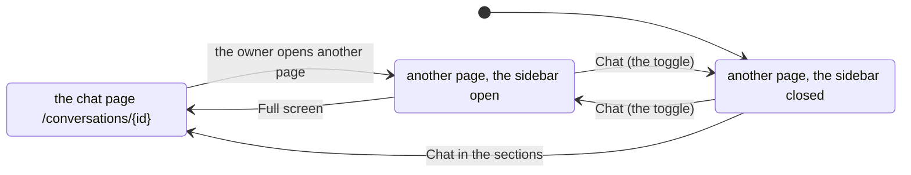

# 103 — The conversation on the screen: a chat page, and a sidebar that follows the owner

> Dated implementation record. Tests use temporary folders, synthetic data and a fake model.

## Status

- **Date / baseline:** 2026-10-14, `04b636d` (master).
- **Priority:** P1. **Effort:** M. **Risk:** LOW: two new reads, a new view and a script for the browser; nothing
  for the schema or the contract.
- **Status:** REJECTED (2026-10-28): superseded by [plan 116](116-strip-to-the-core.md) and
  [RFC 0015](../rfcs/0015-no-conversation.md), which removed the conversation and its pages from the browser.
- **Resolves:** issue [0072](../issues/0072-a-conversation-reads-as-a-page.md). No RFC: the contract in `docs/` does
  not change.

## The owner's decision (2026-10-14)

"An always on sidebar chat with the agent and a full screen chat page. If the user moves out of the full screen chat
page, it becomes a toggleable right sidebar."

## The design

- **Two reads.** `GET /conversations`: the conversations, newest first, and `ask` for a new one.
  `GET /conversations/{id}`: one conversation, its `turns[]` read from its page's body, and `ask` with `conversation`
  filled. `ask` answers with the conversation (its `self` is `/conversations/{id}`), so a browser form lands on the
  chat page. In a browser, a conversation's `/pages/{id}` answers 303 to it, as a metric's page does; JSON keeps the
  page.
- **The turns.** The application's own transcript format (plan 102) is written and read in one place,
  `internal/api/conversations.go`: a turn starts at a line `**Owner** (HH.MM): `; its tool lines start with ``- ` ``;
  its answer starts at `**lifelog:** ` or `**lifelog** did not answer: `. Text before the first turn is `preamble`.
  An edit by the owner that breaks the format is still shown: it stays in the turn's text.
- **The chat page.** The conversations on the left, the thread in the middle (the owner's question, the tool lines
  small, the answer as rendered markdown), the composer at the bottom. No script is needed: the form posts, and the
  server answers with the page.
- **The sidebar.** On every other page of the shell, a right column that a button (Chat, bottom right) opens and
  closes. It holds the thread of the current conversation and a composer. The script loads the thread from the chat
  page's own HTML, so the server draws every turn. It sends a question with `fetch`, shows it at once with "Thinking",
  and draws the thread from the answer. The state (open or closed, the current conversation) is kept in the browser's
  `localStorage`. The chat page sets it open, so leaving the chat page shows the sidebar. On a phone the sidebar is a
  sheet over the page.

## The judgment calls

- **The answer is lost when the page is left while the model works.** The turn runs in its request; a closed request
  stops it (plan 102). The script asks before the browser leaves a page while a question waits. A turn that outlives
  its request needs work that a server owns after the request, and that is a later change if the owner needs it.
- **The sidebar is not on the chat page**, which is the same conversation full size.
- **The format is parsed after all.** Plan 102 kept the body as the only memory, with no parser. A conversation that
  reads as one needs its turns; the writer and the reader of the format are now one file.

## The change

| what | where |
|---|---|
| The transcript format, written and read; `/conversations` and `/conversations/{id}`; the 303 of a conversation's page | `internal/api/conversations.go`, `internal/api/pages.go`, `internal/api/serve.go` |
| The agent writes a turn with the API's format | `internal/chat/agent.go` |
| The chat page, the thread, the sidebar; Chat in the sections | `internal/api/html/conversation.html`, `layout.html`, `app.css`, `app.js`, `internal/api/html.go` |
| The two classes; ask's answer | `API.md`, `README.md` |

## Tests

- The turns of a body worked out by hand: no turn, a preamble, a turn with tool lines, an error turn, a turn whose
  owner edited it, two turns.
- `GET /conversations` lists the conversations newest first and leaves out a tombstoned one; `GET
  /conversations/{id}` gives the turns; a page that is not a conversation is 404 there.
- In a browser: `ask` lands on `/conversations/{id}`; a conversation's `/pages/{id}` answers 303 to it; Home draws
  the sidebar and the Chat toggle; the chat page draws the thread and no sidebar.
- Changed with the behaviour: `reference_test.go` (the two classes).

## Done criteria

- `go generate ./... && go vet ./... && go test ./...` green; `gofmt`.
- The owner uses it in the browser on the service.

## Result

Built as designed above, with three changes found in the work.

- **The script keeps one thing in the browser.** The rule of the script was "it keeps nothing". A sidebar that
  follows the owner from page to page needs its state, so the rule is now narrower: one key, `lifelog.chat`, holds
  open or closed and the current conversation's id, never its text. `TestTheScriptReadsTitlesRenderTheRootAndTheChatOnly`
  checks the key and the two new requests, and keeps every other refusal.
- **The toggle is at the bottom right**, so it never covers the tools at the top of a page.
- **A browser's `ask` gets no receipt.** The chat page shows the turn; a toast would say it twice.
- **Checks** (Linux, Debian 13, Go 1.27.2): `go generate ./... && go vet ./... && go test ./...` green; `gofmt`
  clean; `go test -count=1 -shuffle=on ./internal/chat ./internal/api` green; `app.js` parsed by a JavaScript parser
  (goja, in a scratch module, not a dependency).
- **Not run:** the script in a real browser and screenshots (no browser on this machine), `staticcheck`,
  `govulncheck`, the race check, a Windows run.
