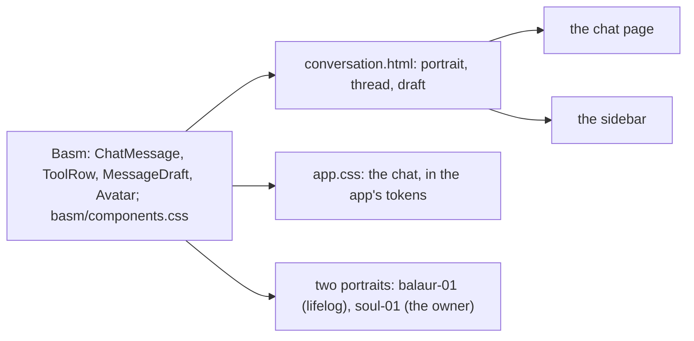

# 104 — The chat in Basm: the conversation drawn as the Chat of the owner's design system

> Dated implementation record. Tests use temporary folders and synthetic data.

## Status

- **Date / baseline:** 2026-10-14, `d335efd` (master).
- **Priority:** P2. **Effort:** S. **Risk:** LOW: the markup and the styles of the chat page and the sidebar; two
  tokens; two pictures. Nothing for the schema, the contract or the API.
- **Status:** DONE.
- **Follows:** [plan 103](103-the-conversation-on-the-screen.md). No issue: the owner's request.

## The owner's decision (2026-10-14)

"In claude.ai design system balaur, we have an ai chat interface design, let's import that and use it in the app."
The source is the Claude Design project **Balaur — Basm** (Hearthwood canon), the project that
[plan 096](../plans/README.md) took the app's materials from: `components/chat` (ChatMessage, ToolRow, MessageDraft,
Avatar), `ui_kits/balaur/ChatScreen.jsx` and the chat rules of `basm/components.css`.

## The design

| Basm | here |
|---|---|
| ChatMessage: a framed pixel portrait, a wood nameplate under it, a parchment speech panel with a stepped tail; Balaur on the left, the owner on the right with the portrait mirrored | each turn: the owner's question on the right ("You · HH.MM"), lifelog's answer on the left ("Lifelog") |
| ToolRow: a dark wood row in mono, `tool · name —`, set in under the portraits | each step: `tool · capture — /days/…`, the refusal in place of the href |
| MessageDraft: the composer as an unsent message, dashed, solid while it is written; Enter sends, Shift+Enter breaks | the draft of the chat page and of the sidebar; the button sends without the script |
| pending: thinking dots, the portrait breathing teal light | the waiting line while the model works |
| tokens: chrome, parchment, parch-edge, outline-2, gold, teal, indigo | `--rail`, `--surface`, `--edge`, `--outline`, `--rail-accent`, and two new ones, `--teal` and `--indigo` |

## The judgment calls

- **Sentence case, not Basm's uppercase mono labels.** Plan 096 left Balaur's tracked capitals out; the nameplates and
  the hint follow the app.
- **The chat sits on oak, not on a parchment sheet.** Parchment panels on parchment lose their edges; the sidebar is
  wood, like the rail.
- **No typewriter.** Basm types a new line out; the answer here is rendered markdown, which a typewriter would show as
  broken markup while it types. Not taken.
- **No dialogue choices.** Basm answers a decision with choices; the model here asks in words, and nothing gives it a
  structured choice to offer. A later change if the owner wants it.
- **`--teal` and `--indigo` are one value in both themes**, Basm's dark values: they are read only on wood, which is
  dark in both. The contrast test checks both on `--rail` and `--rail-deep`.

## The change

| what | where |
|---|---|
| The portrait, the thread, the draft, the sidebar | `internal/api/html/conversation.html` |
| The chat's styles | `internal/api/html/app.css` |
| `--teal`, `--indigo` | `internal/api/html/base.css`, `internal/api/tokens_test.go` |
| The waiting line in Basm's markup; Enter sends a draft | `internal/api/html/app.js` |
| The two portraits and their routes | `internal/api/html/portrait-lifelog.png`, `portrait-owner.png`, `internal/api/serve.go`, `internal/api/html.go` |

## Tests

- The chat page draws each turn with its portrait, nameplate and panel, and the draft with the conversation's id.
- The two tokens hold 4.5:1 on wood in both themes.
- Changed with the behaviour: `internal/chat/agent_test.go` (the markup of the thread).

## Done criteria

- `go generate ./... && go vet ./... && go test ./...` green; `gofmt`; `app.js` parses.
- The portraits are in the repository and served; the owner sees the chat on the service.

## Result

Built as designed above. The two portraits were copied byte for byte from the project (every PNG chunk's CRC
checked), on the owner's word. A test reads both back from the service as PNG.

- **Checks** (Linux, Debian 13, Go 1.27.2): `go generate ./... && go vet ./... && go test ./...` green; `gofmt`
  clean; `app.js` parsed by goja (a scratch module, not a dependency).
- **Not run:** the page in a real browser and screenshots (no browser on this machine), `staticcheck`,
  `govulncheck`, the race check, a Windows run.
