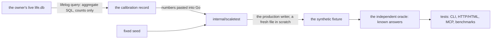
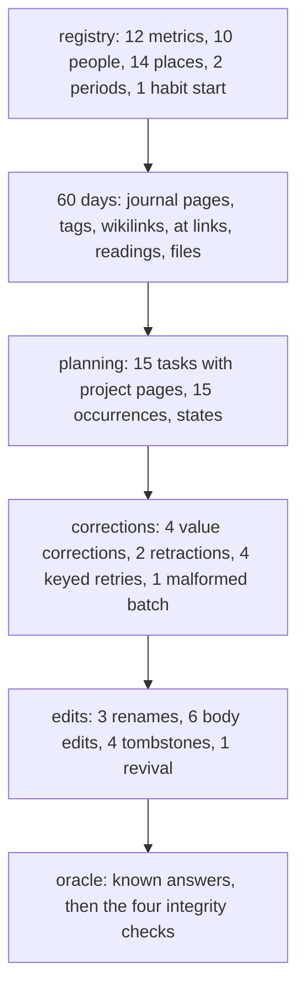
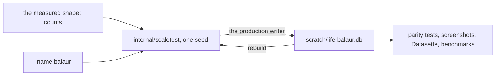

# 105 — The owner's shape in the synthetic fixture: a calibrated workload for tests

> Dated implementation record. Tests use temporary folders and synthetic data only. The owner's live `life.db`
> is never opened by a test, a fixture, a tool, `sqlite3` or Datasette.

## Status

- **Date / baseline:** 2026-10-14, `bd16083` (master).
- **Priority:** P1. **Effort:** L. **Risk:** LOW: this is development tooling. Nothing changes in
  `docs/schema/schema.sql`, the contract, the suites' rules or the product's behavior. The generator grows;
  the writer does not.
- **Status:** TODO.
- **Resolves:** no issue, no RFC. The owner's request of 2026-10-14 is the incident: "make a synthetic database
  from the shape of the file I have filled, and use it for testing." The gap is real and measured below.

## The owner's request (2026-10-14)

The tests build fixtures by hand, one small scenario per suite. `tools/lifescale` builds a large workload,
but its shape is invented: 20 readings a day, 3 files a day, 4,000 notes, one person, one place, one habit,
no task, no session, no period, no tombstone, no rename, no edit, one source. The owner's live file has
214 tasks, 38 people, 54 places, 115 metrics, 114 tombstones and 1,378 journal days over 15 years.
A test that runs on the invented shape exercises a shape the owner never writes.

The plan makes the generator's shape **measured**, not invented. It reads the live file's aggregate counts
through the writer, records the numbers, and generates a fresh database from scratch with them.

## The rule that keeps private data out



- **The live file is never opened by anything in this plan.** The calibration runs `./lifelog query` — the CLI,
  the same writer as the service ([connections](../contract/connections.md) allows one writer on one file).
- **Only aggregates cross into the repo**: counts, year spans, averages and maxima of lengths, proportions.
  No title, body, value, name, place, row date, preview byte or private text. The published record is a table of
  numbers; a reader of the repo learns the shape, not the life.
- **The generator builds from scratch.** It reads no copy, no export, no anonymized record. It takes parameters
  and a seed. Two runs with one seed make the same logical fixture.
- **Re-calibrating is deliberate.** The SQL is fixed in this plan. A new measurement is a new dated row here and
  new numbers in Go, in one commit.

## The measured shape (2026-10-14, `./lifelog query`)

| thing | live | per journal page (1,378 pages) |
|---|---|---|
| journal day pages | 1,378 (1995–2027, 15 years) | — |
| other pages | 236 | 0.17 |
| files | 175, on 36 days; 23 with a preview (avg 118 KB, max 316 KB) | 0.13 |
| metrics | 115 | — |
| people | 38 | 0.028 |
| places | 54 | 0.039 |
| periods | 3 | 0.002 |
| habit periods | 1 | 0.0007 |
| sessions | 0 | 0 |
| tasks | 214: all with a project page, none recurring, none with a reminder, 1 tombstoned | 0.155 |
| task occurrences | 214: 102 done, 112 open, all keyed `once` | 0.155 |
| measurements | 2,228 current, on 1,263 days, 2020–2026 (1.7 a day) | 1.61 |
| links | 644 `wikilink`, 135 `about`, 19 `at`, 3 `part-of` | 0.47 / 0.10 / 0.014 / 0.002 |
| `entity_names` | 2,001 (387 retained aliases beyond preferred names) | 1.45 |
| tombstones | 114 entities | 0.083 |
| body length | pages avg 420, max 36,658; files avg 4,865, max 57,892 | — |
| sources | `cli` 1,290; `api` 657; `agent:pi` 39; `ui` 9; `agent:chat` 3; `schema` 1 | — |
| `import_key` | present on 0 rows | — |

The file is 7.4 MB with its 23 previews. **The owner's shape is small.** A full 15-year fixture is a baseline
fixture, not an opt-in run. The 50-year `lifetime` profile stays for storage and scaling evidence.

The calibration SQL is one statement, run once:

```sql
SELECT 'journal_days','count',count(*) FROM entities WHERE is_journal
UNION ALL SELECT 'journal_years',min(substr(preferred_name_key,1,4))||'-'||max(substr(preferred_name_key,1,4)),
       count(DISTINCT substr(preferred_name_key,1,4)) FROM entities WHERE is_journal
UNION ALL SELECT 'pages_non_journal','count',count(*) FROM entities WHERE entity_type='page' AND NOT is_journal
UNION ALL SELECT 'body_len_avg','pages',CAST(avg(length(body)) AS INT) FROM entities WHERE entity_type='page'
UNION ALL SELECT 'body_len_max','pages',max(length(body)) FROM entities WHERE entity_type='page'
UNION ALL SELECT 'body_len_avg','files',CAST(avg(length(body)) AS INT) FROM entities WHERE entity_type='file'
UNION ALL SELECT 'body_len_max','files',max(length(body)) FROM entities WHERE entity_type='file'
UNION ALL SELECT 'entity_type',entity_type,count(*) FROM entities GROUP BY entity_type
UNION ALL SELECT 'link_kind',kind,count(*) FROM links GROUP BY kind
UNION ALL SELECT 'measurements','current',count(*) FROM measurements WHERE value IS NOT NULL
UNION ALL SELECT 'readings_days','distinct_days',count(DISTINCT day) FROM measurements
UNION ALL SELECT 'readings_years',min(substr(day,1,4))||'-'||max(substr(day,1,4)),
       count(DISTINCT substr(day,1,4)) FROM measurements
UNION ALL SELECT 'files_days','distinct_days',count(DISTINCT day) FROM entities WHERE entity_type='file'
UNION ALL SELECT 'files_mime',mime,count(*) FROM files GROUP BY mime
UNION ALL SELECT 'files_preview','with_preview',count(preview) FROM files
UNION ALL SELECT 'preview_bytes_avg','with_preview',CAST(avg(length(preview)) AS INT) FROM files WHERE preview IS NOT NULL
UNION ALL SELECT 'preview_bytes_max','with_preview',max(length(preview)) FROM files WHERE preview IS NOT NULL
UNION ALL SELECT 'task_state',state,count(*) FROM task_occurrences GROUP BY state
UNION ALL SELECT 'task_project','with_project',count(project_page_id) FROM tasks
UNION ALL SELECT 'task_recurring','recurring',count(repeat_unit) FROM tasks
UNION ALL SELECT 'task_reminder','with_reminder',count(reminder_local_time) FROM tasks
UNION ALL SELECT 'source',source,count(*) FROM entities GROUP BY source
UNION ALL SELECT 'import_key','with_key',count(import_key) FROM entities
UNION ALL SELECT 'tombstones','entities',count(deleted_at) FROM entities
ORDER BY 1,2;
```

It returns counts and length statistics only. It names no row.

## What the generator cannot do today

`internal/scaletest/scale.go` writes through `core.Tx` (the production writer), which is right. Its legs are:
journal pages, readings with corrections and retractions, files, imported notes, one person, one place, one
shared topic, one habit, one rare search term, keyed replay, and a malformed batch that rolls back.

| leg | in the live file | in the generator |
|---|---|---|
| tasks and occurrences (states, project, recurrence, reminder) | 214 / 214 | none |
| people, places, aliases, `entity_names` | 38, 54, 387 aliases | 1, 1, 0 |
| `about`, `at`, `part-of`, `located-in`, `friend`, `family`, `related` links | 135, 19, 3, 0, 0, 0, 0 | none |
| tags (`#health` → `[[health]]`) | in the bodies | none |
| sessions | 0 | none |
| periods | 3 | none |
| habit start and stop, check-ins | 1 habit | start only |
| tombstones and revival | 114 | none |
| renames (retained aliases) | 387 aliases imply them | none |
| body edits (`SaveBody`, revision bumps) | every edited page | none |
| previews at the owner's size | avg 118 KB, max 316 KB | 640×480 noise, opt-in only |
| several sources | `cli`, `api`, `ui`, `agent:*` | `import:scale` only |
| `part-of` categories, `Categories` reads | 3 | none |
| location points on places | 54 places | none |

A test that runs on the current fixture cannot fail on a task, a session, a period, a tombstone, a rename, an
alias, a category, a tag, a place, a preview, a second source, or a mixed-source read.

## The design

### Two profiles, one measured shape

- **`owner`** — the live shape: 5,478 days (1995-01-01 to 2009-12-31, the 15-year span), 1,378 journal pages,
  236 pages, 175 files on 36 days, 115 metrics, 2,228 readings on 1,263 days, 214 tasks with 214 occurrences,
  38 people, 54 places, 3 periods, 1 habit, 644 wikilinks, 135 `about`, 19 `at`, 3 `part-of`, 114 tombstones,
  387 retained aliases.
- **`owner-small`** — the same ratios in a 60-day window, for the baseline: 30 journal pages, 12 pages,
  8 files on 4 days (2 with a preview of about 120 KB), 12 metrics, 48 readings on 28 days (4 corrections,
  2 retractions), 15 tasks with 15 occurrences (7 done, 8 open), 10 people, 14 places, 2 periods, 1 habit
  started and stopped, 4 sessions, 20 wikilinks, 7 `about`, 2 `at`, 1 `part-of`, 1 `located-in`, 1 `friend`,
  4 tombstones, 3 renames, 6 body edits, 4 keyed retries that write nothing, 1 malformed batch that rolls back.

`small`, `lifetime` and `stress` stay. They measure storage and scaling; `owner` and `owner-small` measure
shape. The ratios of `owner-small` are the live ratios per journal page, with one stated departure: the live
file has a page on about 25% of days, and `owner-small` writes on 50% of its 60 days, so a test has enough
rows. The density is recorded here, not hidden in code.

### The legs, in the order the writer takes them



Every write goes through `core.Tx` and `core.Store.Do`, with `BEGIN IMMEDIATE`, as the writer does. No raw
`INSERT` builds the fixture. The sources are the ones the live file shows: `cli`, `api`, `ui`, `agent:pi`,
and `import:scale` for the bulk legs. Provenance is part of the shape.

### The oracle

The fixture keeps hand-checked known answers, independent of the generator's own queries:

| known answer | how it is checked |
|---|---|
| every metric's current series (id, day, value, order) | `SeriesHistory` against the recorded expected rows |
| raw reading, file, page, task, occurrence, name and tombstone counts | `SELECT count(*)` against the manifest |
| the task states and the project page of each task | `Tasks`, `Deadlines` in a fixed window |
| the habit's days and completion | `Habits`, `Completion`, `HabitPeriods` |
| the sessions of a day, and a period's boundaries | `Sessions`, `LifePeriods` |
| the backlinks of the shared topic, by kind | `PageByID`, the edge kinds asserted |
| the categories of `part-of` | `Categories` |
| rare search terms, and a tag page | `Search`, `PageID` |
| the four integrity checks | `Integrity`, `OK` |
| the same seed makes the same logical fixture | `LogicalSHA256` equality, and inequality for a changed seed |

The oracle is a Go table of expected values, written from the parameters, not from a query the generator runs.

### The named persona file: `life-<persona>.db`

The owner asked for a named file, made from the shape of the live database, used for tests. It is built, not
 copied. The name is a synthetic persona, never a real person's name.



- **Generated, not copied.** A copy of `life.db` is private data. It cannot be a fixture: it is not reproducible,
  it changes as the owner writes, and it cannot be shared with another developer. A generated file is reproducible
  from its seed, and the generator is in git while the file is not.
- **Not in git.** `*.db`, `*.db-wal` and `*.db-shm` are already ignored. The file lives in an explicitly selected
  scratch folder, named in the command. `scratch/life-balaur.db` is the agreed home in this repo.
- **One writer per file.** The generator is the only writer of the persona file. A reader (Datasette, a browser
  probe, a benchmark) opens it read-only with `trusted_schema=OFF`, never `immutable=1`. Nothing edits its rows.
- **Rebuildable.** `go run ./tools/lifescale -profile owner -name balaur -dir scratch -keep` makes it again. A
  test that needs a persistent file checks the `logical_sha256` it names, and rebuilds when it does not match.
- **Baseline tests do not read it.** They build in `t.TempDir()`. The named file serves the runs that need one
  file to look at: the browser, Datasette, the benchmarks and the recorded comparisons.

### Where the tests use it

- `internal/scaletest/owner_test.go` — the small fixture builds, its known answers pass, its ratios match the
  published numbers, and reproducibility holds. This runs in the baseline.
- `tools/lifescale -profile owner-small` and `-profile owner` — the same builder, with the JSON report.
- A shared fixture builder `scaletest.Open(t, "owner-small")` returns a `*core.Store` in `t.TempDir()`. The
  client-parity scenarios in `internal/api`, `internal/client` and `internal/mcp` run their existing shared
  scenario on it, so the same owner-shaped file is read through the CLI, the HTTP/HTML API and the MCP tools,
  with the same domain outcomes and the owner-only refusals asserted.
- The browser screenshots of plans 093–096 and 104 are taken on `owner-small`, so the screens show a realistic
  density of tasks, readings, people, places and files.
- The performance baselines (day view, search, backlinks, a metric series, import replay) run on `owner` as
  well as on `small`, so a cost is measured on the shape the owner writes.
- Suites that test one rule keep their own small fixture. Exhaustive cases stay at their owning layer.

## Work

1. `internal/scaletest/owner_profile.go`: the two profiles as a Go table, with the measured numbers, the date
   of the measurement, and the SQL as a comment. No file reads the live database.
2. `internal/scaletest/owner.go`: the legs above, written through `core.Tx`. Extend `Manifest` with tasks,
   occurrences, people, places, periods, sessions, aliases, tombstones, renames, edits, links by kind, and
   preview bytes. Keep `Version` and the digest rule.
3. `internal/scaletest/owner_test.go`: the known answers of `owner-small`, the ratio checks against the
   published numbers, reproducibility for one seed, difference for a changed seed, and the four integrity
   checks on the built file and on a restored snapshot.
4. `tools/lifescale`: accept `-profile owner-small` and `-profile owner`, and `-name PERSONA` for the leaf of the
   generated file (`life-<persona>.db`). The existing flags and report fields stay; `-name` names an invented
   persona, not a real person. `.gitignore` gains `/scratch/`.
5. `scaletest.Open(t, name)`: build in `t.TempDir()`, return `*core.Store`, register `t.Cleanup` close.
6. One client-parity scenario on `owner-small` through the CLI, the HTTP/HTML API and the MCP tools: a day
   view, a task, a series, a search, a backlink list, a preview, and one owner-only refusal to an `agent:*`
   writer.
7. `tests/README.md`: the synthetic scale runner section gains the two profiles, the calibration rule, and the
   statement that the live file is never opened. The diagram and mutant counts do not change.
8. `AGENTS.md`: the persona table gains the measured shape as a fifth row, pointing at this plan. No new
   workload is invented.

## Done criteria

1. `go test ./internal/scaletest -run 'Owner' -v` passes: the known answers, the ratios, reproducibility, the
   integrity checks, and the restored snapshot.
2. `go run ./tools/lifescale -profile owner-small -seed 2075 -samples 1` and `-profile owner` both report a
   green fixture with the published counts.
3. `go run ./tools/lifescale -profile owner -name balaur -dir scratch -keep` writes `scratch/life-balaur.db`,
   reports its `logical_sha256`, and the known answers pass on the retained file. `scratch/` is in `.gitignore`,
   and `git status` shows no database.
4. The parity scenario gives the same domain outcomes on the CLI, the HTTP/HTML API and the MCP tools, and the
   owner-only action is refused to an `agent:*` writer.
5. `go generate ./... && go vet ./... && go test ./...` is green, and `go test -count=1 -shuffle=on ./...` is
   green.
6. `tests/README.md` and `AGENTS.md` say what exists, not what is planned.
7. No file in `tests/`, `internal/` or `tools/` opens `life.db`, and no fixture contains text from the live file.
   The persona file is generated from the seed, and its persona name is invented.

## What this does not prove

- The fixture is synthetic. It is not the owner's data, and it is not a copy of it. It proves that the writer
  and the surfaces handle a realistic **shape**, not that any real answer is correct.
- A named persona file is a snapshot of the **shape**, not of the life. It carries no body, name, reading or
  picture from the live file, and its persona name is invented.
- The calibration is one snapshot of one file, on one date. It says what the owner has written, not what the
  owner will write.
- The ratios are counts and length statistics. They carry no meaning about the content.
- `owner` is a 15-year shape, not a 50-year envelope. The 50-year workload stays `lifetime` and `stress`.
- Real power loss and real data have never been tested, and this plan does not test them.
