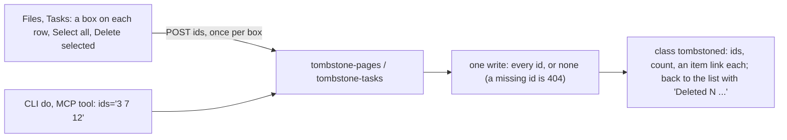

# 107 — Delete several at once: a box on each row of Files and Tasks

> Dated implementation record. Tests use temporary folders and synthetic data. The owner's live `life.db` is never
> opened by a test.

## Status

- **Date / baseline:** 2026-10-14, `4cef363` (master).
- **Priority:** P1. **Effort:** S. **Risk:** LOW: two actions of the catalog, two list views. Nothing for the schema
  or the contract: a tombstone stays `entities.deleted_at` or `tasks.deleted_at` ([D11](../decisions/D11-tombstones.md)).
- **Status:** DONE.
- **Resolves:** no issue, no RFC. The owner's words are the incident.

## The owner's words (2026-10-14)

"I want to be able to mass delete files and tasks and to be able to check them."

## The design

- **Two actions of the catalog, so every surface has them** (the owner's rule of 2026-10-08). `tombstone-pages`
  (`POST /pages/tombstone`) and `tombstone-tasks` (`POST /tasks/tombstone`) take one field, `ids`. A browser sends
  the field once per checked box; a CLI or an agent sends one value with spaces or commas. The handler reads both.
- **One write or none.** `core.Tx.TombstonePages` and `core.Tx.TombstoneTasks` run in one transaction: an id no row
  has is a 404 and nothing is written. A row tombstoned already is left as it is. At most 500 ids.
- **No version for the tasks.** `tombstone-task` checks the task's version; the bulk one does not: the rows were
  picked from a list, a tombstone changes no fact of the task, and `revive-task` undoes it.
- **The list draws the form, not the catalog's generic one.** The field `ids` is a text field for a program; the
  browser draws it as a box on each row inside one form (`pick-form-open` in `layout.html`), with a bar of Select all
  and one danger button. The form posts with no script; the script counts the selection and disables the button
  until a box is checked. The files list offers `tombstone-pages`; the people and the places lists do not, until
  the owner asks.
- **The answer** is the class `tombstoned`; its `result` is the count in words, the toast of the list the browser
  returns to.

## The change

| what | where |
|---|---|
| `TombstonePages`, `TombstoneTasks` | `internal/core/write.go`, `internal/core/tasks.go` |
| The two actions, their routes, the handler | `internal/api/siren.go`, `internal/api/serve.go`, `internal/api/tombstones.go` |
| The lists offer them | `internal/api/pages.go` (`named`, files only), `internal/api/tasks.go` |
| The boxes, the bar, the button | `internal/api/html/layout.html`, `root.html`, `planning.html`, `app.css`, `app.js` |
| The tests | `internal/api/tombstones_test.go` |
| The docs | `API.md` (`tombstoned`, the lists), `README.md` |

## Done when

- [x] `tombstone-pages` and `tombstone-tasks` are in `GET /actions`, so `lifelog do` and the MCP tools carry them.
- [x] A missing id refuses the whole write; the live rows named beside it stay live (tested).
- [x] Files and Tasks draw a box per row, a browser form returns to the list with the count, and a post with no box
      checked comes back with the refusal (tested).
- [x] Baseline green.
