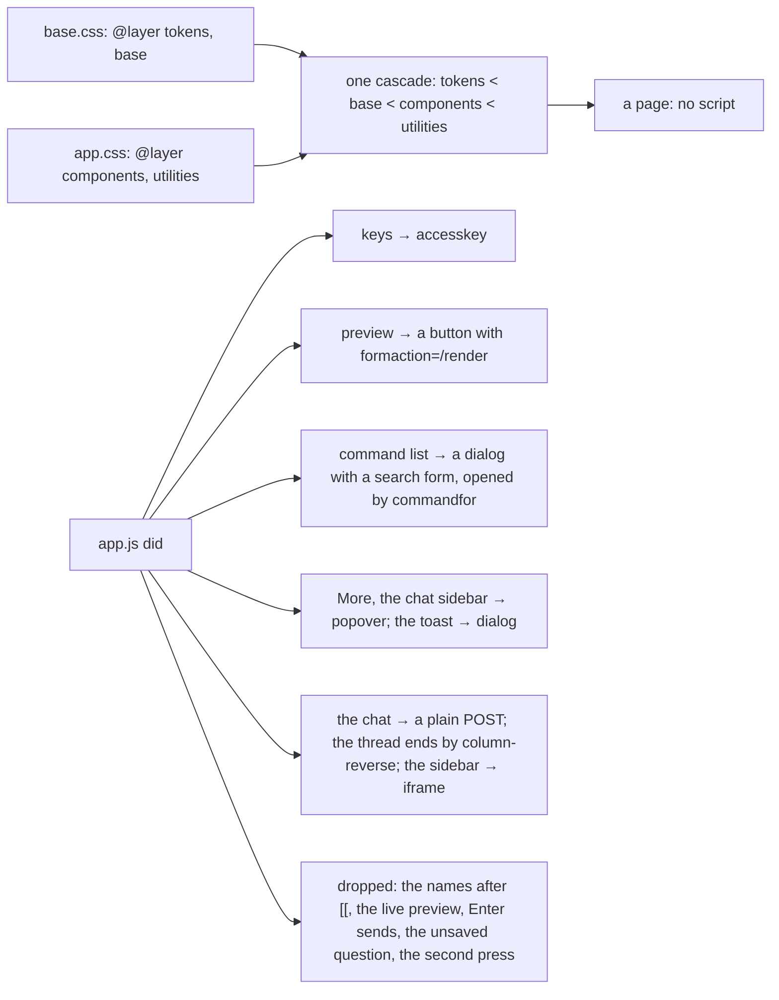

# 108 — The browser made current: layers, containers, and HTML in place of the script

> Dated implementation record. Tests use temporary folders and synthetic data. The owner's live `life.db` is never
> opened by a test.

## Status

- **Date / baseline:** 2026-10-14, `28d10ce` (master).
- **Priority:** P2. **Effort:** M. **Risk:** LOW: presentation only. Nothing for the schema or the catalog; every
  form posts with no script, as before.
- **Status:** DONE.
- **Resolves:** no issue, no RFC. The owner's words are the incident.

## The owner's words (2026-10-14)

"I want to leverage the latest [CSS and HTML features] and update our app and web UI to fully leverage them without
too much complexity." Then: "I want to also fully reduce custom js." And: "even if that means losing some small
functionality, I want it to be as HTML native as possible."

The choices, asked one by one:

| topic | the owner's choice |
|---|---|
| browsers | the current Chromium, Firefox and Safari; a Baseline feature is used plainly, a Chromium-only one as an enhancement |
| the sheets | `@layer`, nesting, logical properties; a container query for every layout breakpoint; `clamp()` scales |
| the script | none: the keys are `accesskey`, the preview a button, the command list a search dialog, the chat a plain form, the sidebar an `iframe` in a popover; the names after `[[`, the live preview, Enter-sends, the question before leaving text, the second press of a danger, the remembered sidebar are dropped |
| the toast | in flow, a `dialog` that Escape and Close close |
| the chat sidebar | a popover sheet over the page, on every screen |
| the pick list | its bar after the rows, the count by a CSS counter, the bar first by `order` |
| motion | `@starting-style` for a dialog and a popover; a scroll-driven drop on the phone's bar, as an enhancement |
| forms | `:user-invalid`; the customizable `select`; the keys drawn by the server |
| serving | inline, as before |

## The design

- **The research (October 2026).** Widely available: `:has()`, nesting, `@layer`, `@container`, `color-mix()`,
  `clamp()`, logical properties, `dialog`, `popover`, `@starting-style`, `transition-behavior`, `light-dark()`.
  Newly available in 2025–2026, in every engine: anchor positioning (Firefox 147), the invoker commands `command`
  and `commandfor` (January 2026), the dialog's `closedby`, `@scope` (March 2026), container style queries (May
  2026), `field-sizing` (June 2026), `sibling-index()` and `text-box-trim` (August 2026). Limited: cross-document
  view transitions (no Firefox; already in use, a no-op there), the customizable `select` (Firefox behind a flag),
  scroll-driven animations (Firefox behind a flag). Skipped: `if()`, `@function`, `corner-shape`, interest invokers,
  speculation rules.
- **One cascade in four layers.** `base.css` declares `@layer tokens, base, components, utilities;` once; a layer is
  document-wide, so the second `style` element joins the order. `@font-face` stays outside the layers. A rule that
  must beat every layer (print, reduced motion) keeps its `!important`, which reverses the layer order.
- **A rule asks the column.** `.column` is the one size container. A breakpoint inside the page is a container
  query on it, at the viewport's value less the column's padding (899 → 867). A `@media` width stays only where the
  viewport is the subject: the phone's bars, the touch size of a control, the top layer.
- **The script is gone.** What it did is HTML: the dialog, the popover, the invoker commands, `accesskey`,
  `formaction`, `iframe`, and the request header `Sec-Fetch-Dest: iframe`, by which the chat page knows to draw
  itself without the shell. What HTML cannot do is dropped, by the owner's word.
- **Not used, and why.** Anchor positioning: its one consumer, the list after `[[`, is gone. Same-document view
  transitions: nothing swaps the DOM any more; the chat's POST and 303 is a cross-document transition already.
  `text-box-trim`: it moves the leaf's number, which was not asked. `@scope`, container style queries,
  `sibling-index()`: no rule needs them.

## The judgment calls

- **The toast is a `dialog` in flow, not a popover.** A popover lives in the top layer and would float over the
  page; the toast stays at the top of the page until the next page, as the design says. `closedby="closerequest"`
  gives it Escape, and `<form method="dialog">` its Close, with no script. It loses `role="status"`.
- **The chat sidebar is a sheet, not a column.** A popover cannot be a grid column. The owner chose the sheet:
  the page no longer narrows, and the panel opens with no script. It holds the chat page in an `iframe`, so its
  draft posts inside it. Whether it is open is not remembered across pages.
- **The pick bar comes after the rows in the HTML.** A CSS counter counts what comes before it, so the bar with
  the count is last in the source and first on the screen (`order:-1`). For a keyboard and a reader the rows come
  first, then Select all and Delete: choose, then delete.
- **The keys are the browser's.** `accesskey` works with the browser's own modifier (Alt in Chromium, Alt+Shift in
  Firefox, Ctrl+Alt on a Mac), which the footer says. Ctrl+Enter, Escape-to-leave-a-field, `/` and `?` have no
  native form and are gone.

## The change

| what | where |
|---|---|
| The layers, nesting, logical properties | `internal/api/html/base.css`, `app.css` |
| Container queries, `clamp()` | `base.css`, `app.css` |
| The search dialog, More, the toast, the keys, Preview, the pick list | `layout.html`, `root.html`, `planning.html`, `day.html`, `styleguide.html`, `editing.go`, `pages.go` |
| The chat as plain HTML, the iframe sidebar, the script deleted | `conversation.html`, `layout.html`, `html.go`, `app.js` (deleted) |
| Motion | `app.css`, `base.css` |
| `:user-invalid`, the customizable select | `base.css` |
| The tests | `internal/api/browser_view_test.go`, `shell_test.go`, `states_test.go`, `tombstones_test.go`, `browser_page_test.go`, `internal/chat/agent_test.go` |
| The docs | `README.md`, `API.md` |

## Done when

- [x] No page carries a `script` element; `app.js` is gone (tested).
- [x] The sheets are four layers in one declared order, nested, in logical properties (tested).
- [x] No width `@media` remains but the phone's and the top layer's; the rest are container queries (tested).
- [x] The search dialog, More, the toast, the chat sidebar and the pick list work with no script (tested on the HTML).
- [ ] Opened in a browser with scripts off: not done here (see the result).
- [x] Baseline green after every commit.

## Result

Six commits on `2d23831` (the plan): the layers, the container queries, the shell without its script, the chat,
the motions, the forms. After every one: `gofmt -l` clean, `go generate ./... && go vet ./... && go test ./...`
green, and `go test ./internal/api ./internal/chat -count=1 -shuffle=on` green. The declarations of the layered
sheets were flattened and compared with the sheets before them, outside the repo: the same set, in logical
names.

Not run: no browser, Chromium or JavaScript runtime is on this machine, and the permission of the session refused
a run of the built binary, so no page was opened and no screenshot compared. The HTML of every view is held by the
tests through the handler. The first look in a browser should take `GET /styleguide` at 1440 and 390 px, light and
dark, with scripts off, and the deliberate differences are these: the type, the leaf and the sheet's padding scale
with the column between the old two sizes; with the sidebar at a viewport of 900 to 1179 px the year shows two
columns; the toast carries a Close of its own; the chat sidebar is a sheet over the page, not a column, and the
page no longer narrows; the thread opens at its end; the select is the app's own in Chromium and Safari. Any other
difference is a defect of this plan.
