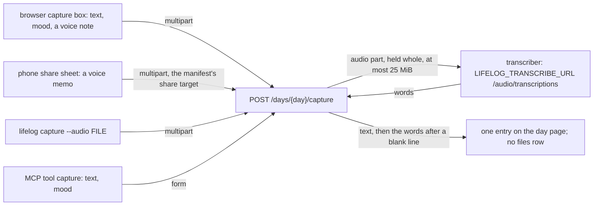

# 109 — A voice note: capture takes a recording, a transcriber turns it into words

> Dated implementation record. Tests use temporary folders, synthetic data and a fake transcriber; no test calls a
> real one. The owner's live `life.db` is never opened by a test.

## Status

- **Date / baseline:** 2026-10-14, `895d2aa` (master).
- **Priority:** P1. **Effort:** S. **Risk:** LOW: one field on one action of the catalog and one process environment.
  Nothing for the schema or the contract: the words are an entry of the day page, and the recording is never stored
  ([D9](../decisions/D09-binary-files.md)).
- **Status:** DONE.
- **Resolves:** no issue, no RFC. The owner's words are the incident.

## The owner's words (2026-10-14)

"Can we also register audio messages?" Then: "I want a lighter path for short voice notes." The owner's answers to
the two open questions:

| question | decision |
|---|---|
| where speech becomes text | an endpoint of the OpenAI audio-transcriptions protocol that `lifelog` calls, named by the environment, as the chat model is; not the phone's keyboard, not a whisper binary beside `lifelog` |
| a look at the words before they are written | no: the words go straight onto the day page, in one request; a wrong word is fixed in the editor like any entry |

Earlier the same day the owner confirmed that originals stay outside `life.db` and that a picture a day is the
preview of D9. A voice note follows: its words are kept, its bytes are not.

## The design

- **One field on one action, so every surface has it** (the owner's rule of 2026-10-08). `capture` gains `audio`, a
  `file` field with `accept: audio/*`, an extension of the catalog's field shape a browser draws as the file input's
  `accept`, so a phone offers its recorder. The MCP tool `capture` is unchanged: a file field is sent by the CLI or a
  browser, the one difference the MCP surface already has for `add-file`.
- **The transcriber is a process environment, as the chat model is.** `LIFELOG_TRANSCRIBE_URL` (a base URL ending
  in `/v1`), `LIFELOG_TRANSCRIBE_MODEL` and optional `LIFELOG_TRANSCRIBE_KEY` name an endpoint of the OpenAI
  audio-transcriptions protocol (`internal/speech`). Without them a capture with a note answers 503 `no_transcriber`
  and a capture without one is unchanged. A failure of the endpoint is 502 `transcriber`; a note with no words is
  422; a note over 25 MiB is 413, refused before the endpoint sees it. A refused capture writes nothing, the text
  beside the note included.
- **Transcription before the transaction.** The handler holds the note in memory, calls the endpoint, then opens the
  write: no network inside a write transaction. The entry is the text, then the words after a blank line, one entry.
  The words carry no mark that they were spoken; the owner may ask for one.
- **The capture box is multipart** on Home and on a day page, with no script: the browser's own file input, posted
  with the text. The manifest's share target becomes multipart too, with `files: [{name: audio, accept: [audio/*]}]`,
  so a phone's share sheet sends a voice memo straight into Capture; shared text still arrives as before.
- **Rejected.** Dictation in the browser (the Web Speech API sends the speech to the browser's vendor, and the pages
  fetch nothing from another host); a whisper binary `lifelog` runs as a subprocess (a second binary to install and
  keep working on Linux and Windows); a `transcribe` action that returns the words for a look first (a second round
  trip and a script, and the share-sheet path would still write directly).

## The change

| what | where |
|---|---|
| the endpoint client, `FromEnv` | `internal/speech/speech.go` |
| the `audio` field, `Field.Accept` | `internal/api/siren.go`, `internal/api/html/layout.html`, `API.md` |
| `Transcriber`, `NoTranscriber`, the multipart reader, the entry | `internal/api/voice.go`, `internal/api/days.go`, `internal/api/serve.go` (`NewWith`) |
| the share target | `internal/api/html/manifest.webmanifest` |
| `lifelog capture --audio` | `cmd/lifelog/main.go` |
| the tests | `internal/speech/speech_test.go`, `internal/api/voice_test.go`, `internal/api/shell_test.go`, `internal/client/tools_test.go`, `cmd/lifelog/main_test.go` |
| the docs | `README.md`, `API.md` |

## Done when

- [x] `capture` carries `audio` in `GET /actions`; the MCP tool `capture` carries no file field (tested).
- [x] A note's words land on the day page after the text; no `files` row is written; a refused capture writes
      nothing (tested, with a fake transcriber in-process and a fake endpoint for the CLI).
- [x] The capture box on Home and on a day page is multipart with the audio input; the manifest's share target
      takes an audio file (tested).
- [x] Baseline green.
