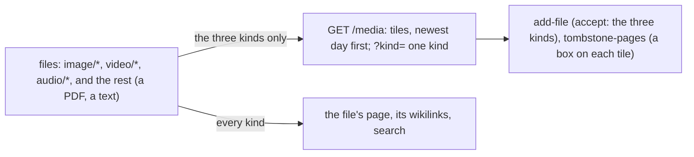

# 110 — The media list: Files becomes Media, the pictures, the videos and the recordings as tiles

> Dated implementation record. Tests use temporary folders and synthetic data. The owner's live `life.db` is never
> opened by a test.

## Status

- **Date / baseline:** 2026-10-14, `1697b50` (master).
- **Priority:** P1. **Effort:** S. **Risk:** LOW: one list of the API and its view. Nothing for the schema or the
  contract: a file stays what [D9](../decisions/D09-binary-files.md) says, and `add-file` keeps a file of any kind.
- **Status:** DONE.
- **Resolves:** no issue, no RFC. The owner's words are the incident.

## The owner's words (2026-10-14)

"I want to revamp the files view to Media and for now to only support audio, video and images in there."

## The design

- **One list, the three kinds.** `GET /media` replaces `GET /files`. Its rows are the live files whose type starts
  with `image/`, `video/` or `audio/`; each carries its kind, the address of its picture when it keeps one, its day
  and its mentions. `?kind=` reads one kind; another word is refused. The counts by kind come with every page.
- **Newest day first.** A file's day is `entities.day` (the day given, a photo's EXIF day, else the day it was
  kept); a photo kept with its capture day unknown takes the day of the newest day page that shows it, else it has
  none and comes last.
- **A file of another kind is kept as before.** `add-file` (`POST /files`) and `lifelog file` change nothing; a
  PDF keeps its page, which search and its wikilinks reach. The list's own copy of `add-file` carries `accept` on
  its file input, the three kinds; the catalog's does not. More kinds come when the owner asks.
- **Tiles.** The browser draws a tile a file: the picture over the title, or the icon of the kind for a recording
  or a video sent with no frame; the kinds as links under the head; the delete boxes of [plan 107](107-delete-several-at-once.md)
  on the corner of each tile. No script.

## The change

| what | where |
|---|---|
| `Media`, `MediaCounts`, `MediaKinds` | `internal/core/read.go` |
| The list, its route, the home link, the sidebar, the icons | `internal/api/media.go`, `serve.go`, `days.go`, `html.go`, `assets.go` |
| The people and the places lists no longer carry the file branch | `internal/api/pages.go` |
| The tiles | `internal/api/html/root.html`, `app.css` |
| The tests | `internal/api/media_test.go`; `/files` became `/media` in the tests of the lists |
| The docs | `API.md` (`media`, the lists), `README.md` |

## Done when

- [x] `GET /media` lists the three kinds only, newest day first, with kind, picture, day, mentions and counts; one
      kind by `?kind=`, another word refused; a PDF kept is not in it (tested).
- [x] The browser draws the tiles, the kinds, the counts, and the delete boxes return to `/media` (tested).
- [x] `add-file` is unchanged; the list's copy carries `accept` (tested).
- [x] Baseline green.
