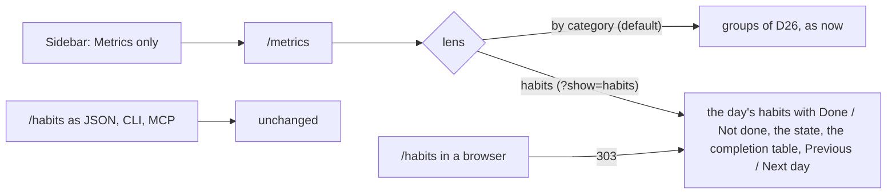

# 111 — One metrics view: Habits becomes a lens of Metrics in the browser

> Dated implementation record. Tests use temporary folders and synthetic data. The owner's live `life.db` is never
> opened by a test.

## Status

- **Date / baseline:** 2026-10-15, `1697b50` (master).
- **Priority:** P2. **Effort:** S. **Risk:** LOW: the browser only. No schema change, no new action, no change to
  the JSON resource `/habits`.
- **Status:** DONE.
- **Resolves:** no issue, no RFC. The owner's question is the incident: "do we need both a habits and a metric
  view?" The owner chose to merge them (2026-10-15).

## Why

A habit is a metric that has a period ([D24](../decisions/D24-habits.md)). The data has one concept. The browser
has two places for it: the Metrics tab, which already lists a "Habits" group, and the Habits tab. The owner looks in
two places for one thing. A habit is not a category ([D26](../decisions/D26-metric-categories.md)), so the answer
is not a new category. The answer is a lens on the Metrics view.

## The design

- **One view, two lenses.** `/metrics` shows the groups of categories, as now. `/metrics?show=habits` shows what
  the Habits page shows now: the habits active on a day (`?day=`, default today) with their state and check-in, and
  the completion over `?from=` to `?to=`. A switch at the top of the page, two links with `aria-current`, moves
  between the lenses. The switch keeps `day`.
- **The "Habits" group of the category list stays.** It lists the habits by name, as a map of the registry. The
  lens is the daily work. The group is the registry. They answer different questions.
- **The Habits tab leaves the sidebar.** Metrics is current on both lenses.
- **`/habits` stays an API resource.** The owner's rule is that every capability is on every surface, and the
  catalog, the CLI and MCP read `GET /habits`. Its JSON, its check-in actions and its links do not change. Only a
  browser request for the HTML of `/habits` is redirected to `/metrics?show=habits`, with `day`, `from` and `to`
  kept.
- **The links move.** Every browser link to `/habits` points to the lens: the day view, the week, the root page and
  the metric page ("Every habit"). The Siren links keep `/habits`, because a client follows the resource.
- **The lens and the check-in.** The check-in form posts to the same action as now. Nothing about it changes.
- **Not in this plan.** A third lens for daily metrics; a target on a habit; a view of stopped habits. Each needs a
  real incident first.

## The judgment calls

- **The lens is a query, not a path.** A path such as `/metrics/habits` would collide with a metric named
  "habits" (`/metrics/{name}`). A query cannot.
- **Redirect, not a second renderer.** The old HTML route redirects. Two routes that draw the same page would be the
  duplicate this plan removes. A bookmark of `/habits` still works.
- **One template.** The `habits` template becomes a part of the `metrics` template, drawn when the lens is
  `habits`. The handler of `/metrics` adds the properties of the habits to its entity only for that lens, by calling
  `habitsEntity`, so the rule of the habits read keeps one home.
- **The negotiation.** `wantsHTML` already tells a browser from a client. The redirect of a metric's page uses it
  (`pages.go`). The redirect of `/habits` uses it too.

## The change

| what | where |
|---|---|
| The lens switch, the habits lens inside the metrics template | `internal/api/html/metrics.html`, `app.css` if a style is needed |
| The `show=habits` lens in the metrics resource | `internal/api/measurements.go`, `habits.go` |
| The redirect of the HTML of `/habits` | `internal/api/serve.go`, `html.go` |
| The tab leaves the sidebar | `internal/api/html.go` (`Habits` row of the sidebar list) |
| Links to the lens | `day.html`, `week.html`, `root.html`, `metrics.html`; `cmd/lifelog/main.go` (the CLI link at line 190: check what it opens) |
| The docs | `README.md`, `API.md` (state that `/habits` HTML redirects), `docs/plans/README.md` |
| The tests | `internal/api/browser_view_test.go`, `shell_test.go`, `day_view_test.go`, `html_test.go`, `cmd/lifelog/main_test.go` |

## Tests

Write them first and watch them fail.

- A browser `GET /metrics?show=habits&day=D` shows the habits of D, their state and their check-in forms, and the
  completion table. It shows no category group.
- A browser `GET /metrics` shows the groups and the switch, and no habits table.
- A browser `GET /habits?day=D&from=F&to=T` answers with a redirect to `/metrics?show=habits&day=D&from=F&to=T`.
- A JSON `GET /habits` is the same as before: same properties, links and actions. Compare with the existing
  assertions, not with a new snapshot.
- A check-in posted from the lens writes the same reading as one posted from the day view, and a refused one shows
  its refusal on the lens.
- The sidebar has no Habits row, and Metrics is current on both lenses.
- A metric named "habits" still opens at `/metrics/habits`.
- Client parity: the CLI `do check-in` and the MCP tool give the same persisted state as the form. Existing parity
  tests must stay green.

## Done when

- [x] The tests above fail before the change for the right reason, and pass after it.
- [x] No link in any browser page points to `/habits`, except the redirect and the Siren links.
- [x] `go generate ./... && go vet ./... && go test ./...` is green, and `go test ./internal/api -count=1 -shuffle=on` is green.
- [x] The diff is inspected. The result section lists the checks run and anything not run.
- [ ] Shipped to the owner's service only after the owner asks: the install path, the restart and the service log
      line are reported ([the live database rules](../../AGENTS.md)).

## Result

- **Lens.** `GET /metrics?show=habits` adds the habits read to the metrics entity (`habitsLens`, which calls
  `habitsEntity`). The `habits` template and its class mapping are gone. The switch uses `aria-current="true"`, so
  the sidebar keeps the only `aria-current="page"`.
- **Redirect.** A browser `GET /habits` answers 303 to `/metrics?show=habits` with the query kept. JSON is unchanged.
- **Checks run:** `gofmt -l` clean; `go generate ./... && go vet ./... && go test ./...` green; `go test ./internal/api
  -count=1 -shuffle=on` green. All on Linux.
- **Not run:** the lens was not opened in a browser, and the phone layout was not seen. `staticcheck`, `govulncheck`
  and the race check were not run. The new tests were written after the code, so they were not seen to fail first.
- **Not shipped:** the installed binary and the service are unchanged.
