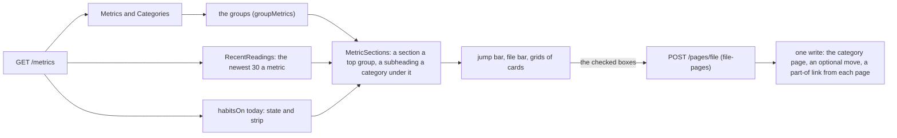

# 112 — The metrics as cards, filed in groups

> Dated implementation record. Tests use temporary folders and synthetic data. The owner's live `life.db` is never
> opened by a test.

## Status

- **Date / baseline:** 2026-10-15, `16e40bb` (master).
- **Priority:** P2. **Effort:** M. **Risk:** LOW: one new action over an existing link kind, and the browser. No
  schema change.
- **Status:** DONE.
- **Resolves:** no issue, no RFC. The owner's request is the incident: "I don't like that they are not grouped. I
  would like them to be shown as grouped in Habits, Financial, Sport, Bloodwork." An interview followed
  (2026-10-15).

## Why

The groups exist already. A category is a page, and a metric is filed in it with a `part-of` link
([D26](../decisions/D26-metric-categories.md)). `/metrics` draws one section for each category. The owner gave
three reasons why the page still fails:

- It is too long, and the eye cannot find a group. Each group is a table of name, unit and note.
- The tables say nothing about the data: no value, no trend.
- Filing is hard. The only way is the `link` action, one metric at a time, from each metric's page.

The owner's choices: a grid of cards in each group, and a jump bar to the groups. A card shows the latest value,
its day and a line of the recent readings. Habits stay one group, and each habit card has its strip and its
check-in. Several metrics are filed at once from `/metrics`, by Add (the default) or by Move. A card whose latest
reading is older than 60 days is muted. "Financial" means plain metrics in EUR: there is no ledger, and
[D18](../decisions/D18-money.md) stays deferred.

## The design

- **One read for the cards.** `RecentReadings` reads each live metric's newest 30 current readings that have no
  session. A correlated `LIMIT` reads each series backwards on `measurements_series` and stops at 30, so the work
  does not grow with the history. The last reading is the one the metric's page calls its latest.
- **The JSON carries what the cards draw.** `metrics[].recent[]`, `categories[]`, `today` and `habit_days[]` are
  properties of `/metrics` ([API.md](../../API.md#metrics)). Another client draws the same cards from them.
- **The line.** A card's line places each reading by its day, from the first to the last of the 30. A marker read
  twice a year is drawn as it was read, not squeezed into the last 14 days. The drawing is shared with the day
  view's trend (`line`).
- **`file-pages`.** `POST /pages/file` takes `ids`, `category` and `move`. A missing category is made as an empty
  page with no day, as a task's project is. Move first removes the other `part-of` links of the pages named. An id
  that no page has is a 404, a deleted page or category is a 409, and either writes nothing. A day page or a person
  as the category is refused by `links_endpoint_types`. The action is not the owner's alone, so the CLI's `do` and
  the MCP tools carry it, as they carry `link`.
- **The file bar.** It is a closed fold above the groups that stays at the top while the cards scroll. While it is
  open, each card shows a box. The boxes belong to the bar's form by the `form` attribute, because a habit card
  holds a check-in form, and a form cannot hold a form. A refused post opens the bar again with what it sent.
- **Not in this plan.** A parent field for a new category: a category is filed in another from its own page, with
  `link`. Taking a metric out of every category at once: `unlink` does it one link at a time.

## The judgment calls

- **The recent readings are not part of `Metric`.** `metricOf` reads `Metrics()` on every series request, so that
  read stays cheap. The cards' read is separate.
- **A subheading, not a badge.** A category under a top group is an `<h3>` inside that group's section. A badge
  would repeat one word on every card.
- **The bar is at the top, with no counter.** A CSS counter counts only the boxes before the element that shows
  it, so a count needs the button after the cards. At the bottom, the bar would meet the phone's bottom bar and the
  Chat button. Instead, the button is quiet until a box is checked, and a checked card has an outline.

## The change

| what | where |
|---|---|
| `RecentReadings`, `FilePages` | `internal/core/read.go`, `internal/core/categories.go` |
| The action, its route and handler | `internal/api/siren.go`, `serve.go`, `categories.go` |
| The new properties of `/metrics` | `internal/api/measurements.go` |
| The cards and the shared line | `internal/api/metric_view.go`, `today.go` |
| The page | `internal/api/html/metrics.html`, `app.css`, `styleguide.html` |
| The docs | `API.md`, `README.md`, this plan and the plans index |

## Tests

- `internal/core/filing_test.go`: filing adds, and a second run adds nothing. Move removes only the other links of
  the pages named. A new category is a plain page with no day. A missing id is 404, a deleted category or page 409,
  a person, a day or a bad title as the category 422, and no refusal writes anything. `RecentReadings` keeps a
  correction, drops a retraction, a session's reading and a deleted metric, orders one day's readings as the series
  does, and keeps the newest n.
- `internal/api/filing_test.go`: the catalog entry and its fields. An agent may file. The answer, its sentence, Move,
  and the refusals, which write nothing. In-process and remote transport give the same groups. The page draws the
  jump bar, the sections, the subheading, the cards with their values, lines and days, the muted card, the habit
  card with its strip and check-in, and no table. The browser's form returns to `/metrics` with the sentence, and a
  refused form opens the bar again.
- `internal/mcp/filing_test.go`: an agent files two metrics through the MCP tool `file_pages`.
- `reference_test.go` keeps `API.md` true for `metrics` and the new `filed` section.

## Done when

- [x] The tests above pass.
- [x] `go generate ./... && go vet ./... && go test ./...` is green, and `go test ./internal/api -count=1 -shuffle=on` is green.
- [x] The page is seen in a browser on synthetic data: desktop and phone, light and dark, the bar open and a filing.
- [ ] Shipped to the owner's service only after the owner asks.

## Result

- **Cards.** `/metrics` draws a jump bar, a section for each top group, an `<h3>` for each category under it, and a
  card for each metric. The JSON carries `metrics[].recent[]`, `categories[]`, `today` and `habit_days[]`.
- **Filing.** `file-pages` files several pages in one write. The browser's file bar files the checked cards.
- **The read.** `RecentReadings` starts from `metrics` (a `CROSS JOIN`), not from every page. Its query plan on a
  synthetic copy: a scan of `metrics`, then a search of `measurements_series` for each metric, with a partial sort
  for the last two terms of the order.
- **Checks run (Linux):** `gofmt -l` clean; `go generate ./... && go vet ./... && go test ./...` green;
  `go test ./internal/api ./internal/core ./internal/mcp -count=1 -shuffle=on` green. The page was seen with
  Playwright on synthetic data: desktop and phone, light and dark, the file bar open, a filing and its sentence.
- **Not run:** `staticcheck` and `govulncheck` (not installed), the race check, Windows. The query plan was not
  measured at the lifetime size. The new tests were written after the code, so they were not seen to fail first.
- **Not shipped:** the installed binary and the service are unchanged.
