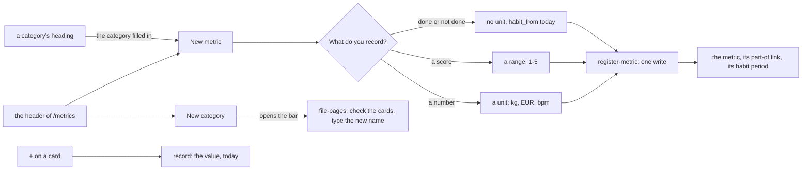

# 113 — New metric, new category and a new reading, from the metrics page

> Dated implementation record. Tests use temporary folders and synthetic data. The owner's live `life.db` is never
> opened by a test.

## Status

- **Date / baseline:** 2026-10-15, `725e260` (master).
- **Priority:** P2. **Effort:** M. **Risk:** LOW: two optional fields on an owner-only action, and the browser. No
  schema change.
- **Status:** DONE.
- **Resolves:** no issue, no RFC. The owner's report is the incident: "It's quite difficult to understand how to add
  a new metric category, how to add a new metric and how to add a new recording to a metric." An interview followed
  (2026-10-15).

## Why

The three tasks are in three places, and each one uses the words of the data model:

| task | before | the problem |
|---|---|---|
| a new category | no button: open "File in a category", check cards, type a new name | a category exists only when something is `part-of` it ([D26](../decisions/D26-metric-categories.md)), and the page does not say so |
| a new metric | Home, in the closed fold "Owner: a metric, a snapshot, a query" | far from `/metrics`; the unit rules (`''` a habit, `1-5` a scale) are hidden in prose; no category; a habit needs a second step on another page |
| a new reading | "Record a reading" in the header, where you type the metric's name | a number card has no control, but a habit card has one |

## The design

The owner's choices: a **+** on each number card; a category is made with its first metric; the New metric form
asks what you record and starts the habit at once; New metric is in the header of `/metrics` and under each
category's heading, and not on Home.

- **`register-metric` takes `category` and `habit_from`.** Both are optional. With them, one write makes the metric,
  files it in the category (a missing category is made, as `file-pages` makes it), and starts its habit from that
  day. A refusal of any step writes nothing: `habit_periods` refuses a habit of a metric with a unit. The action
  stays the owner's alone, so the CLI's `do` carries the new fields, and no MCP tool does.
- **The kind chooser.** Three radio buttons switch three forms with CSS (`:has`), with no script. Each form posts
  `register-metric`: a number asks for a unit, a score for a range, and done or not done sends no unit and today as
  `habit_from`. One line says that a unit never changes.
- **New category.** `/metrics?new=category` opens the bar, now called "Move to a category", with one line: check
  the metrics, then type the name of the new category.
- **New metric here.** A category's heading links to `/metrics?new=metric&category=<title>`: the New metric fold
  opens with the category filled in.
- **+ on a card.** A closed fold on each number card: one value field and Save. It posts `record` for today and
  returns to `/metrics`. Another day is on the metric's page.
- **Home** keeps the snapshot and the query in its owner fold.

## The judgment calls

- **No `kind` field in the catalog.** The kind is the unit (`''`, a range, or another unit), and a habit is a habit
  period. A `kind` field would be a second home for the same fact.
- **The "Reading" item of the New menu is the card's +.** A header form that asks for the metric's name is what the
  owner found hard, so it goes.

## Tests

- `internal/core/filing_test.go`: `CreateMetric` makes the metric, its `part-of` link and its habit period in one
  write; an existing metric is filed in one more category; a plain metric gets neither. A habit of a metric with a
  unit, a deleted category, a day as the category and a bad `habit_from` are refused, and make neither the metric
  nor the category.
- `internal/api/new_metric_test.go`: the catalog fields; `today` as `habit_from`; the answer's sentence; a refusal
  writes nothing. The page draws the three kind forms, New category, `?new=metric&category=` and `?new=category`;
  Home has no New metric form; the browser's habit and number forms; "+ New metric here"; the card's + records a
  value for today; a habit card has no +; a refused form opens again on its kind with what it sent.
- Updated: `states_test.go` (the owner mark of New metric is on `/metrics`), `metrics_lens_test.go`,
  `filing_test.go` (the bar's id).

## Result

- **`register-metric`** takes `category` and `habit_from` (`Store.CreateMetric`, one write).
- **`/metrics`** has New metric (a kind chooser, three forms, no script) and New category in its header,
  "+ New metric here" under each category's heading, "+ Add" on each number card, and the bar "Move to a category".
  Home keeps the snapshot and the query.
- **Checks run (Linux):** `gofmt -l` clean; `go generate ./... && go vet ./... && go test ./...` green;
  `go test -count=1 -shuffle=on ./internal/api ./internal/core ./internal/mcp` green. The page was seen on a
  synthetic copy (desktop and phone, light and dark), with a flow: + Add on a card, and a new habit in a new
  category. Not run: `staticcheck`, `govulncheck` (not installed), the race check, Windows.
- **Known limit:** a category that holds only habits has no section of its own, because a habit is drawn under
  Habits (plan 112). Its "+ New metric here" shows only when it holds a metric that is not a habit.
