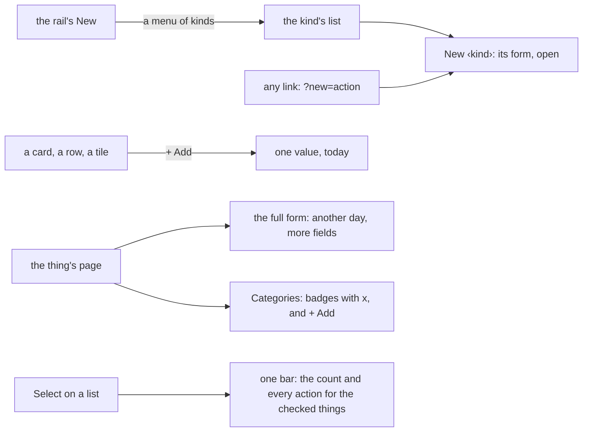

# 114 — One way to do a thing, on every page

> Dated implementation record. Tests use temporary folders and synthetic data. The owner's live `life.db` is never
> opened by a test.

## Status

- **Date / baseline:** 2026-10-15, `ebf3a87` (master).
- **Priority:** P2. **Effort:** L, in four steps. **Risk:** LOW to MEDIUM: the browser, and the titles of the
  catalog's actions. No schema change, no new data rule, no action name changes.
- **Status:** IN PROGRESS: steps 1 to 3 done.
- **Resolves:** no issue, no RFC. The owner's request (2026-10-15), after plan 113: "consolidate this behaviour
  across the entire app so that users always follow the same patterns." An interview followed.

## Why

The app does each of four tasks in more than one way:

| task | the ways today |
|---|---|
| make a new thing | the rail's New opens a fold at the bottom of Home with every create form; a list's header has its own button; `/metrics` has New metric with `?new=` |
| add to a thing | + Add on a metric card; Done / Not done on a habit; outcome buttons on an occurrence; "Record a reading" on a day, where you type the metric's name |
| put a thing in a group | the bar on `/metrics`; elsewhere "Add a typed link" with the kind `part-of` |
| act on several things | Media and Tasks: boxes, and a Delete bar at the bottom with a count; Metrics: a bar at the top with no count |

The words vary too: New, Create, Keep, Record, Capture, Write, File and Revive name a few meanings.

## The rules

1. **A new thing is made on its list.** Each list has one New ‹kind› button in its header. The rail's New opens a
   menu of the kinds; each item opens its list with the form open. A page has no list, so New page is on Home's
   header, beside Open a page. The New fold at the bottom of Home goes.
2. **A link opens a form.** `?new=<action>` opens the form of that action on any page, and a query parameter with
   the name of a field fills it in (`/metrics?new=register-metric&category=Sport`). `view.shown` does it once for
   every action, as it does for a refused form. `/metrics?new=metric` and `?new=category` become this rule.
3. **You add to a thing where you see it.** + Add on a card, a row or a tile records one value for today. The
   thing's page has the full form. First: the reading tiles of a day and of Today.
4. **Categories are badges.** Every page and metric shows its categories as badges, each with ×
   (`unlink`, `part-of`), and + Add (`link`, `part-of`, a category title). "Add a typed link" stays for the other
   kinds.
5. **One selection.** One bar for every list that acts on several things: Select shows the boxes, and the bar holds
   the count and one button for each action the list offers (Media: Delete; Tasks: Delete; Metrics: Put in a
   category). Metrics get no bulk Delete: a metric holds readings, and it is deleted one at a time, on its page. The buttons share one form and choose their action with `formaction`; all of them take `ids`.
   The bar is after the list, so the CSS counter counts the boxes, and it sticks to the bottom, above the phone's
   bottom bar.
6. **One verb a meaning,** in the catalog's titles, so the CLI and the MCP tools say the same words. The action
   names do not change: `do register-metric` still works.

| meaning | the word | titles that change |
|---|---|---|
| make a thing | New | Record session → New session; Record period → New period; Keep a file → New file |
| add to a thing that exists | Add | Record → Add a reading; Capture occurrence → Add an occurrence; Link → Add a link; Capture → Add to the day |
| take away | Remove | Unlink → Remove a link |
| bring back | Restore | Revive, Revive session, Revive task, Revive occurrence → Restore … |
| put in a group | Put in a category | File in a category → Put in a category |

## The steps

Each step is one commit, with its tests, and can ship alone.

| step | rules | where |
|---|---|---|
| 1. Words and New | 1, 2, 6 | `siren.go` titles; `html.go` (`shown`, `Asked`); `layout.html` (`boxed`, the rail's menu); `root.html`; `metrics.html` |
| 2. + Add | 3 | `today.go` (`ReadingTiles`), `day.html`, `root.html` |
| 3. Category badges | 4 | `page.html`, `metrics.html` (the margin's Links), `app.css` |
| 4. One selection | 5 | `layout.html` (`pick-form-*`), `root.html` (Media), `planning.html` (Tasks), `metrics.html`, `app.css` |

## Tests

- Step 1: every list draws its New button; `?new=<action>` opens that form and fills the named fields on any page;
  an unknown name opens nothing; Home has no New fold; the rail's menu links each kind; the catalog titles; MCP tool
  descriptions follow the titles.
- Step 2: + Add on a day's tile records for that day and returns to it.
- Step 3: a badge's × removes only that `part-of` link; + Add files the page; a day page refuses (422) as before.
- Step 4: one bar on Media, Tasks and Metrics; each button posts its action with the checked ids; Delete needs no
  category; the count.
- Every step: `go generate ./... && go vet ./... && go test ./...`, a shuffled run of api, and a look in a browser on
  synthetic data (desktop and phone, light and dark).

## Result

- **Step 1, words and New.** `view.shown` opens and fills the form that `?new=` names; a form a link opens starts in
  its first field. The rail's New is a popover menu of nine kinds (`newKinds`). Home lost its New fold and has New
  page in its header. `/metrics?new=metric` and `?new=category` are now `?new=register-metric` and
  `?new=file-pages`. Eighteen catalog titles follow the table above. Tests: `internal/api/new_forms_test.go`, and
  the tests that named the old words or the Home fold.
- **Step 2, + Add.** The card's + Add is one template, `add-reading` (`layout.html`). A day's reading tile, and so
  Today's, uses it for that day; its label is Today on today, else the short day. Test:
  `TestADaysReadingTileAddsAReadingForThatDay`.
- **Step 3, category badges.** A page that may be `part-of` (not a day page) offers `file-pages` with its own id
  and the category titles as the options of `category`. One template, `categories` (`layout.html`), draws the
  badges in the head of a page and of a metric: x posts `unlink` with `part-of`, and + Add posts `file-pages`. A
  badge shows the category the page is in, not its path. The metric's `link` is no longer titled "File in
  category" with `part-of` filled: it is "Add a link", as on every page. Test: `TestAPagesCategoriesAreBadges`.
